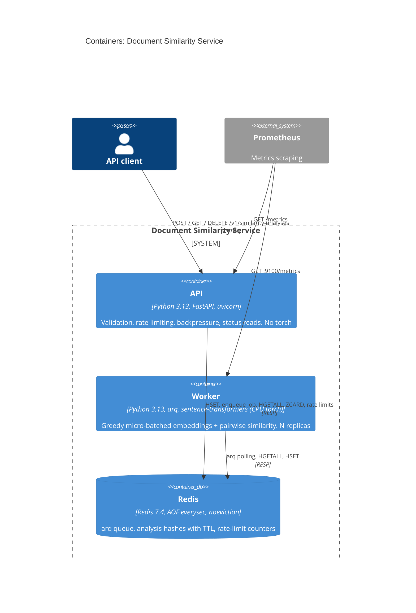
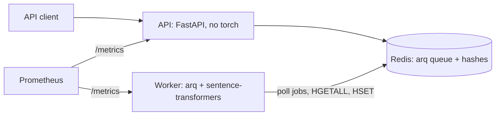

<!-- markdownlint-disable MD033 -->
# Document Similarity Service

Clients submit a small `.txt` document and a query and get back a cosine-similarity score from `sentence-transformers/all-MiniLM-L6-v2`. Embedding is CPU-bound and slow compared to accepting a request, so the API answers `202 Accepted` and a separate worker pool computes the result: a burst raises queue wait, not API latency. Details: [`SPEC.md`](SPEC.md); business scenarios: [`BEHAVIOR.md`](BEHAVIOR.md).

| Decision | In one line |
|---|---|
| [Overload handling](#overload-handling) | Four layers turn overload into `413`/`429`/`503`; size and rate checks run after the upload is received; a failing Redis is not covered |
| [I/O vs CPU](#architecture) | The API never imports `torch`; the worker (arq + model) does all CPU work |
| [Redis + arq](#key-decisions-and-trade-offs) | Queue (via the `arq` library), analysis state and rate limits on one Redis |
| [Retention](#api) | 24 h TTL from creation; `410` is decided from the UUIDv7 timestamp, no tombstones |
| [Capacity](#capacity-model) | One measured number, `T` (49 emb/s per worker replica in the image), sizes replicas and queue depth |
| **Biggest weaknesses** | [Redis failure handling](#known-limitations), unconditional worker writes (a stale worker can recreate a deleted record), default `MAX_QUEUE_DEPTH` implies ~20 s of waiting against a 5 s target |

**Start here:** [Run it](#run-it) · [Architecture](#architecture) · [Key decisions](#key-decisions-and-trade-offs) · [Known limitations](#known-limitations) · [TODO](#todo)

## Run it

Needs Docker, or `uv` + Python 3.13. `docker compose up --build` starts Redis, the API (`:8000`) and 2 workers (OpenAPI at `/docs`). Outputs below are from a real run.

```bash
curl -i -X POST http://localhost:8000/v1/similarity-analyses -H "X-Client-Id: client-a" \
  -F "file=@samples/fox.txt" -F "query=fox over dog"
# 202 Accepted   location: /v1/similarity-analyses/01a15047-...   retry-after: 1
# {"id":"01a15047-...","status":"queued","created_at":"...","expires_at":"...","links":{"self":"..."}}
curl -s http://localhost:8000/v1/similarity-analyses/<id> -H "X-Client-Id: client-a"
# {"id":"01a15047-...","status":"done","attempts":1,"result":[0.6069390756512486],"document_truncated":false,...}
curl -i -X DELETE http://localhost:8000/v1/similarity-analyses/<id> -H "X-Client-Id: client-a"
# 204; the next GET returns 404 (the API logs a RuntimeError per DELETE and closes the connection)

make test-unit   # ~5-10 s, no model load, needs Docker for Redis      make test   # + 8 BEHAVIOR.md scenarios, real model (~60 s)
scripts/benchmark.sh --iterations 20   # throughput inside the worker image; `make help` lists the rest
```

<details><summary>Colima and Ryuk</summary>
testcontainers starts a real Redis for the tests. On Colima its Ryuk reaper cannot reach the Docker socket and the tests hang; the `Makefile` exports `TESTCONTAINERS_RYUK_DISABLED=true`. Not needed on CI's native Docker.
</details>

## What it does

A client uploads a `.txt` file and a query (1 analysis); the service returns `list[float]` of length 1, computed pairwise (query *i* vs document *i*), never as an N x N matrix. **Non-goals:** authentication, multi-region, model quality, chunking of long documents. Delivery is at-least-once. Full assumptions table: [`SPEC.md` §2](SPEC.md#2-explicit-assumptions).

| Assumption | Value | Status |
|---|---|---|
| Input | UTF-8 `.txt` up to 100 KB; query 1-1,000 chars after trimming | assumed |
| Document analysed | first 4,096 chars (API pre-cut, reported as `document_truncated`), then the model's own 256 tokens (not reported) | model limit known; margin assumed |
| Traffic, hardware | 500,000 req/day = 5.8 req/s; peak factor 10x = 58 req/s, 116 emb/s; CPU only | traffic given; rest assumed |
| SLA | p95 accept < 100 ms; p95 time-to-result < 5 s at nominal load | assumed |
| Retention | 24 h from creation, then `410`; document and query text live only in the queued job's payload until it finishes | assumed |
| Client identity | `X-Client-Id` header, no real auth (spoofable) | assumed |
| Delivery | duplicate computation gives the same score, but worker writes are unconditional (see limitations) | known |

## Architecture

**I/O vs CPU separation.** The API container (validation, rate limiting, status reads) never imports `torch`; the worker container is the only place that does. `test_api_no_torch.py` fails if that regresses (API image 231 MB, worker 1.6 GB, measured).



<details><summary>Flowchart fallback (Mermaid marks C4 as experimental)</summary>


</details>

**Request flow** (sequence diagram: [`SPEC.md` §3.4](SPEC.md#34-request-flow)):
1. The API receives and parses the whole multipart body, then checks the rate limit, validates and pre-cuts the document to `MAX_DOC_CHARS`.
2. It checks queue depth (`ZCARD`); at `MAX_QUEUE_DEPTH` it returns `503`.
3. It writes the analysis record (`queued`, with TTL), then enqueues an arq job (job id = analysis id), and returns `202`.
4. arq starts jobs; the `Batcher` groups up to `BATCH_MAX_SIZE` of them and encodes the batch in one call on a thread.
5. Each job writes its record (`done`/`failed`) and arq removes the job.
6. The client polls `GET`. Lifecycle: `queued -> processing -> done | failed`; a retry or restart stays `processing`; the record ends at TTL (`410`) or `DELETE` (`404`). State diagram: [`SPEC.md` §5](SPEC.md#5-job-lifecycle).

```
src/similarity/  submit/ (POST: validation, outcomes, enqueue, router)   results.py (GET, DELETE)
  worker/ (jobs.py arq job, batcher.py, app.py arq wiring, entrypoint.py)   encoder.py (only torch import)
  analysis.py (shared kernel: record schema, keys, job contract, UUIDv7 math)   api.py config.py observability.py
  capacity.py (formulas)   api_paths.py   dependencies.py (Depends aliases)
```

## API

**Client experience.** Base path `/v1/similarity-analyses`; `GET`/`DELETE` need the `X-Client-Id` that created the analysis; a mismatch returns `404`, so existence is never leaked.

| Request | Status | Meaning |
|---|---|---|
| `POST` | `202` | queued; `Location`, `Retry-After: 1`, `expires_at` |
| `POST` | `413` / `415` / `422` | over `MAX_FILE_SIZE_BYTES` (decided after the full body arrives) / not `.txt` / not UTF-8, empty, bad query or `X-Client-Id` |
| `POST` | `429` | over the per-client limit; jittered `Retry-After`; decided after the full body arrives |
| `POST` | `503` | queue full; jittered `Retry-After` |
| any | `503` / `500` | uvicorn concurrency limit (`text/plain`, no `Retry-After`) / Redis unreachable (`text/plain`) |
| `GET` | `200` | `queued`/`processing` (`Retry-After: POLL_INTERVAL_HINT_S`), `done` (`result`, `document_truncated`), `failed` (`error: {code, message, attempts}`) |
| `GET` | `404` / `410` | never existed, other client's or deleted / TTL elapsed; body `null` |
| `DELETE` | `204` / `404` / `409` | deleted / not found or not yours / still `queued` or `processing` |
| `GET /health`, `/ready` | `200` / `200`,`503` | process alive, no dependency check / Redis `PING` |

Errors from the API's own handlers are RFC 9457 Problem Details with a `code` field; the rest are not (`404`/`410` `null`, FastAPI's default `422` for a missing form field or malformed UUID, `text/plain` for uvicorn and Redis errors). `document_truncated` is `true` only when the API cut the document to `MAX_DOC_CHARS`; the model's 256-token cut is not reported.

## Overload handling

**Load handling.** Four layers, in the order a request meets them. Measured on Apple M3 Pro, compose under Colima:

| # | Layer | Response | Honest cost of a rejection |
|---|---|---|---|
| 0 | `uvicorn --limit-concurrency` (`API_CONCURRENCY_LIMIT`) | `503` `text/plain` | none in the app; also counts `/health` |
| 1 | Per-client rate limit (`limits`, Redis, fixed window) | `429` + `Retry-After` | full body already received and parsed, plus 1 Redis call |
| 2 | Validation incl. size cap (capped read of `MAX_FILE_SIZE_BYTES + 1`) | `413`/`415`/`422` | full body already received; no `Content-Length` check |
| 3 | Queue depth (`ZCARD >= MAX_QUEUE_DEPTH`) | `503` + `Retry-After` | 1 Redis call |

- FastAPI parses the whole multipart body before the handler runs. A 300 MB upload got `413` only after all 300 MB was sent; a rate-limited client got `429` after 0.93 s, also after the full upload. Once the body is in, rejection is fast (3,000 `429`s at concurrency 50: p99 42 ms). Early rejection on `Content-Length` is in TODO.
- `429` = "you send too much", `503` = "we are full". `Retry-After = base + uniform(0, base)` seconds avoids synchronised retries. An accepted job is never dropped by the queue limit.
- The queue limit is **soft** (`ZCARD`, then enqueue). With one API replica, 1,500 concurrent POSTs and workers stopped gave exactly 1,000 accepted (overshoot 0); several replicas are not measured.
- **Greedy batching:** the `Batcher` takes the jobs waiting (up to `BATCH_MAX_SIZE`), lingers once for `BATCH_LINGER_MS` if not full, and encodes on a thread so arq keeps polling. A lone analysis waits for `POLL_DELAY_S` + linger; arq starts up to `2 x BATCH_MAX_SIZE` jobs so the next batch collects during inference. Draining ~1,000 queued analyses took 7-8 s with 2 workers (batches averaged ~30 of 32).
- **Attempts and recovery:** arq counts a try at every start, including one that ends in a crash, and the job stores it as `attempts` before computing; with `max_tries = MAX_ATTEMPTS + 1` the last start fails the analysis without computing. If encoding a batch raises, pairs are retried one by one; a pair that still fails is retried by arq after `VISIBILITY_TIMEOUT_S`. After a worker `SIGKILL` with 300 analyses in flight, the 64 it held restarted ~40 s later (`VISIBILITY_TIMEOUT_S` + 10 s) and all ended `done`. On `SIGTERM` arq waits `SHUTDOWN_GRACE_S` (the full period while any job is in flight); stop took 6.0 s under load, exit 0, nothing lost.

| Redis pitfall | Handling |
|---|---|
| Finished jobs stay in the queue / a length cap trims accepted jobs | arq removes finished jobs (`keep_result=0`); no cap is used, the limit is enforced in the API |
| Eviction of keys with a TTL (our analyses) | `noeviction` is set, but `maxmemory` is not, so Redis grows until the host's OOM killer acts |
| Torch sees host cores, not the container limit | compose sets `OMP_NUM_THREADS=2` next to `cpus: "2"`; `TORCH_NUM_THREADS` is not wired |
| Unpickling data read from Redis | jobs are JSON, not arq's default pickle |

**Not covered:** a failing Redis. Down gives `500`, stalled gives hangs (no socket timeout); see [Known limitations](#known-limitations).

## Capacity model

**Explicit, measurable scalability assumptions** (`capacity.py`, used by `benchmark.py`):

```
peak_embeddings_s = requests_per_day / 86_400 * peak_factor * 2 * (1 - cache_hit_rate / 2)   # query + document
worker_replicas   = ceil(peak_embeddings_s / (T * 0.7)) + 1       # T = measured emb/s per replica
max_queue_depth   = ceil(replicas * (T / 2) * max_acceptable_wait_s)
```

0.7 utilisation: queueing delay grows like `u / (1 - u)` (about 2.3x service time at 70 %, 9x at 90 %); `+1` replica tolerates losing one. Cost per job is bounded (4,096-char pre-cut, 256-token model limit), which is what makes `T` a constant.

Worker image, Linux arm64, `--cpus 2`, 2 torch threads, Apple M3 Pro under Colima (measured; `T = batch x 2 / p50`):

| Batch | p50 / p95 (ms) | `T` (emb/s) |
|---|---|---|
| 1 | 74.3 / 76.7 | 26.9 |
| 8 | 632.4 / 639.2 | 25.3 |
| 16 | 1,313.3 / 1,334.5 | 24.4 |
| 32 | 1,341.1 / 1,353.6 | 47.7 |
| 64 | 2,613.1 / 2,678.7 | 49.0 |

Replicas at `T` = 49.0 (computed; peak factor 10x assumed, no cache, 5 s wait assumed): 100k req/day = 23 emb/s peak, 2 replicas, queue limit 245; 500k = 116 emb/s, 5, 613; 1M = 231 emb/s, 8, 980; 5M = 1,157 emb/s, 35, 4,288. **Consequence:** compose runs 2 workers with `MAX_QUEUE_DEPTH = 1000`, so a full queue means `1000 / (2 x 49/2) ≈ 20 s` of waiting against the 5 s target.

Native macOS arm64 (Apple Accelerate BLAS) measures `T` = 760 emb/s at batch 32 (~15x higher) and would give 2 replicas for 500k req/day; the gap is not explained (BLAS backend differs; the images are native arm64), so sizing uses the worker-image figure. The jump between batch 16 and 32 is padding from encoding queries and documents in one interleaved list (up to ~2x CPU at small batches). Detail: [`SPEC.md` §7.4](SPEC.md#74-measurements-apple-m3-pro-cpython-313-2-torch-threads-10-iterations-after-3-warm-up). All numbers come from one laptop: re-run `scripts/benchmark.sh` on the hardware you will run on.

## Observability

**Can an operator diagnose "slow", "stuck", "failing"?** Prometheus metrics and JSON logs:

| Question | Metric (type) | Caveat |
|---|---|---|
| Time-to-result p95 < 5 s? | `analysis_end_to_end_seconds` (histogram, worker) | includes queue wait and inference |
| Keeping up? | `queue_depth` (gauge, worker) | queued + retrying + running |
| How long has the oldest job waited? | `queue_oldest_age_seconds` (gauge, worker) | primary alert; grows for a job stuck on a dead worker |
| Requests, rejections | `http_requests_total{handler,method,status}` (counter, API) | status grouped `2xx`/`4xx`/`5xx`; uvicorn `503`s not counted |
| Accepting fast (< 100 ms)? | `http_request_duration_seconds` (histogram, API) | per handler |
| Batch cost, batching working? | `inference_batch_duration_seconds`, `inference_batch_size` (histograms) | |
| Failure rate, retries | `analyses_completed_total{status}`, `analysis_retries_total` (counters) | |
| Truncation | `documents_truncated_total` (counter) | counts the API pre-cut only |

- Application events are JSON, one line each (`analysis_id`, `attempts`, `batch_size`, `reason`); document and query text are never logged, nor is their length or a hash.
- Not JSON: uvicorn's access log, arq's per-job lines, the `Batches: 100%` progress bar. `client_id`, `batch_id` and cold-start time are not logged; `client_id` is never a metric label (cardinality).
- `/health` has no dependency check (a Redis blip must not restart every replica) but is subject to the concurrency limit; `/ready` pings Redis. Worker liveness: arq refreshes a health key every 15 s and the image `HEALTHCHECK` runs `arq --check`; it shows the polling loop is alive, not that a job progresses. Worker metrics are on `:9100`; queue gauges refresh every second.

## Configuration

Environment variables only, validated at start-up (`pydantic-settings`); full list in [`.env.example`](.env.example) and [`SPEC.md` §10](SPEC.md#10-configuration).

| Variable | Default | Purpose |
|---|---|---|
| `RESULT_TTL_S` / `MAX_ATTEMPTS` | `86400` / `3` | retention / tries before `failed` |
| `MAX_FILE_SIZE_BYTES` / `MAX_DOC_CHARS` | `102400` / `4096` | `413` threshold / pre-cut (assumed) |
| `RATE_LIMIT` / `API_CONCURRENCY_LIMIT` | `20/second` / `200` | per client (assumed) / uvicorn limit, applied only by the image `CMD` |
| `MAX_QUEUE_DEPTH` | `1000` | `503` threshold; should come from the benchmark (formula: 245 at `T` = 49, 2 replicas) |
| `BATCH_MAX_SIZE` / `BATCH_LINGER_MS` | `32` / `10` | micro-batch cap / wait for a non-full batch |
| `VISIBILITY_TIMEOUT_S` | `30` | arq job timeout and retry delay; a dead worker's job restarts after this + 10 s; must exceed p95 batch time (2.7 s measured) |
| `SHUTDOWN_GRACE_S` | `5` | wait for in-flight jobs on `SIGTERM`; keep below the stop timeout minus the longest batch |

Defined but not wired: `MAX_QUERY_LENGTH` (validation hard-codes 1,000) and `TORCH_NUM_THREADS` (threads follow `OMP_NUM_THREADS`). Start-up invariants: `MAX_DOC_CHARS <= MAX_FILE_SIZE_BYTES`, `MAX_ATTEMPTS >= 1`. Build-time only: `MODEL_NAME`, `MODEL_REVISION` (pinned; the model is baked into the image).

## Key decisions and trade-offs

| Decision | Chosen | Rejected | Why |
|---|---|---|---|
| Result delivery, API style | `202` + polling; REST resource `similarity-analyses` with `links.self` | sync; webhook; `/jobs`; full HATEOAS | sync ties a connection to CPU work and turns overload into timeouts; webhooks need retries and signing; the domain name hides the queue |
| Process split | API (no torch) + worker | thread or process pool in one container | a stuck worker cannot freeze health checks; each part scales on its own bottleneck |
| Backing service | Redis (queue, state, rate limits) | separate message broker; Postgres `SKIP LOCKED` | one moving part; see ADR-001 below |
| Queue library | `arq` 0.25.0 | own Streams consumer (earlier version, ~580 lines); Celery; RQ; Dramatiq | arq gives redelivery, try counter, graceful shutdown, health key; Celery is heavy with one model per process, RQ forks per job, Dramatiq has no async. Costs: no batching, polling, needs `redis<6` upstream |
| Batching | greedy `Batcher` with a 10 ms linger | one job per encode; long fill-and-wait | batch 32 gave ~2x batch 1 in the image (47.7 vs 26.9 emb/s, measured) |
| Retry | arq `Retry` after `VISIBILITY_TIMEOUT_S` | exponential backoff | embedding is deterministic, waiting does not fix it; jitter sits on client `Retry-After` |
| Rate and queue limits | `limits` fixed window on Redis; soft queue limit (`ZCARD`, then enqueue) | hand-written limiter, token bucket; atomic Lua | ready tool, up to 2x burst at window edges accepted; queue overshoot bounded by in-flight POSTs (measured 0, one replica) |
| Retention | TTL from creation; `410` from UUIDv7 | tombstones | zero extra storage; `expires_at` known at creation |
| Model and images | model baked into the worker image at a pinned revision (`HF_HUB_OFFLINE=1`, warmed up); multi-stage build, CPU-only torch | download at start; one image | no runtime dependency on Hugging Face; reproducible; smaller API image, no CUDA download |
| Observability | Prometheus + JSON logs + `analysis_id` | OpenTelemetry | same diagnostic value at a fraction of the setup |
| Tests | real model + real Redis (testcontainers) for BDD; fake encoder for unit tests | mocked Redis; fake model in BDD | a fake-model integration test proves plumbing, not the service |
| Code | flat vertical slices, pure functions + I/O at the end of each file | layers, DI container | a feature lives in one place; decisions testable without infrastructure |

**ADR-001: Redis as the single backing service.**
- **Decision:** queue (arq), analysis state (hashes with TTL) and rate-limit counters on one Redis.
- **Why:** one moving part, enough for the brief's scale, fast tests with a single container.
- **Rejected:** a separate message broker (a second moving part, and a local emulator for tests).
- **Cost:** durability and failover are those of single-node Redis (AOF `everysec`, ~1 s loss on crash, single point of failure); record and job are two writes, not one transaction; no dead-letter queue.
- **Revisit when:** a durability guarantee, multi-node operation or per-message dead-lettering is needed.

Deviations from the original design (Python 3.13; `submit/` and `worker/` became packages; `dependencies.py`/`api_paths.py` added; BDD on the real model; sizing from the worker image; the hand-written consumer replaced by arq; other statements corrected): [`SPEC.md` §16](SPEC.md#16-implementation-notes--deviations).

## Testing and quality gates

- **Unit:** validation, `404` vs `410`, `Retry-After` bounds, state transitions, batching and per-item failure isolation, retry and attempt overflow, pairwise result shape, capacity formula, config invariants, "API does not import torch".
- **Behaviour:** all 8 `BEHAVIOR.md` scenarios, 1:1 with `test_given_..._when_..._then_...`, on a real arq worker in burst mode, real Redis and the real pinned model. **Smoke:** compose + curl. **Model:** `scripts/benchmark.py` (throughput, not quality).
- **Gates** (pre-commit and CI): `ruff`, `mypy --strict`, `gitleaks`, `hadolint`, key/yaml/EOL hooks; CI adds `pip-audit` and builds both images. Locally: `make pre-commit`, `make audit`.
- **Not tested:** model quality, `/metrics` content, sustained load (TODO), real-server responses (the `TestClient` hides the `DELETE` error), concurrent writes to one record, Redis failures.

## Known limitations

Measured on Apple M3 Pro, compose under Colima, unless noted. Ordered by impact.

| Limitation | Impact | Mitigation today |
|---|---|---|
| Redis down or stalled: `500 text/plain`, `/ready` 503; an arq worker can exit with code 1 (one of two did; compose has no restart policy); stalled Redis has no socket timeout, so `POST` hangs > 30 s and `/ready` > 20 s | Accepted work stays `queued` if no worker survives; clients see timeouts | AOF kept queued work across a restart (measured with the previous consumer) |
| `noeviction` without `maxmemory`; single-node Redis | Redis grows until the host's OOM killer acts (an OOM error would surface as `500`); single point of failure, ~1 s of data at risk on a crash | `MAX_QUEUE_DEPTH` and the pre-cut bound the queue; hashes bounded by TTL x traffic |
| Worker writes are unconditional | A worker stalled past `VISIBILITY_TIMEOUT_S` + 10 s can overwrite `attempts` or recreate a deleted record (32 deleted analyses reappeared with the previous consumer; not re-measured with arq) | The stall must last tens of seconds (p95 batch 2.7 s) |
| A crash or timeout takes jobs with it: a dead worker's jobs (up to `2 x BATCH_MAX_SIZE` = 64) restart after ~40 s and a document that keeps killing the worker can fail healthy co-held analyses (not reproduced); a job over `VISIBILITY_TIMEOUT_S` is cancelled, not retried, and its record stays `processing`; record and job are two writes | Delayed or stuck analyses until TTL | Exceptions are isolated per item; a failed enqueue deletes the record |
| `document_truncated` reports only the API pre-cut | A 2,925-char document scored like its first half with the flag `false` (measured with the previous consumer) | Documented in [API](#api) |
| Contract gaps: `DELETE` `204` is malformed (RuntimeError logged, connection closed, next keep-alive request can fail); several error formats; UUID version not checked (nil UUID returns `410`); whitespace-only documents are accepted | Client friction | Deletion itself succeeds |
| Metrics: `status` grouped, uvicorn `503`s uncounted; logs not uniformly JSON; `client_id`, `batch_id`, cold-start time, text length/hash not logged | Rejections cannot be split by reason from metrics; clients and batches cannot be correlated | `analysis.rejected` log event has `reason` |
| Config defined but not wired; worker health key shows the polling loop is alive, not job progress | Changing `MAX_QUERY_LENGTH`/`TORCH_NUM_THREADS` does nothing; a hung job is not detected | Marked in [Configuration](#configuration) |
| API `CMD` is shell form: `SIGTERM` does not reach uvicorn (stop 10.4 s, exit 137); `API_CONCURRENCY_LIMIT` applies only via the image `CMD`; `/health` is subject to the concurrency limit; arq waits the full `SHUTDOWN_GRACE_S` on stop | In-flight requests cut on stop; liveness could fail under a flood (not observed) | Worker stop is graceful (6.0 s, exit 0) |
| Redis is published on all host interfaces without a password; Redis image not digest-pinned; `chown -R` duplicates the model layer (+92 MB); `arq` pinned to 0.25.0 (newer releases need `redis<6`) | Open Redis on an untrusted network; larger image; no queue-library upgrade | Local use only; other images and the model revision are pinned |
| Capacity: defaults imply ~20 s of waiting vs a 5 s target; interleaved encoding pads queries (up to ~2x CPU at batch <= 16, measured x1.68 native, x2.13 in the image); a lone analysis waits `POLL_DELAY_S` + linger (~0.1 s) | Slow `503`s; lower throughput at low load | Re-run the benchmark on target hardware and set `MAX_QUEUE_DEPTH`; batches of 32 are unaffected |
| `X-Client-Id` is spoofable; the queue limit is soft | Rotating the header bypasses per-client limits; overshoot under concurrent POSTs (0 measured, one replica) | Only the queue limit protects capacity; overshoot bounded by in-flight requests |
| Tests and compose run arq on Redis only | No second broker implementation is validated by CI | The broker is touched only in `submit/enqueue.py` and `worker/` (`app.py`, `jobs.py`) |

## What I'd cut / do next

**With 2 hours:** skip crash recovery and Dockerizing; run API and worker as plain `uv run` processes and keep the happy path, validation and the two load-shedding codes (`429`, `503`).
**With more time, first:** a second broker adapter validated by the same BDD suite, and real authentication; both sit in small, isolated parts of the code.

## How this was built

Design decisions were recorded in [`SPEC.md`](SPEC.md), with rejected alternatives, before any code was written. The implementation was done by an AI coding agent (Claude, credited with a `Co-Authored-By` trailer in the commits) against SPEC.md's step-by-step plan, one step at a time, gated on `pre-commit run --all-files` and the full test suite; `git log` has each step.

<!-- ENTER: confirm -->

## TODO

**Correctness and safety** (ordered by value; effort S/M/L)
- **Early rejection** on `Content-Length` (and the rate limit) in ASGI middleware, before the body is parsed: uploads are fully received before `413`/`429` (M)
- **Real authentication** (API keys or OIDC): `X-Client-Id` is spoofable (M)
- **Conditional record writes** (Lua: only if the record exists and is `processing`): a stale worker can recreate deleted records (M)
- **Atomic queue limit** (Lua check-and-add): closes the soft-limit window (S); **Redis `socket_timeout` + `RedisError` -> `503` + `Retry-After`; set `maxmemory` and map OOM to `503`**: stalled or full Redis hangs or returns `500` (S)
- **Token-count truncation flag** in the worker: the model's 256-token cut is not reported (S)
- **Contract cleanups**: empty `204` for `DELETE`; one error format (Problem Details for `404`/`410`, validation errors, `500`, `Retry-After` on the concurrency `503`); reject non-v7 UUIDs and whitespace-only documents (S)
- **`Idempotency-Key`** on `POST` (S); **tombstone** so `GET` after `DELETE` returns `410` (S); **cancellation** `queued -> cancelled` (M)

**Scalability and performance**
- **Encode queries and documents separately**: interleaving pads queries (S)
- **Benchmark on the hardware you will run on, with thread limits applied in the worker**: one laptop's numbers; the ~15x gap is unexplained (S)
- **End-to-end load test** (k6/Locust) ramping to `503`: no automated proof that backpressure holds (M)
- **Query embedding cache** by content hash (M); **ONNX/OpenVINO with quantisation** (L); **dynamic `MAX_QUEUE_DEPTH`** from live replicas (M); **`Retry-After` from depth and throughput** (S); **token bucket / client tiers** (M); **multi-file submissions** (M); **chunking** beyond the context window (L)

**Reliability**
- **Worker reconnect loop + compose `restart:` policy**: workers exit when Redis goes away (S)
- **Handle arq job-timeout cancellation** (mark `failed` or retry): the record stays `processing` (S); **isolate items after a worker crash** (M)
- **Worker exponential backoff with jitter**: only useful once embedding calls an external provider (S, when triggered); **replace or upgrade `arq`**: pinned to 0.25.0 (M); **second broker adapter** validated by the BDD suite (L); **Redis durability/HA** beyond AOF `everysec` (M); **dead-letter store** for `failed` analyses (S)

**Operations**
- **Exec-form API `CMD`** (`exec uvicorn ...`): `SIGTERM` does not reach uvicorn (S); **liveness path outside the concurrency limit** (S); **wire or remove dead config** (`MAX_QUERY_LENGTH`, `TORCH_NUM_THREADS`) (S); **`dev` Docker target with live reload** (S)
- **Observability**: ungrouped status labels; uvicorn access log through structlog with the progress bar off and `client_id` on accept/reject; `batch_id`, cold-start time, text length and hash in logs (S each)
- **OpenTelemetry** with trace context through the queue (L); **dashboards and alerts** (e.g. `queue_oldest_age_seconds > 5 s` for 2 min) (M); **optional Prometheus + Grafana compose profile** (S)
- **Bind Redis to localhost; digest-pin the Redis image; `COPY --chown` against the duplicate model layer** (S); **model outside the image** for multiple or large models (M); **image scanning**, **SBOM**, **coverage threshold in CI** (S each)

**API and product**
- **Webhook delivery** (M); **long-polling** `GET ...?wait=10` (S); **full HATEOAS** (M); **per-tier retention** (S); **long-term export** of results (M); **`pytest-bdd`** for `BEHAVIOR.md` once non-developers write scenarios (S, when triggered)
