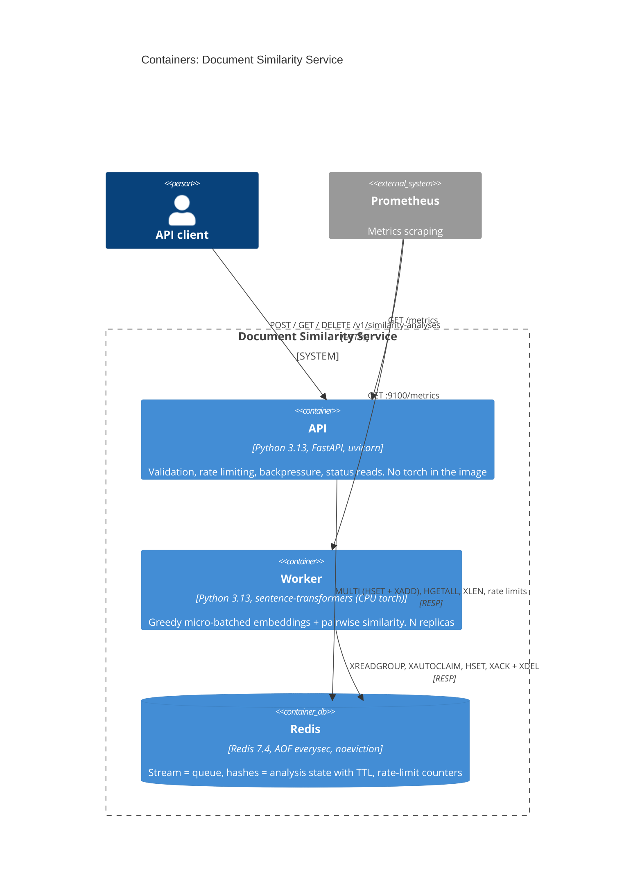
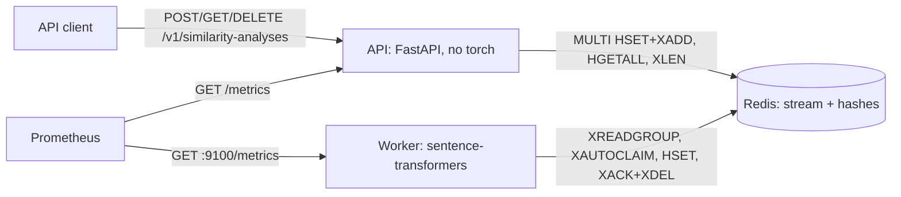
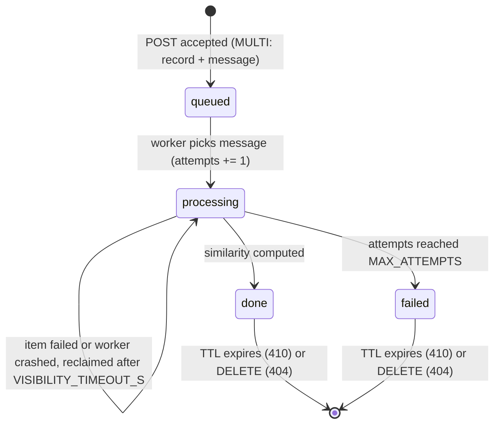

<!-- markdownlint-disable MD033 -->
# Document Similarity Service

Clients submit a small `.txt` document together with a query and get back a similarity score
computed with `sentence-transformers/all-MiniLM-L6-v2`. Embedding is CPU-bound and much slower
than accepting an HTTP request, so the API accepts work immediately (`202 Accepted`) and a
separate worker pool computes results asynchronously, so a traffic burst degrades queue wait
time instead of the API itself. Full design rationale lives in [`SPEC.md`](SPEC.md); business
scenarios in [`BEHAVIOR.md`](BEHAVIOR.md).

**The 30-second version:**

| Decision | In one line |
|---|---|
| [Overload handling](#how-overload-is-handled) | Four protection layers turn overload into an explicit `413`/`429`/`503`; size and rate checks run after the upload is received, and Redis failures are not covered (see [Known limitations](#known-limitations)) |
| [API/worker split](#architecture) | The API never imports `torch`; a stuck or slow worker can't take down health checks or request handling |
| [Redis as the single backing service](#adr-001-redis-as-the-single-backing-service) | Queue, state, and rate limits on one Redis for a 2-4h prototype, with a documented migration path to Azure Service Bus |
| [Retention](#key-decisions-and-trade-offs) | TTL from creation, `410` decided from the UUIDv7 timestamp itself, no tombstone storage needed |
| [Capacity model](#capacity-model) | One measured number (`T`, embeddings/s per replica) drives replica count and queue-depth sizing; inside the worker image it measured 49 emb/s, ~15x below the native macOS figure |

**Start here:** [Run it](#run-it) · [Architecture](#architecture) · [Key decisions](#key-decisions-and-trade-offs)
· [Known limitations](#known-limitations) · [TODO](#todo)

## Table of contents

- [Run it](#run-it)
- [What the system does](#what-the-system-does)
- [Architecture](#architecture)
- [API at a glance](#api-at-a-glance)
- [How overload is handled](#how-overload-is-handled)
- [Capacity model](#capacity-model)
- [Observability](#observability)
- [Configuration](#configuration)
- [Key decisions and trade-offs](#key-decisions-and-trade-offs)
- [Deviations from the original design](#deviations-from-the-original-design)
- [Production on Azure](#production-on-azure)
- [Testing and quality gates](#testing-and-quality-gates)
- [Known limitations](#known-limitations)
- [What I would cut / do next](#what-i-would-cut--do-next)
- [How this was built](#how-this-was-built)
- [TODO](#todo)

## Run it

Prerequisites: Docker (for `docker compose`), or `uv` + Python 3.13 for local development.

```bash
docker compose up --build
```

Starts Redis, the API (`:8000`), and 2 worker replicas.

```bash
curl -i -X POST http://localhost:8000/v1/similarity-analyses \
  -H "X-Client-Id: client-a" \
  -F "file=@samples/fox.txt" \
  -F "query=fox over dog"
```

```
HTTP/1.1 202 Accepted
location: /v1/similarity-analyses/01a15047-5031-7f67-b85b-fa5cb414e098
retry-after: 1

{"id":"01a15047-...","status":"queued","created_at":"...","expires_at":"...","links":{"self":"..."}}
```

```bash
curl -s http://localhost:8000/v1/similarity-analyses/<id> -H "X-Client-Id: client-a"
```

```json
{"id":"01a15047-...","status":"done","attempts":1,"result":[0.6069390756512486],"document_truncated":false,...}
```

(Both outputs above are from a real run against this codebase, not illustrative placeholders.
`result` is specific to the exact document/query text; `0.87`-style round numbers elsewhere in
older drafts of this project were SPEC placeholders, not measurements.)

```bash
curl -i -X DELETE http://localhost:8000/v1/similarity-analyses/<id> -H "X-Client-Id: client-a"
# 204 No Content, then a second GET on the same id returns 404
# (the API logs a RuntimeError for every DELETE and closes the connection; see Known limitations)
```

OpenAPI docs: `http://localhost:8000/docs`.

### Local development

```bash
make install          # uv sync --all-groups + pre-commit install
make test              # full suite: unit + BEHAVIOR.md integration tests (~60-70s)
make test-unit         # fast subset, no model load; still needs Docker for Redis (~5-10s)
make test-integration  # BEHAVIOR.md scenarios only (needs Docker, real model)
make run-api           # uvicorn --reload, against Redis on localhost:6379
make run-worker        # one worker process, against the same Redis
make help              # full command list
```

`make test-unit`/`make test-integration` split by the `behavior` pytest marker, not by directory.

<details>
<summary>Local dev notes: Colima and Ryuk</summary>

testcontainers (used by the integration tests to start a real Redis) relies on Ryuk, a reaper
container that cleans up test containers on exit. On Colima, Ryuk can't reach the Docker socket
through the VM boundary and the tests hang. The `Makefile` exports
`TESTCONTAINERS_RYUK_DISABLED=true` to work around this; it isn't needed on CI's native Docker,
and isn't a code change -- just an environment variable for local runs.
</details>

## What the system does

A client uploads a `.txt` file and a short query; the service returns a cosine-similarity score
between the query and the document, computed by a pinned sentence-embedding model. The problem
statement implies ~500,000 requests/day with unknown burst shape, and embedding is too slow
(tens of milliseconds per item, see [Capacity model](#capacity-model)) to compute inline without
either rejecting bursts or queueing silently behind a client-visible timeout. The design accepts
work fast and makes overload explicit instead.

**Non-goals:** authentication, multi-region, semantic quality of the model, documents longer than
the model's context window (chunking).

**Assumptions** (full table in [`SPEC.md` §2](SPEC.md#2-explicit-assumptions)):

| Assumption | Value | Status |
|---|---|---|
| Unit of work | 1 file + 1 query = 1 analysis | given (task description) |
| Max upload size | 100 KB | assumed |
| Analysed document length | first 4,096 chars (API pre-cut, reported as `document_truncated`), then model truncation at 256 tokens (not reported) | model limit: known; margin: assumed |
| Encoding / extension | UTF-8 only, `.txt` only | assumed |
| Query length | 1-1,000 chars after trimming | assumed |
| Traffic | 500,000 req/day -> 5.8 req/s average | given |
| Peak factor | 10x average -> 58 req/s, 116 emb/s | assumed (no traffic data) |
| Hardware | CPU only, no GPU | assumed |
| Worker throughput `T` | varies by machine | **measured** (see [Capacity model](#capacity-model)) |
| SLA | p95 accept < 100ms; p95 time-to-result < 5s at nominal load | assumed |
| Result format | `list[float]` of length 1, computed pairwise (query *i* vs document *i*), never as an N x N similarity matrix | known (task's `[[0.87]]` flattened deliberately) |
| Client identity | `X-Client-Id` header, no real auth | assumed; **spoofable**, see [Known limitations](#known-limitations) |
| Retention | 24h from creation, then `410 Gone`; document/query text itself lives only in the stream message until the worker acks it, not in the retained record | assumed |
| Delivery semantics | at-least-once | known (a duplicate computation of the same text gives the same score, but worker writes are unconditional, so a duplicate can overwrite or recreate a record; see [Known limitations](#known-limitations)) |

## Architecture

This is where the I/O-bound/CPU-bound separation lives: the API container never imports `torch`,
and the worker container is the only place that does.



<details>
<summary>Flowchart fallback (C4 syntax is marked experimental by Mermaid)</summary>



</details>

**Request flow:**

```mermaid
sequenceDiagram
  autonumber
  participant C as Client
  participant A as API
  participant R as Redis
  participant W as Worker
  C->>A: POST (file, query, X-Client-Id)
  A->>A: receive + parse the whole multipart body (FastAPI, before the handler)
  A->>R: rate limit check
  A->>A: validate (size, .txt, UTF-8, query) + pre-cut to MAX_DOC_CHARS
  A->>R: XLEN (queue depth)
  A->>R: MULTI: HSET status=queued, XADD stream
  A-->>C: 202 + Location + Retry-After + expires_at
  W->>R: XREADGROUP (greedy, up to BATCH_MAX_SIZE)
  W->>R: HINCRBY attempts, HSET status=processing
  W->>W: encode batch, pairwise similarity
  W->>R: HSET status=done/failed; XACK + XDEL
  C->>A: GET /v1/similarity-analyses/{id}
  A->>R: HGETALL
  A-->>C: 200 {status, result | error}
```

**Job lifecycle:**



**Code layout** (vertical slices, flat, functional -- one slice is one file, or a small package
once it passes ~300 lines; slices never import each other):

| Path | What it is |
|---|---|
| `submit/` | POST slice (package: `validation.py` pure checks, `outcomes.py` sum-type -> response, `enqueue.py` rate limit + `MULTI` enqueue, `router.py` route) |
| `results.py` | GET + DELETE slice: ownership check, `404`/`410`/`409` decisions |
| `worker/` | Worker slice (package: `items.py` pure parsing, `batch.py` one-batch logic, `loop.py` consumer loop, `main.py` entrypoint) |
| `encoder.py` | `Encoder` Protocol + the real sentence-transformers implementation -- the only module that imports torch |
| `analysis.py` | Shared kernel: record schema, Redis key names, `transition()` state machine, UUIDv7/expiry math -- the one module both processes depend on |
| `capacity.py` | Pure capacity-planning formulas, used by `scripts/benchmark.py` and its tests |
| `api_paths.py` | Single source of truth for `/v1/...` path construction |
| `dependencies.py` | FastAPI `Depends()` getters as `Annotated` type aliases, so handlers take dependencies as typed function arguments instead of reading `request.app.state` directly |
| `observability.py` | structlog JSON setup + Prometheus metrics registry |
| `api.py` | App factory: slice routers, `/health`, `/ready`, `/metrics` |
| `config.py` | `pydantic-settings` (`ApiSettings`, `WorkerSettings`), with startup invariant checks |

A unit test (`test_api_no_torch.py`) asserts that importing `similarity.api` never pulls in
`torch`, so the API image can't silently regress to carrying the model's dependencies.

## API at a glance

The client-facing contract: what a client sees at every stage of an analysis's lifecycle. Base
path `/v1/similarity-analyses`. Errors returned by the API's own handlers (`409`, `413`, `415`,
`422`, `429`, queue-full `503`) use RFC 9457 Problem Details (`application/problem+json`) with an
extra `code` field. Other errors do not: `404`/`410` have a JSON `null` body, a missing form field
or a malformed UUID returns FastAPI's default `422` (`{"detail": [...]}`), uvicorn's
concurrency-limit `503` is `text/plain` without `Retry-After`, and a Redis failure returns
`500 text/plain`.

| Method | Status | When | Notes |
|---|---|---|---|
| `POST` | `202` | queued | `Location`, `Retry-After: 1` |
| `POST` | `413` | file over `MAX_FILE_SIZE_BYTES` | `code: PAYLOAD_TOO_LARGE`; decided after the whole body is received |
| `POST` | `415` | not a `.txt` file | `code: UNSUPPORTED_MEDIA_TYPE` |
| `POST` | `422` | not UTF-8, empty file, invalid query/`X-Client-Id` | `code: VALIDATION_ERROR`; the query limit is hard-coded at 1,000 chars (`MAX_QUERY_LENGTH` is not read) |
| `POST`/`GET` | `422` | missing form field (`file`), malformed UUID in the path | FastAPI's default body `{"detail": [...]}`, not Problem Details |
| `POST` | `429` | over per-client rate limit | `Retry-After` (jittered), `code: RATE_LIMITED`; decided after the whole body is received |
| `POST` | `503` | queue at capacity | `Retry-After` (jittered), `code: OVERLOADED` |
| any | `503` | more than `API_CONCURRENCY_LIMIT` concurrent requests (uvicorn, before the app) | `text/plain` `Service Unavailable`, no `Retry-After`; applies to `/health` too |
| any | `500` | Redis unreachable | `text/plain` `Internal Server Error`; with Redis stalled, requests hang instead (no socket timeout) |
| `GET` | `200` | `queued`/`processing` | `Retry-After: POLL_INTERVAL_HINT_S` |
| `GET` | `200` | `done` | `result: [float]`, `document_truncated: bool` -- `true` only if the API pre-cut the document to `MAX_DOC_CHARS`; the model's own 256-token truncation is not reported |
| `GET` | `200` | `failed` | `error: {code, message, attempts}` |
| `GET` | `404` | never existed, wrong client, or deleted | body `null`; existence never leaked across clients |
| `GET` | `410` | existed, TTL elapsed | body `null`; decided from the UUIDv7 timestamp, no tombstone stored, and the UUID version is not checked (the nil UUID returns `410`) |
| `DELETE` | `204` | `done`/`failed` deleted | the server logs a `RuntimeError` after each `204` and closes the connection, so a second request on the same keep-alive connection can fail |
| `DELETE` | `404` | not found / not this client's (code never returns `410`: the SPEC's DELETE table has no such case, and the implementation matches that exactly) | |
| `DELETE` | `409` | still `queued`/`processing` | cancellation is out of scope |
| `GET /health` | `200` | process responds | **no dependency checks** |
| `GET /ready` | `200`/`503` | Redis `PING` | hangs instead of returning `503` if Redis is stalled (no socket timeout) |

**Ownership rule:** `GET`/`DELETE` require the same `X-Client-Id` that created the analysis. A
mismatch returns `404` -- identical to "never existed" -- so existence is never leaked to a
client that doesn't own the record.

## How overload is handled

This is the part of the brief about handling bursts without degrading the API, so it gets the
most detail. Four protection layers, in the order a request meets them:

| Order | Layer | Protects against | Response | Cost if rejected |
|---|---|---|---|---|
| 0 | `uvicorn --limit-concurrency` (from `API_CONCURRENCY_LIMIT`) | API flooding | `503` (`text/plain`, no `Retry-After`) | none in the app; counts every request, including `/health` |
| 1 | Per-client rate limit (`limits`, Redis, fixed window), the first check in the handler after the `X-Client-Id` format check | one client consuming all capacity | `429` + `Retry-After` | the whole multipart body has already been received and parsed, plus 1 Redis round-trip |
| 2 | File and query validation, including the size cap (a capped read of `MAX_FILE_SIZE_BYTES + 1` bytes from the parsed upload) | oversized or invalid input reaching the queue | `413` / `415` / `422` | the whole body has already been received; there is no `Content-Length` check |
| 3 | Queue depth (`XLEN >= MAX_QUEUE_DEPTH`) | broker growth, broken SLA | `503` + `Retry-After` | 1 Redis round-trip |

FastAPI parses the full `multipart/form-data` body (spooling the file part to a temporary file)
before the handler runs, so layers 1 and 2 are decided only after the upload has been received.
Measured by reviewer on an Apple M3 Pro (compose under Colima): a 300 MB upload got `413` only
after all 300 MB had been sent, and a client that had used up its rate limit got `429` for a
300 MB upload after 0.93 s, also after the full upload. The capped read bounds API memory (the API
container used 53 MiB after these tests), not network or disk I/O. Rejecting on `Content-Length`
before the body is parsed is in [TODO](#todo).

`429` means "you are sending too much"; `503` from layer 3 means "we are full". Once the body is
in, these rejections are immediate: 3,000 rate-limited POSTs at concurrency 50 completed at p99
42 ms (measured by reviewer with `ab`, same machine). `Retry-After = base + uniform(0, base)`
seconds (jittered) on `429` and queue-full `503`, so clients rejected in the same second don't all
retry in the same second. An accepted job is never trimmed by the queue limit (no `XADD MAXLEN`).

This covers overload, not a failing Redis: with Redis down the API returns `500 text/plain`, and
with Redis stalled `POST` and `/ready` hang, because no socket timeout is configured. See
[Known limitations](#known-limitations).

The queue-depth check is a **soft** limit: `XLEN` then `XADD` is not one atomic operation, so
under concurrent POSTs the queue can exceed `MAX_QUEUE_DEPTH` by up to the number of requests in
flight at that instant. Measured by reviewer with one API replica and the workers stopped: 1,500
concurrent POSTs (concurrency 300) produced exactly 1,000 accepted analyses and `XLEN` = 1,000
(overshoot 0). Overshoot with several API replicas has not been measured. An atomic Lua
check-and-add would close the window; not implemented (see [TODO](#todo)).

**Greedy micro-batching:** the worker's `XREADGROUP COUNT=BATCH_MAX_SIZE BLOCK=READ_BLOCK_MS`
returns as soon as at least one message is available and takes up to `BATCH_MAX_SIZE`. At low
traffic, batch size is effectively 1 (latency like no batching); at high traffic batches fill
naturally (throughput like full batching). No timer waits for a batch to fill. Measured by
reviewer: draining a 1,000-analysis backlog, both workers processed full batches of 32.

**Per-item isolation (exceptions only):** queries and documents in a batch are encoded together in
one call. If that call raises, every item in the batch is retried **individually** instead of the
whole batch failing, so one item whose computation raises can't fail the rest (`worker/batch.py`'s
`process_batch` -> `process_item_alone` fallback). This does not cover a worker process that dies
(see the next paragraph).

**Attempts and retry:** `attempts` is incremented **before** computing, not after a failure --
a worker killed mid-batch (e.g. the OOM killer) never reaches an `except` block, so counting at
the start guarantees a message that kills workers eventually stops being retried, at
`MAX_ATTEMPTS`. Every analysis in that batch is counted too, and the batch is reclaimed together,
so if one document keeps killing the worker, the healthy analyses in its batch can also end as
`failed` (follows from the code; not reproduced). A message whose attempts are exhausted when
reclaimed is failed without even attempting computation (the "poison circuit breaker"). Measured
by reviewer: one worker was `SIGKILL`ed while 300 analyses were in flight; the other worker
reclaimed the 32 unacked analyses after `VISIBILITY_TIMEOUT_S` and all 300 ended `done` (32 with
`attempts = 2`). `VISIBILITY_TIMEOUT_S` -- how long before an unacked message is reclaimed from a
possibly-crashed worker -- should be set from the measured worst p95 batch time
(`scripts/benchmark.py` prints this), with headroom: too short reclaims healthy in-flight work and
processes it twice (same score, but the slower worker's write is unconditional and can overwrite or
recreate the record, see [Known limitations](#known-limitations)); too long delays recovery from a
real crash.

**Redis Streams pitfalls handled:**

| Pitfall | Consequence if unhandled | Handling |
|---|---|---|
| Acked entries stay in the stream | `XLEN` grows forever: false "queue full", unbounded RAM | `XDEL` right after `XACK`, so `XLEN` = outstanding work only |
| `XADD MAXLEN` looks like a queue limit | Silently trims the oldest *accepted* jobs | Never used; the limit is enforced in the API before `XADD` |
| `maxmemory-policy volatile-lru` (a common managed default) | Evicts keys with a TTL -- i.e. our analyses | `noeviction` is set in `docker-compose.yml`, but `maxmemory` is not, so the policy never triggers: nothing is evicted and nothing limits memory, and Redis grows until the host's OOM killer stops it. With a limit set, the resulting OOM error would surface as `500`, not `503` (see [TODO](#todo)) |
| Torch thread oversubscription | Torch sees host cores, not the container's cgroup limit; throughput drops under throttling | `docker-compose.yml` sets `OMP_NUM_THREADS=2` next to `cpus: "2"`, and torch reads `OMP_NUM_THREADS` at start-up. The worker does not apply `TORCH_NUM_THREADS` (defined in config, not wired), so outside this compose file the thread count follows `OMP_NUM_THREADS` or torch's default (all visible cores) |

## Capacity model

**Formula** (`capacity.py`, used by both `benchmark.py` and the production-sizing table below):

```
average_rps        = requests_per_day / 86_400
peak_rps            = average_rps * peak_factor
peak_embeddings_s   = peak_rps * 2 * (1 - cache_hit_rate / 2)   # query + document per analysis
worker_replicas     = ceil(peak_embeddings_s / (T * 0.7)) + 1   # T = measured throughput/replica
max_queue_depth     = ceil(active_replicas * (T / 2) * max_acceptable_wait_s)
```

**Why 0.7 utilisation:** queueing wait time grows roughly like `u / (1 - u)` -- about 2.3x service
time at 70% utilisation, 9x at 90%, 99x at 99%. The `+ 1` replica tolerates losing one replica
without breaching the target.

**Why capacity is computable at all:** the API pre-cuts documents to `MAX_DOC_CHARS` and the
model truncates further at 256 tokens, so CPU cost per job has a hard ceiling regardless of
upload size -- this is what makes `T` a meaningful constant instead of a moving target.

**Recompute for a different traffic level or machine:**

```bash
# inside the worker image with the compose CPU limit (--cpus 2): the deployment-class number
scripts/benchmark.sh --iterations 20 --max-acceptable-wait-s 5.0
# natively on the host: not representative of a Linux deployment (see below)
uv run python scripts/benchmark.py --iterations 20 --max-acceptable-wait-s 5.0
```

Both print p50/p95 per batch size, `T`, the worst p95 batch time and a replica table.
`T` = `batch_size * 2 / p50`, counting both the query and document embedding per analysis. The
benchmark applies `torch.set_num_threads(TORCH_NUM_THREADS)` itself (default 2).

**Measured benchmark** (Apple M3 Pro, CPython 3.13, 2 torch threads, 10 iterations per batch size
after 3 discarded warm-up iterations, a ~5-token query and a 4,096-char document):

| Batch size | Worker image, Linux arm64, `--cpus 2`: p50 / p95 (ms) | `T` (emb/s) | Native macOS arm64: p50 / p95 (ms) | `T` (emb/s) |
|---|---|---|---|---|
| 1 | 74.3 / 76.7 | 26.9 | 8.5 / 8.7 | 234.0 |
| 8 | 632.4 / 639.2 | 25.3 | 40.5 / 42.1 | 395.3 |
| 16 | 1,313.3 / 1,334.5 | 24.4 | 77.2 / 78.0 | 414.7 |
| 32 | 1,341.1 / 1,353.6 | 47.7 | 84.3 / 85.8 | 759.6 |
| 64 | 2,613.1 / 2,678.7 | 49.0 | 166.7 / 171.7 | 768.1 |

Worker-image columns: measured by reviewer on the Apple M3 Pro, worker image under Colima (aarch64
VM, 4 vCPU), `docker run --cpus 2`. Native columns: measured on the same machine during
implementation; the reviewer reproduced them within 6% (757.1 emb/s at batch 32). The worst p95
batch time in the worker image is 2.7 s (batch 64), below `VISIBILITY_TIMEOUT_S = 30`.

**Why the two measurements differ by ~15x:** not established. The images are native arm64, so no
CPU emulation is involved. One difference is measured: torch's BLAS backend is Apple Accelerate
natively and OpenBLAS in the Linux image (`torch.__config__.show()`). Colima's virtualisation
overhead and threading inside a CPU-limited container were not isolated. The worker-image
measurement is the closer proxy for a Linux deployment, so the sizing below uses it.

**Why `T` roughly doubles from batch 16 to 32:** padding in the current code path. The worker
(and the benchmark) encodes queries and documents in one interleaved list; `sentence-transformers`
sorts that list by length and encodes it in internal batches of 32 texts, so up to batch 16 every
short query shares an internal batch with documents and is padded to document length. From batch
32 on, queries and documents land in separate internal batches. Measured by reviewer: at batch 16,
interleaved encoding took 76.7 ms vs 45.6 ms with queries and documents encoded separately (x1.68
natively, x2.13 in the worker image); at batch 32 there was no difference. The table above reflects
the interleaved code path as it is today; encoding queries and documents separately is in
[TODO](#todo).

**Replica table**, computed with `capacity.py` from `T` = 49.0 emb/s (worker image, best batch
size), peak factor 10x (assumed), cache hit rate 0 (no cache implemented), maximum acceptable wait
5 s (assumed):

| Requests/day | Peak emb/s (computed) | Replicas (computed) | Queue depth (computed) |
|---|---|---|---|
| 100,000 | 23.1 | 2 | 245 |
| 500,000 | 115.7 | 5 | 613 |
| 1,000,000 | 231.5 | 8 | 980 |
| 5,000,000 | 1,157.4 | 35 | 4,288 |

**What this means for the defaults:** compose runs 2 worker replicas and `MAX_QUEUE_DEPTH` defaults
to 1,000. At `T` = 49, 2 replicas complete `2 x 49 / 2 = 49` analyses/s, so a full queue is
`queue_depth / (replicas x T/2) = 1000 / 49 ≈ 20 s` of waiting, against the 5 s target (assumed).
The formula gives a depth of 245 for 2 replicas; for 500,000 requests/day it asks for 5 replicas
and a depth of 613.

For comparison only, the same formula with the native `T` = 768.1 emb/s (not representative of the
deployment) gives 2 / 2 / 2 / 4 replicas and queue depths 3,841 / 3,841 / 3,841 / 7,681. The first
three depths are identical because `max_queue_depth` depends only on the replica count and `T`
(`replicas x T/2 x wait`, rounded up), and all three rows need 2 replicas; the formula has no floor
or minimum.

**What these numbers do not prove:** they come from one laptop, not from a production SKU. An Azure
node would differ again (x86, a different BLAS backend, different core counts). Re-run
`scripts/benchmark.sh` on hardware matching the deployment target before sizing replicas or
`MAX_QUEUE_DEPTH`.

## Observability

What an operator can actually see once this is running, mapped to the operational question each
signal answers:

| Question | Metric | Type | Where |
|---|---|---|---|
| How long did analyses wait before their batch started? (creation -> batch start; **excludes inference time**, so it is not the time-to-result SLA) | `analysis_end_to_end_seconds` | histogram | worker |
| Keeping up? | `queue_depth` | gauge | worker |
| How long has the oldest job waited? | `queue_oldest_age_seconds` | gauge | worker |
| How many requests per handler and status class? (`status` is grouped as `2xx`/`4xx`/`5xx`, so `429`/`413`/`415`/`422` are not distinguishable; uvicorn's concurrency-limit `503`s are not counted; the rejection reason is only in the `analysis.rejected` log event) | `http_requests_total{handler,method,status}` | counter | API (instrumentator) |
| Is accepting fast (< 100ms)? | `http_request_duration_seconds{handler,method}` | histogram | API (instrumentator) |
| What does a batch cost? | `inference_batch_duration_seconds` | histogram | worker |
| Does batching work under load? | `inference_batch_size` | histogram | worker |
| What fraction fails? | `analyses_completed_total{status}` | counter | worker |
| Is something failing repeatedly? | `analysis_retries_total` | counter | worker |
| How many analyses had their document pre-cut by the API to `MAX_DOC_CHARS`? (the model's 256-token truncation is not counted) | `documents_truncated_total` | counter | worker |

`queue_oldest_age_seconds` is the primary alert signal and the reliable one: depth says *how
much* is queued, age says *how long the oldest queued work has waited* -- free to compute, since a
stream entry ID's leading part is a millisecond timestamp, and independent of the timestamps
below. `analysis_end_to_end_seconds` and a record's `updated_at` both use a timestamp taken when
the batch starts, before inference, so neither includes compute time (measured by reviewer: 28
analyses summed to 0.058 s of "end-to-end" time while their batches took 0.31 s). `client_id` is
never a metric label (unbounded cardinality would bloat Prometheus), and it is not logged either.

**Logs:** stdout. Application events are JSON, one line per event (`structlog`), with `ts`,
`level`, `event` plus per-event fields such as `analysis_id`, `attempts`, `batch_size`, `reason`.
Not everything on stdout is JSON: uvicorn's access log is plain text (including a `GET /health`
line every ~10 s from the Docker `HEALTHCHECK`), `sentence-transformers` prints a `Batches: 100%`
progress bar for every encode call, and model loading prints plain-text lines. `client_id` is not
logged, so a rate-limited client cannot be identified from logs. Document text and query content
are never logged, and neither is their length or a hash, despite that being the original intent.
Two fields from the original design are **not** implemented: a `batch_id` correlating the items of
one batch, and a `duration_ms` on `worker.model_loaded` for cold-start time -- tracked in
[TODO](#todo).

**Health semantics:** `/health` never checks Redis -- a Redis blip would otherwise restart every
API replica at once (a self-inflicted restart storm) without fixing Redis. `/health` is counted by
`--limit-concurrency`, though, so under a flood it can return `503` like any other request, which a
liveness probe would treat as a failure (not observed in the reviewer's burst test, where it stayed
`200`). `/ready` does check Redis (`PING`), so a load balancer can stop routing to a replica that
can't reach it without killing the process; with Redis stopped it returns `503`, but with Redis
stalled it hangs (> 20 s, measured by reviewer) because no socket timeout is set. The worker has no
liveness check: it writes a heartbeat file (`HEARTBEAT_PATH`) after every loop iteration, but
nothing reads it -- the worker image has no `HEALTHCHECK`, compose defines none, and
`HEARTBEAT_MAX_AGE_S` is only used in a start-up invariant.

## Configuration

Environment variables only, validated at startup with `pydantic-settings` -- bad or inconsistent
config fails the container at boot rather than misbehaving at runtime. Full list in
[`.env.example`](.env.example); defaults below are read directly from `config.py`.

| Variable | Default | Purpose | Source |
|---|---|---|---|
| `REDIS_URL` | `redis://redis:6379/0` | queue + state | — |
| `LOG_LEVEL` | `INFO` | — | — |
| `RESULT_TTL_S` | `86400` | retention | assumed |
| `STREAM_KEY` | `analyses:jobs` | stream name | — |
| `CONSUMER_GROUP` | `workers` | consumer group | — |
| `MAX_FILE_SIZE_BYTES` | `102400` | `413` threshold | assumed |
| `MAX_DOC_CHARS` | `4096` | pre-cut before enqueue | assumed |
| `MAX_QUERY_LENGTH` | `1000` | **defined, not wired**: validation hard-codes 1,000 | assumed |
| `RATE_LIMIT` | `20/second` | per-client limit (`limits` syntax) | assumed |
| `RATE_LIMIT_STRATEGY` | `fixed-window` | `limits` strategy | — |
| `MAX_QUEUE_DEPTH` | `1000` | `503` threshold | **should come from benchmark** (the formula gives 245 for 2 replicas at `T` = 49) |
| `RETRY_AFTER_BASE_S` | `5` | `Retry-After` base before jitter | assumed |
| `POLL_INTERVAL_HINT_S` | `1` | `Retry-After` on in-progress `GET` | assumed |
| `API_CONCURRENCY_LIMIT` | `200` | `uvicorn --limit-concurrency`, applied only by the Dockerfile's API `CMD` (not by `make run-api`) | assumed |
| `BATCH_MAX_SIZE` | `32` | greedy micro-batch cap | **should come from benchmark** |
| `READ_BLOCK_MS` | `5000` | `XREADGROUP BLOCK` | assumed |
| `VISIBILITY_TIMEOUT_S` | `30` | `XAUTOCLAIM` idle threshold | **should exceed measured p95 batch time** |
| `RECLAIM_INTERVAL_S` | `10` | how often to look for abandoned messages | assumed |
| `MAX_ATTEMPTS` | `3` | retry cap before `failed` | assumed |
| `TORCH_NUM_THREADS` | `2` | **defined, not wired** in the worker; only `scripts/benchmark.py` applies it | — |
| `OMP_NUM_THREADS` | not a setting; `2` in `docker-compose.yml` | torch's thread count in the worker; keep it equal to the container's CPU limit | from deployment |
| `HEARTBEAT_PATH` | `/tmp/worker-heartbeat` | heartbeat file, written every loop iteration; nothing reads it | — |
| `HEARTBEAT_MAX_AGE_S` | `30` | **defined, not wired**: only used by the start-up invariant | assumed |
| `METRICS_PORT` | `9100` | worker `/metrics` | — |

**Startup invariants** (reject misconfiguration at boot): `MAX_DOC_CHARS <= MAX_FILE_SIZE_BYTES`;
`HEARTBEAT_MAX_AGE_S > 2 * READ_BLOCK_MS / 1000`; `MAX_ATTEMPTS >= 1`.

**Build-time only** (Dockerfile `ARG`, not read by `pydantic-settings`): `MODEL_NAME`,
`MODEL_REVISION`. Changing the model means building a new image, not restarting with new env vars.

## Key decisions and trade-offs

| Decision | Chosen | Rejected | Why |
|---|---|---|---|
| Result delivery | `202` + polling | sync; webhook | Sync ties an HTTP connection to CPU-bound work, turning overload into timeouts. Webhooks need retries, signing, SSRF protection -- TODO if needed |
| API style | REST, `similarity-analyses` resource, Richardson level 2 + `links.self` | `/jobs`; full HATEOAS; `303` to a sub-resource | The domain name hides the queue as an implementation detail; a separate round-trip for an 8-byte result isn't worth it. Full HATEOAS is TODO |
| Process split | API (no torch) + worker | thread pool; process pool in one container | A stuck worker can't freeze API health checks; each part scales on its own bottleneck |
| Backing service | Redis (queue + state + rate limits) | Service Bus (+ emulator); Postgres `SKIP LOCKED`; RabbitMQ | See [ADR-001](#adr-001-redis-as-the-single-backing-service) below |
| Queue library | Own Redis Streams consumer (the `worker/` package, ~580 lines including batch processing) | Celery / RQ / arq | A library would hide exactly what's being evaluated here: acks, redelivery, depth |
| Batching | Greedy (take what's waiting, <= `BATCH_MAX_SIZE`) | fill-and-wait with a timer | Self-tuning: no latency penalty at low load, full throughput at high load |
| Retry | Fixed visibility timeout, `MAX_ATTEMPTS` tries | exponential backoff in the worker | Embedding is a deterministic function -- waiting longer doesn't fix a content-related failure. Jitter is applied where a herd actually forms instead: the client-facing `Retry-After`. Backoff becomes worth adding once embedding goes through a flaky external provider (e.g. a hosted API) whose errors are transient |
| Rate limiting | `limits` library, fixed window, Redis storage | hand-written; token bucket (Lua) | Ready tool; up to 2x burst at window edges is acceptable for a prototype |
| Queue limit | Soft (`XLEN` then `XADD`) | atomic Lua check-and-add | Overshoot is bounded by concurrent in-flight POSTs (measured 0 with one API replica); acceptable, not atomic -- see [How overload is handled](#how-overload-is-handled) |
| Retention | TTL from creation; `410` from the UUIDv7 timestamp, no tombstones | tombstones; TTL from completion | Zero extra storage; `expires_at` is knowable at creation time, so it can be returned in the `202` body |
| Model delivery | Baked into the worker image at a pinned revision at build time, `HF_HUB_OFFLINE=1` at runtime, warmed up with one throwaway encode call before serving traffic | download at container start; mount from storage | No runtime dependency on Hugging Face during scale-out; reproducible builds; warm-up avoids paying lazy-init cost on the first real request |
| Base image split | Multi-stage `Dockerfile` (`api` target: no torch; `worker` target: CPU-only torch from a dedicated PyTorch CPU wheel index, not the default PyPI GPU build) | one image with everything | Smaller API image, no CUDA weight downloaded for a CPU-only deployment |
| Observability | Prometheus + JSON logs + `analysis_id` correlation | OpenTelemetry + collector | Same diagnostic value at a fraction of the setup cost; OTel is TODO |
| Tests | Real pinned model + real Redis (testcontainers) for BDD; fake encoder only for `process_batch` unit tests | mocked Redis (fakeredis) anywhere; fake model in the integration layer | A fake-model "integration" test proves the plumbing works, not that the service works -- see [deviations](#deviations-from-the-original-design) item 9 |
| Code organisation | Flat vertical slices + small shared kernel | layered `domain/`/`application/`/`adapters/` | A feature lives in (mostly) one file; the only cross-cutting module is the API<->worker contract |
| Paradigm | Pure functions + an I/O handler at the end of each file | service classes + a DI container | Decisions are testable without infrastructure; side effects stay at each slice's edge |

### ADR-001: Redis as the single backing service

- **Decision:** queue (Streams), analysis state (hashes with TTL), and rate-limit counters all on
  one Redis. The documented production target moves the queue to Azure Service Bus.
- **Why:** one component instead of three; status and message are written atomically in one
  `MULTI` (two systems would mean a dual write with no shared transaction); fast tests
  (testcontainers with only Redis).
- **Rejected for this prototype:** the Service Bus emulator, because it needs a SQL Server
  sidecar, doesn't persist across container restarts, and has no Python testcontainers module
  (only Java/Go/.NET).
- **Accepted cost:** broker semantics Service Bus gives for free (delivery count, DLQ) are
  hand-rolled here; local tests run against a different broker than production would use
  (dev/prod parity gap, see [Known limitations](#known-limitations)).
- **Mitigation:** broker calls live in `submit/enqueue.py` (`XLEN`, `XADD`), `worker/loop.py`
  (`XREADGROUP`, `XAUTOCLAIM`, `XLEN`/`XRANGE` for metrics) and `worker/batch.py` (`XACK`/`XDEL`).
  Switching to Service Bus would replace the enqueue path and the worker package's queue handling;
  the API contract, the record schema and the results slice would stay. No adapter exists, and
  none is validated by CI.
- **Revisit when:** message durability with an SLA is required, an operational DLQ is needed,
  multiple consumers (pub/sub) appear, or compliance requirements apply.

## Deviations from the original design

Full detail with impact and reasoning in [`SPEC.md` §16](SPEC.md#16-implementation-notes--deviations);
summary:

| # | Deviation | Reason |
|---|---|---|
| 1 | Python 3.13, not 3.12 | 3.13 was already available; no reason to target older |
| 2 | `submit.py`/`worker.py` became packages | Both passed the SPEC's own ~300-line-per-file threshold |
| 3 | `dependencies.py`/`api_paths.py` added | Remove repeated magic strings and manual `app.state` reads |
| 4 | Test files split to mirror the source packages | Each test module maps to one source module |
| 5 | `API_CONCURRENCY_LIMIT` was in config but not passed to uvicorn | Now passed by the Dockerfile's shell-form API `CMD`; that form makes `sh` PID 1 (see [Known limitations](#known-limitations)) |
| 6 | `batch_id` and cold-start duration log fields not implemented | Oversight; not fixed, tracked in [TODO](#todo) |
| 7 | Jitter RNG passed as a plain function argument, not via `Depends()` like the clock | Both are testable either way; just inconsistent with each other |
| 8 | BDD scenarios run against the real model, not a fake | A fake-model "integration" test doesn't prove the service works -- see below |
| 9 | Replicas were first sized from a native macOS benchmark; `SPEC.md` §7.3 asked for a measurement inside the worker image | Sizing now uses the worker-image measurement (`T` = 49 emb/s), see [Capacity model](#capacity-model) |
| 10 | Several `SPEC.md` statements do not match the implementation: body read before rate limiting, error format, `document_truncated`, record writes and `EXPIREAT`, Redis memory and failure handling, thread limits, `MAX_QUERY_LENGTH`, worker liveness, metric and log fields, consumer size | Recorded in `SPEC.md` §16 items 11-21 and in [Known limitations](#known-limitations); not changed in code |

**Item 8 in detail:** all 8 `BEHAVIOR.md` scenarios now load and run the real pinned
`sentence-transformers` model (loaded once per test session). The fake encoder
(`tests/fake_encoder.py`) still exists but now only backs the pure unit tests of `process_batch`
logic. The scenario about a failure that "can never succeed" was reframed from a literal
"poisoned document" string (meaningless to a real model, which encodes anything) to a wrapper
that makes one specific analysis's embedding call raise, simulating an infrastructure failure
rather than a content-triggered one. Full suite runtime grew from roughly 20s to 60-70s as a
result; this is an accepted cost of testing against the real model, not something being chased
down for speed.

## Production on Azure

| Local component | Azure service | What changes |
|---|---|---|
| API container | Azure Container Apps (HTTP scaling) | Scale on request rate; same image from Azure Container Registry |
| Worker container | Azure Container Apps + KEDA scale rule on queue length | Scale-to-zero at night; threshold derived from `T/2 * target_wait` |
| Redis Stream | Azure Service Bus queue | Peek-lock = ack, `DeliveryCount` = attempts, `LockDuration` = visibility timeout, built-in DLQ, scheduled messages for backoff |
| Redis hashes | Azure Managed Redis, or Cosmos DB with TTL | Set eviction policy explicitly; polling grows Cosmos RU cost |
| Rate limiting, identity | Azure API Management (`rate-limit-by-key`, subscription keys / Entra ID) | Rejected traffic never reaches the containers; real auth replaces `X-Client-Id` |
| Secrets | Key Vault references, later Managed Identity to Redis | No secrets in env files or the repo |
| `/metrics` | Azure Monitor managed Prometheus + Managed Grafana | |
| stdout logs | Log Analytics (Container Apps collects automatically) | |

The `202` + polling API contract does not change; only what sits behind it does. **At 10x
traffic** (5,000,000 req/day in the replica table above): worker replicas go from 5 to 35 by the
formula at `T` = 49 (worker-image measurement on a laptop; an Azure SKU must be measured), the soft
queue limit's overshoot risk grows with concurrent request volume
(making the atomic-Lua TODO more valuable), and the per-client rate limit's 2x fixed-window burst
tolerance starts to matter more in absolute request counts even though it's the same relative
bound.

## Testing and quality gates

| Layer | What | How |
|---|---|---|
| Unit | Validation, `404` vs `410` from UUIDv7, `Retry-After` bounds, state transitions, attempt-overflow, pairwise result shape, capacity formula, config invariants, "API doesn't import torch" | Plain pytest on pure functions; injected clock/RNG; `test_worker_batch.py` uses a real Redis via testcontainers, so `make test-unit` needs Docker (no model load) |
| Integration (BDD) | All 8 `BEHAVIOR.md` scenarios, 1:1 to `test_given_..._when_..._then_...` | FastAPI `TestClient` + one driven iteration of the worker loop + real Redis (testcontainers) + the real pinned model (`make test-integration`) |
| Model | Throughput and latency, not correctness | `scripts/benchmark.py` |
| Smoke | `docker compose up` + curl happy path | Manual (see [Run it](#run-it)) |

**Quality gates, enforced identically in pre-commit and CI:** `ruff` (lint + format), `mypy
--strict` (whole package; `torch`/`sentence-transformers`/`numpy` import errors ignored only for
`encoder.py`'s boundary), `gitleaks`, `hadolint`, `detect-private-key`/`check-yaml`/EOL hooks. CI
additionally runs `pip-audit` and builds both Docker targets (`api`, `worker`).

```bash
make pre-commit   # uv run pre-commit run --all-files
make audit        # uv export + pip-audit
```

**Not tested (deliberately):** semantic quality of the model's embeddings, `/metrics` content,
end-to-end load under sustained traffic (TODO). **Not tested today:** responses from a real
uvicorn server (the in-process `TestClient` does not surface the `DELETE` error), concurrent writes
from two workers to one record, and Redis failures.

## Known limitations

Ordered by impact on a real deployment. Measurements labelled "reviewer" were taken on an Apple M3
Pro running the compose stack under Colima.

| Limitation | What happens | Impact | Mitigation today |
|---|---|---|---|
| Worker writes are unconditional | A worker slower than `VISIBILITY_TIMEOUT_S` still writes its full record after another worker has finished it and the client has deleted it; measured by reviewer: 32 deleted analyses reappeared as `done`, with `attempts` overwritten | A deleted result and its owner `client_id` can be stored again for up to 24 h | `VISIBILITY_TIMEOUT_S = 30` is far above the measured p95 batch time (2.7 s), so this needs a stall of tens of seconds |
| Attempts increment is not atomic | `HINCRBY` + `HSET` run as two round-trips after a separate existence check and do not re-apply `EXPIREAT` | If the record expires in between, a hash without TTL or required fields is left behind and `GET` returns `500` | Only possible for analyses processed ~24 h after creation |
| Redis down | `POST`/`GET` return `500 text/plain`; `/health` stays `200`, `/ready` returns `503`; both workers exit with code 1 and compose has no restart policy, so after Redis returns the API accepts `202` again but nothing processes the queue (measured by reviewer) | Accepted work stays `queued` until the workers are restarted by hand | AOF `everysec` kept queued work across a Redis restart (measured by reviewer) |
| Redis stalled | No socket timeout: `POST` hangs > 30 s and `/ready` > 20 s (measured by reviewer with `docker pause`) | Clients see timeouts instead of `503`; requests pile up until `--limit-concurrency` rejects them | None |
| No Redis memory limit | `noeviction` is set without `maxmemory`, so nothing is evicted and nothing limits memory | Redis grows until the host's OOM killer stops it; with a limit set, OOM errors would surface as `500`, not `503` | `MAX_QUEUE_DEPTH` and the 4,096-char pre-cut bound the stream; analysis hashes are bounded only by TTL x traffic |
| Single-node Redis | One Redis holds queue, state and rate limits; `AOF everysec` bounds data loss on crash to roughly 1 second, no HA | Single point of failure | None; managed HA tier is in TODO |
| `document_truncated` reports only the API pre-cut | The flag is `true` only when the document exceeded `MAX_DOC_CHARS` (4,096 chars); the model ignores text beyond 256 tokens (~1.1k chars) without reporting it; measured by reviewer: a 2,925-char document scored exactly like its first half, flag `false` | Clients can't tell that part of a document was not analysed | Documented in [API at a glance](#api-at-a-glance) |
| A worker crash takes its batch with it | Attempts are counted for the whole batch and the batch is reclaimed together, so a document that keeps killing the worker can push healthy analyses in the same batch to `failed` (follows from the code; not reproduced) | Healthy analyses can fail | Exceptions (as opposed to crashes) are isolated per item |
| `X-Client-Id` is a spoofable identity, not authentication | Any client can send any id | Rotating the header value bypasses per-client rate limiting | Only the global queue-depth limit protects capacity |
| Capacity defaults don't match the measurement | Compose runs 2 workers with `MAX_QUEUE_DEPTH = 1000`; at `T` = 49 a full queue is ~20 s of waiting against the 5 s target; all numbers come from one laptop | Clients can wait ~4x longer than the target before getting `503` | Re-run `scripts/benchmark.sh` on the target SKU and set `MAX_QUEUE_DEPTH` from the formula |
| Queries are padded to document length | Queries and documents are encoded in one interleaved list, so at batch sizes up to 16 queries are padded to document length (measured by reviewer: x1.68 natively, x2.13 in the worker image at batch 16) | Up to ~2x CPU per analysis at low and medium load | Batches of 32 or more are not affected |
| Dev/prod broker parity gap | Tests and local/compose runs use Redis Streams; the documented production target is Azure Service Bus | The production broker path is not validated by CI | Broker calls are limited to `submit/enqueue.py` and the `worker/` package (ADR-001) |
| No worker liveness check | The worker writes a heartbeat file every loop iteration, but nothing reads it; the image has no `HEALTHCHECK` | A hung worker is not restarted | None |
| API shutdown is not graceful | The API `CMD` is shell form, so `sh` is PID 1 and `SIGTERM` does not reach uvicorn; `docker compose stop api` takes 10.4 s and exits 137 (measured by reviewer; the worker stops in 1.6 s, exit 0). `API_CONCURRENCY_LIMIT` is applied only through this `CMD`, not by `make run-api` | In-flight requests are cut off on every stop, deploy or scale-in | None |
| `/health` is subject to `--limit-concurrency` | Under a flood, `/health` can get uvicorn's `503` like any other request (not observed in the reviewer's burst test) | A liveness probe could restart replicas under load | None |
| `DELETE` response is malformed | `204` is sent from a `JSONResponse` with a `null` body; the server logs `RuntimeError: Response content longer than Content-Length` and closes the connection | A second request on the same keep-alive connection can fail (`RemoteProtocolError`) | The deletion itself succeeds |
| Soft queue-depth limit | `XLEN` then `XADD` is not atomic; the queue can exceed `MAX_QUEUE_DEPTH` under concurrent POSTs | Overshoot measured 0 with one API replica (1,500 concurrent POSTs); not measured with several replicas | Overshoot is bounded by in-flight requests |
| Inconsistent error format | Problem Details only from the API's own handlers; `404`/`410` return `null`, FastAPI's default `422` for missing fields or malformed UUIDs, uvicorn's `503` and Redis `500` are `text/plain` | Clients must handle several error formats | Documented in [API at a glance](#api-at-a-glance) |
| `analysis_end_to_end_seconds` excludes inference | It and `updated_at` use a timestamp taken before the batch is encoded | The metric under-reports time-to-result | Alert on `queue_oldest_age_seconds` |
| `http_requests_total` groups status codes | `status` is `2xx`/`4xx`/`5xx`; uvicorn's `503`s are not counted | Rejections can't be broken down by reason from metrics | The `analysis.rejected` log event has `reason` |
| Logs are not uniformly JSON and lack fields | uvicorn's access log is plain text, a progress bar is printed per batch, `/health` is logged every ~10 s; `client_id`, `batch_id`, cold-start duration and document/query length or hash are not logged | Log parsing needs filtering; batches and clients can't be correlated | Application events are JSON with `analysis_id` |
| Config that is defined but not wired | `MAX_QUERY_LENGTH` (validation hard-codes 1,000), `TORCH_NUM_THREADS` (the worker relies on `OMP_NUM_THREADS` from compose) | Changing these settings has no effect | Marked in [Configuration](#configuration) |
| Redis is published on the host | `docker-compose.yml` maps `6379` on all interfaces, without a password | Anyone on the same network can read and write the data | Local use only; don't run on an untrusted network |
| Image reproducibility and size | The Redis image is not pinned by digest (the others are); `chown -R` duplicates the model layer (+92 MB) | Redis can change between pulls; larger worker image | Python and uv base images and the model revision are pinned |
| UUID version not checked | Any UUID whose timestamp bits are older than `RESULT_TTL_S` returns `410`, e.g. the nil UUID | A never-existing id can look expired | None |
| Whitespace-only documents are accepted | The query is trimmed before validation, the document is not | A blank document is queued and scored | None |

## What I would cut / do next

**With only 2 hours:** skip the worker crash-recovery scenario (`XAUTOCLAIM` reclaim) and
Dockerizing both images -- ship the API and worker as plain `uv run` processes against a local
Redis, keep the happy path, input validation, and the two load-shedding status codes (`429`,
`503`). Those four cover most of what a reviewer evaluates (I/O vs CPU separation, explicit
backpressure) at a fraction of the implementation cost.

**With more time, first:** close the dev/prod parity gap (a real Service Bus adapter validated by
the same BDD suite in CI) and wire real authentication -- both are listed in Known limitations
above, and both are scoped to a small, already-isolated part of the codebase.

## How this was built

Design decisions were made in a separate design phase and recorded in [`SPEC.md`](SPEC.md),
including rejected alternatives, before any code was written. The implementation was done by an AI
coding agent (Claude, credited with a `Co-Authored-By` trailer in the commits) against SPEC.md's
step-by-step plan, one step at a time, gated on `pre-commit run --all-files` and the full test
suite passing before moving to the next step; each step's commit history is in `git log`.

<!-- ENTER: confirm -->

## TODO

Grouped and ordered by value. Every item from `SPEC.md` §14 is included; items marked **(found
during implementation)** are gaps this documentation audit surfaced that weren't in the original
TODO.

**Correctness & safety**

| Item | Why it matters | Effort |
|---|---|---|
| Real authentication (APIM subscription keys / Entra ID) | `X-Client-Id` is trivially spoofable; rotating IDs bypasses per-client limits | M |
| Atomic queue limit (Lua check-and-add) | Closes the soft-limit overshoot window | S |
| `Idempotency-Key` on `POST` | Avoids duplicate analyses from client retries | S |
| Tombstone so `GET` after `DELETE` returns `410` instead of `404` | Currently indistinguishable from "never existed" | S |
| Cancellation (`queued -> cancelled`) | Out of scope today; no way to abort queued work | M |
| Reject on `Content-Length` (and check the rate limit) in ASGI middleware, before the body is parsed | Oversized and rate-limited uploads are fully received before `413`/`429` | M |
| Truncation flag from a token count in the worker | `document_truncated` misses the model's 256-token cut, so clients are not told when text was ignored | S |
| Conditional record writes (Lua: write only if the record exists and is `processing`) and an atomic attempts increment that re-applies `EXPIREAT` | A stale worker can recreate deleted records or overwrite `attempts`; an expiry between check and increment leaves a TTL-less hash | M |
| Redis `socket_timeout` + `RedisError` -> `503` + `Retry-After` | A stalled Redis hangs requests; a failed Redis returns `500 text/plain` | S |
| Set `maxmemory` and map Redis OOM errors to `503` | `noeviction` has no effect without a memory limit | S |
| Empty `204` for `DELETE` (`Response`, not `JSONResponse(content=None)`) | Every `DELETE` logs a `RuntimeError` and drops the connection | S |
| Consolidate the error format (Problem Details for `404`/`410`, FastAPI validation errors and `500`; `Retry-After` on the concurrency-limit `503`) | Clients handle several error formats | S |
| Reject non-v7 UUIDs and whitespace-only documents | The nil UUID returns `410`; blank documents are queued | S |
| Bind Redis to localhost in compose (or drop the host port) | Redis is published on all interfaces without a password | S |

**Scalability & performance**

| Item | Why it matters | Effort |
|---|---|---|
| Query embedding cache keyed by content hash | Embedding is deterministic, so this is safe; reduces the `H` term in the capacity formula | M |
| ONNX / OpenVINO backend with quantisation | Would change measured `T` directly | L |
| Dynamic `MAX_QUEUE_DEPTH` from live replica count | Today it's a static config value | M |
| `Retry-After` computed from current depth and throughput, not a fixed base | More accurate client guidance under real load | S |
| Token bucket / client tiers and priorities | Fixed-window rate limiting allows up to 2x burst at window edges | M |
| End-to-end load test (k6/Locust) ramping to `503` | No automated proof backpressure holds under sustained load | M |
| Benchmark on the target deployment SKU, with thread limits applied in the worker | Current numbers are one laptop's only, and the ~15x native/container gap is not explained | S (once hardware is available) |
| Encode queries and documents separately | Interleaving pads queries to document length (~1.7-2.1x slower at batch 16) | S |
| Multi-file submissions in one request | Today one file + one query = one analysis | M |
| Chunking for documents beyond the model's context window | The model ignores text beyond 256 tokens; `document_truncated` reports only the API's 4,096-char pre-cut | L |

**Reliability**

| Item | Why it matters | Effort |
|---|---|---|
| Service Bus adapter + the same BEHAVIOR.md suite on the emulator in CI | Closes the dev/prod parity gap from ADR-001 | L |
| Redis durability/HA beyond AOF `everysec` | Single-node Redis is a SPOF today | M |
| Dead-letter stream for operator inspection of `failed` analyses | Failures are visible per-analysis via `GET` but not aggregated anywhere operators can browse | S |
| Worker exponential backoff with jitter | Not useful today (embedding is deterministic); becomes valuable once embedding moves behind a flaky external provider | S (when triggered) |
| Worker reconnect loop + compose `restart:` policy | Workers exit when Redis goes away and stay down; accepted work stays `queued` | S |
| Worker liveness probe (read the heartbeat, or remove it) | Nothing detects a hung worker today | S |
| Isolate items after a worker crash (e.g. retry reclaimed items one at a time) | A document that kills the worker can take its whole batch to `failed` | M |

**Operations**

| Item | Why it matters | Effort |
|---|---|---|
| OpenTelemetry with trace context through the queue | Richer cross-process correlation than `analysis_id` logging alone | L |
| Dashboards + alerts (e.g. `queue_oldest_age_seconds > 5s` for 2 min) | No alerting exists today, only raw metrics | M |
| Optional Prometheus + Grafana compose profile | Logs/metrics are stdout/`:9100` only; no visualization shipped | S |
| `batch_id` correlation and cold-start duration in logs **(found during implementation)** | Both were in the original design's §8.2 and were never implemented | S |
| Document/query length and hash in logs **(found during implementation)** | Originally intended for correlation without exposing content; not emitted today | S |
| `dev` Docker target with live-reload | Rebuilding the production multi-stage image for every local change is slow | S |
| Model outside the image (Blob / Azure ML registry) | Needed for multiple or very large models | M |
| Image scanning (Trivy / Defender for Containers) | Not run today | S |
| SBOM generation | Not produced today | S |
| Coverage threshold in CI | Not enforced today (tests are comprehensive but uncounted) | S |
| Managed Identity to Redis | Currently a plain connection string | M |
| Wire or remove dead config (`MAX_QUERY_LENGTH`, `TORCH_NUM_THREADS`, `HEARTBEAT_MAX_AGE_S`) | These settings look effective but change nothing | S |
| Exec-form API `CMD` (`exec uvicorn ...`) | `sh` is PID 1, `SIGTERM` does not reach uvicorn, stop takes ~10 s and ends in `SIGKILL` | S |
| Take the `analysis_end_to_end_seconds` / `updated_at` timestamp after inference | Both exclude compute time today | S |
| Ungrouped status labels in `http_requests_total` | `4xx` hides why requests are rejected | S |
| uvicorn access log through structlog, progress bar off, `client_id` on accept/reject events | stdout mixes plain text and JSON; rate-limited clients can't be identified | S |
| Liveness on a path not counted by `--limit-concurrency` | Under a flood `/health` can return `503` | S |
| Digest-pin the Redis image; avoid the duplicated model layer (`COPY --chown`) | Reproducibility; ~92 MB of worker image | S |

**API & product**

| Item | Why it matters | Effort |
|---|---|---|
| Webhook delivery | Avoids polling for clients that want push | M |
| Long-polling (`GET ...?wait=10`) | Reduces poll frequency without a webhook | S |
| Full HATEOAS | Today only `links.self` is exposed | M |
| Per-tier retention | Today retention is a single global `RESULT_TTL_S` | S |
| Long-term export (Blob + lifecycle management) | No archival path exists once a result expires | M |
| `pytest-bdd` for `BEHAVIOR.md` scenarios | Current plain-pytest mapping is 1:1 but requires reading Python to follow; worth it once non-developers start writing scenarios | S (when triggered) |

**Found during implementation (full list)**

This group exists specifically to not bury what a documentation audit surfaced after the fact:

- `API_CONCURRENCY_LIMIT` was configured but not passed to uvicorn; the Dockerfile's API `CMD` now
  passes it (shell form, which makes `sh` PID 1 -- see Known limitations).
- `batch_id` log correlation field: designed, never implemented.
- Cold-start duration on the `worker.model_loaded` log event: designed, never implemented.
- Document/query length-and-hash logging: designed, never implemented.
- Jitter RNG injected as a plain function argument instead of via `Depends()`, inconsistent with
  how the clock is injected -- cosmetic, not a correctness issue.
- `SPEC.md`'s original file tree (§3.5) and testing-strategy table (§13) described a flat
  `submit.py`/`worker.py` and a fake-model BDD suite that no longer match the code; corrected in
  `SPEC.md` §16.
