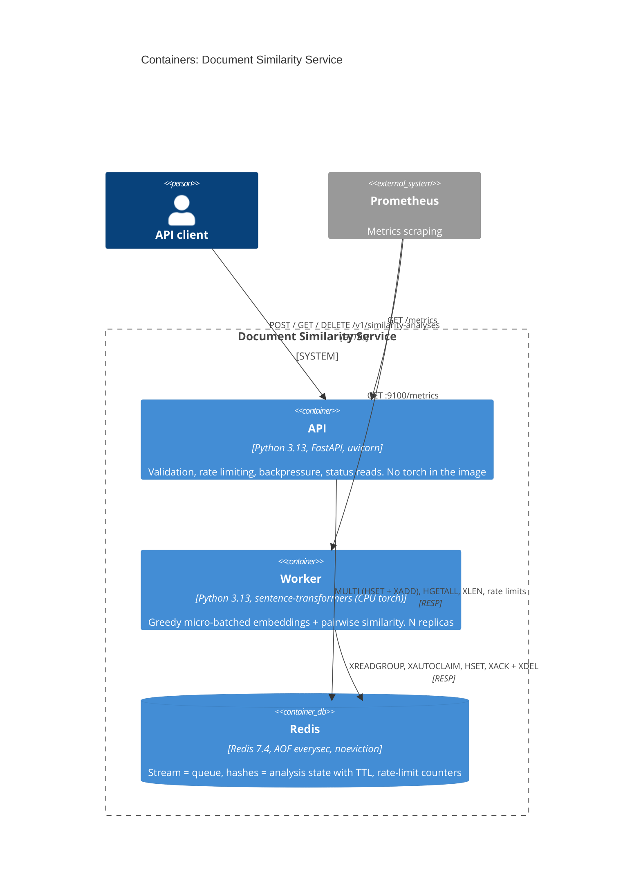
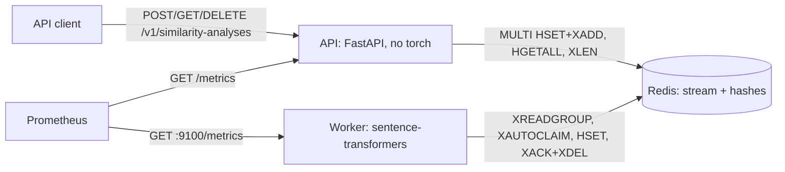
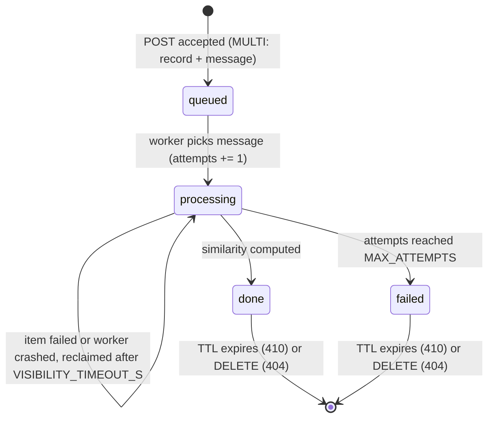

<!-- markdownlint-disable MD033 -->
# Document Similarity Service

Clients submit a small `.txt` document together with a query and get back a similarity score
computed with `sentence-transformers/all-MiniLM-L6-v2`. Embedding is CPU-bound and much slower
than accepting an HTTP request, so the API accepts work immediately (`202 Accepted`) and a
separate worker pool computes results asynchronously, so a traffic burst degrades queue wait
time instead of the API itself. Full design rationale lives in [`SPEC.md`](SPEC.md); business
scenarios in [`BEHAVIOR.md`](BEHAVIOR.md).

**Start here:** [Run it](#run-it) · [Architecture](#architecture) · [Key decisions](#key-decisions-and-trade-offs)
· [Known limitations](#known-limitations) · [TODO](#todo)

## Table of contents

- [Run it](#run-it)
- [What the system does](#what-the-system-does)
- [Architecture](#architecture)
- [API at a glance](#api-at-a-glance)
- [How overload is handled](#how-overload-is-handled)
- [Capacity model](#capacity-model)
- [Observability](#observability)
- [Configuration](#configuration)
- [Key decisions and trade-offs](#key-decisions-and-trade-offs)
- [Deviations from the original design](#deviations-from-the-original-design)
- [Production on Azure](#production-on-azure)
- [Testing and quality gates](#testing-and-quality-gates)
- [Known limitations](#known-limitations)
- [What I would cut / do next](#what-i-would-cut--do-next)
- [How this was built](#how-this-was-built)
- [TODO](#todo)

## Run it

Prerequisites: Docker (for `docker compose`), or `uv` + Python 3.13 for local development.

```bash
docker compose up --build
```

Starts Redis, the API (`:8000`), and 2 worker replicas.

```bash
curl -i -X POST http://localhost:8000/v1/similarity-analyses \
  -H "X-Client-Id: client-a" \
  -F "file=@samples/fox.txt" \
  -F "query=fox over dog"
```

```
HTTP/1.1 202 Accepted
location: /v1/similarity-analyses/01a15047-5031-7f67-b85b-fa5cb414e098
retry-after: 1

{"id":"01a15047-...","status":"queued","created_at":"...","expires_at":"...","links":{"self":"..."}}
```

```bash
curl -s http://localhost:8000/v1/similarity-analyses/<id> -H "X-Client-Id: client-a"
```

```json
{"id":"01a15047-...","status":"done","attempts":1,"result":[0.6069390756512486],"document_truncated":false,...}
```

(Both outputs above are from a real run against this codebase, not illustrative placeholders.
`result` is specific to the exact document/query text; `0.87`-style round numbers elsewhere in
older drafts of this project were SPEC placeholders, not measurements.)

```bash
curl -i -X DELETE http://localhost:8000/v1/similarity-analyses/<id> -H "X-Client-Id: client-a"
# 204 No Content, then a second GET on the same id returns 404
```

OpenAPI docs: `http://localhost:8000/docs`.

### Local development

```bash
make install          # uv sync --all-groups + pre-commit install
make test              # full suite: unit + BEHAVIOR.md integration tests (~60-70s)
make test-unit         # fast subset, no Docker model load (~5-10s)
make test-integration  # BEHAVIOR.md scenarios only (needs Docker, real model)
make run-api           # uvicorn --reload, against Redis on localhost:6379
make run-worker        # one worker process, against the same Redis
make help              # full command list
```

`make test-unit`/`make test-integration` split by the `behavior` pytest marker, not by directory.

<details>
<summary>Local dev notes: Colima and Ryuk</summary>

testcontainers (used by the integration tests to start a real Redis) relies on Ryuk, a reaper
container that cleans up test containers on exit. On Colima, Ryuk can't reach the Docker socket
through the VM boundary and the tests hang. The `Makefile` exports
`TESTCONTAINERS_RYUK_DISABLED=true` to work around this; it isn't needed on CI's native Docker,
and isn't a code change -- just an environment variable for local runs.
</details>

## What the system does

A client uploads a `.txt` file and a short query; the service returns a cosine-similarity score
between the query and the document, computed by a pinned sentence-embedding model. The problem
statement implies ~500,000 requests/day with unknown burst shape, and embedding is too slow
(tens of milliseconds per item, see [Capacity model](#capacity-model)) to compute inline without
either rejecting bursts or queueing silently behind a client-visible timeout. The design accepts
work fast and makes overload explicit instead.

**Non-goals:** authentication, multi-region, semantic quality of the model, documents longer than
the model's context window (chunking).

**Assumptions** (full table in [`SPEC.md` §2](SPEC.md#2-explicit-assumptions)):

| Assumption | Value | Status |
|---|---|---|
| Unit of work | 1 file + 1 query = 1 analysis | given (task description) |
| Max upload size | 100 KB | assumed |
| Analysed document length | first 4,096 chars, then model truncation at 256 tokens | model limit: known; margin: assumed |
| Encoding / extension | UTF-8 only, `.txt` only | assumed |
| Query length | 1-1,000 chars after trimming | assumed |
| Traffic | 500,000 req/day -> 5.8 req/s average | given |
| Peak factor | 10x average -> 58 req/s, 116 emb/s | assumed (no traffic data) |
| Hardware | CPU only, no GPU | assumed |
| Worker throughput `T` | varies by machine | **measured** (see [Capacity model](#capacity-model)) |
| SLA | p95 accept < 100ms; p95 time-to-result < 5s at nominal load | assumed |
| Result format | `list[float]` of length 1 | known (task's `[[0.87]]` flattened deliberately) |
| Client identity | `X-Client-Id` header, no real auth | assumed; **spoofable**, see [Known limitations](#known-limitations) |
| Retention | 24h from creation, then `410 Gone` | assumed |
| Delivery semantics | at-least-once | known (embedding is deterministic, so a duplicate computation is harmless) |

## Architecture



<details>
<summary>Flowchart fallback (C4 syntax is marked experimental by Mermaid)</summary>



</details>

**Request flow:**

```mermaid
sequenceDiagram
  autonumber
  participant C as Client
  participant A as API
  participant R as Redis
  participant W as Worker
  C->>A: POST (file, query, X-Client-Id)
  A->>R: rate limit check
  A->>A: validate + pre-cut to MAX_DOC_CHARS
  A->>R: XLEN (queue depth)
  A->>R: MULTI: HSET status=queued, XADD stream
  A-->>C: 202 + Location + Retry-After + expires_at
  W->>R: XREADGROUP (greedy, up to BATCH_MAX_SIZE)
  W->>R: HINCRBY attempts, HSET status=processing
  W->>W: encode batch, pairwise similarity
  W->>R: HSET status=done/failed; XACK + XDEL
  C->>A: GET /v1/similarity-analyses/{id}
  A->>R: HGETALL
  A-->>C: 200 {status, result | error}
```

**Job lifecycle:**



**Code layout** (vertical slices, flat, functional -- one slice is one file, or a small package
once it passes ~300 lines; slices never import each other):

| Path | What it is |
|---|---|
| `submit/` | POST slice (package: `validation.py` pure checks, `outcomes.py` sum-type -> response, `enqueue.py` rate limit + `MULTI` enqueue, `router.py` route) |
| `results.py` | GET + DELETE slice: ownership check, `404`/`410`/`409` decisions |
| `worker/` | Worker slice (package: `items.py` pure parsing, `batch.py` one-batch logic, `loop.py` consumer loop, `main.py` entrypoint) |
| `encoder.py` | `Encoder` Protocol + the real sentence-transformers implementation -- the only module that imports torch |
| `analysis.py` | Shared kernel: record schema, Redis key names, `transition()` state machine, UUIDv7/expiry math -- the one module both processes depend on |
| `capacity.py` | Pure capacity-planning formulas, used by `scripts/benchmark.py` and its tests |
| `api_paths.py` | Single source of truth for `/v1/...` path construction |
| `dependencies.py` | FastAPI `Depends()` getters as `Annotated` type aliases, so handlers take dependencies as typed function arguments instead of reading `request.app.state` directly |
| `observability.py` | structlog JSON setup + Prometheus metrics registry |
| `api.py` | App factory: slice routers, `/health`, `/ready`, `/metrics` |
| `config.py` | `pydantic-settings` (`ApiSettings`, `WorkerSettings`), with startup invariant checks |

A unit test (`test_api_no_torch.py`) asserts that importing `similarity.api` never pulls in
`torch`, so the API image can't silently regress to carrying the model's dependencies.

## API at a glance

Base path `/v1/similarity-analyses`. Errors use RFC 9457 Problem Details
(`application/problem+json`) with an extra `code` field.

| Method | Status | When | Notes |
|---|---|---|---|
| `POST` | `202` | queued | `Location`, `Retry-After: 1` |
| `POST` | `413` | file over `MAX_FILE_SIZE_BYTES` | `code: PAYLOAD_TOO_LARGE` |
| `POST` | `415` | not a `.txt` file | `code: UNSUPPORTED_MEDIA_TYPE` |
| `POST` | `422` | not UTF-8, empty file, invalid query/`X-Client-Id` | `code: VALIDATION_ERROR` |
| `POST` | `429` | over per-client rate limit | `Retry-After` (jittered), `code: RATE_LIMITED` |
| `POST` | `503` | queue at capacity | `Retry-After` (jittered), `code: OVERLOADED` |
| `GET` | `200` | `queued`/`processing` | `Retry-After: POLL_INTERVAL_HINT_S` |
| `GET` | `200` | `done` | `result: [float]`, `document_truncated: bool` |
| `GET` | `200` | `failed` | `error: {code, message, attempts}` |
| `GET` | `404` | never existed, wrong client, or deleted | existence never leaked across clients |
| `GET` | `410` | existed, TTL elapsed | decided from the UUIDv7 timestamp, no tombstone stored |
| `DELETE` | `204` | `done`/`failed` deleted | |
| `DELETE` | `404` | not found / not this client's (code never returns `410`: the SPEC's DELETE table has no such case, and the implementation matches that exactly) | |
| `DELETE` | `409` | still `queued`/`processing` | cancellation is out of scope |
| `GET /health` | `200` | process responds | **no dependency checks** |
| `GET /ready` | `200`/`503` | Redis `PING` | |

**Ownership rule:** `GET`/`DELETE` require the same `X-Client-Id` that created the analysis. A
mismatch returns `404` -- identical to "never existed" -- so existence is never leaked to a
client that doesn't own the record.

## How overload is handled

This is the part of the brief about handling bursts without degrading the API, so it gets the
most detail. Four protection layers run cheapest-first, each cutting off before the next's cost:

| Order | Layer | Protects against | Response | Cost if rejected |
|---|---|---|---|---|
| 0 | `uvicorn --limit-concurrency` (from `API_CONCURRENCY_LIMIT`) | API flooding | `503` | zero, built into uvicorn |
| 1 | `Content-Length` check + capped read | API OOM from huge uploads | `413` | no body I/O |
| 2 | Per-client rate limit (`limits`, Redis, fixed window) | one client consuming all capacity | `429` + `Retry-After` | 1 Redis round-trip, before body read |
| 3 | Queue depth (`XLEN >= MAX_QUEUE_DEPTH`) | broker growth, broken SLA | `503` + `Retry-After` | 1 Redis round-trip |

`429` means "you are sending too much"; `503` means "we are full" -- never a timeout, never a
silently dropped accepted job. `Retry-After = base + uniform(0, base)` seconds (jittered), so
clients rejected in the same second don't all retry in the same second.

The queue-depth check is a **soft** limit: `XLEN` then `XADD` is not one atomic operation, so
under concurrent POSTs the queue can briefly exceed `MAX_QUEUE_DEPTH` by roughly the number of
requests in flight at that instant. An atomic Lua check-and-add would close this; not implemented
(see [TODO](#todo)) because the overshoot is bounded and acceptable for a prototype.

**Greedy micro-batching:** the worker's `XREADGROUP COUNT=BATCH_MAX_SIZE BLOCK=READ_BLOCK_MS`
returns as soon as at least one message is available and takes up to `BATCH_MAX_SIZE`. At low
traffic, batch size is effectively 1 (latency like no batching); at high traffic batches fill
naturally (throughput like full batching). No timer waits for a batch to fill.

**Per-item isolation:** queries and documents in a batch are encoded together in one call. If
that call raises, every item in the batch is retried **individually** instead of the whole batch
failing, so one bad document can't fail the rest (`worker/batch.py`'s `process_batch` ->
`process_item_alone` fallback).

**Redis Streams pitfalls handled:**

| Pitfall | Consequence if unhandled | Handling |
|---|---|---|
| Acked entries stay in the stream | `XLEN` grows forever: false "queue full", unbounded RAM | `XDEL` right after `XACK`, so `XLEN` = outstanding work only |
| `XADD MAXLEN` looks like a queue limit | Silently trims the oldest *accepted* jobs | Never used; the limit is enforced in the API before `XADD` |
| `maxmemory-policy volatile-lru` (a common managed default) | Evicts keys with a TTL -- i.e. our analyses | `noeviction` in `docker-compose.yml`: full memory fails writes (`503`) instead of silently losing accepted work |
| Torch thread oversubscription | Torch sees host cores, not the container's cgroup limit; throughput drops under throttling | `TORCH_NUM_THREADS`/`OMP_NUM_THREADS` set to the container's CPU limit |

## Capacity model

**Formula** (`capacity.py`, used by both `benchmark.py` and the production-sizing table below):

```
average_rps        = requests_per_day / 86_400
peak_rps            = average_rps * peak_factor
peak_embeddings_s   = peak_rps * 2 * (1 - cache_hit_rate / 2)   # query + document per analysis
worker_replicas     = ceil(peak_embeddings_s / (T * 0.7)) + 1   # T = measured throughput/replica
max_queue_depth     = ceil(active_replicas * (T / 2) * max_acceptable_wait_s)
```

**Why 0.7 utilisation:** queueing wait time grows roughly like `u / (1 - u)` -- about 2.3x service
time at 70% utilisation, 9x at 90%, 99x at 99%. The `+ 1` replica tolerates losing one replica
without breaching the target.

**Why capacity is computable at all:** the API pre-cuts documents to `MAX_DOC_CHARS` and the
model truncates further at 256 tokens, so CPU cost per job has a hard ceiling regardless of
upload size -- this is what makes `T` a meaningful constant instead of a moving target.

**Recompute for a different traffic level or machine:**

```bash
uv run python scripts/benchmark.py --iterations 20 --max-acceptable-wait-s 5.0
```

**Measured benchmark** (Apple M3 Pro, native -- not inside Docker, see caveat below -- CPython
3.13, `TORCH_NUM_THREADS=2`, 10 iterations per batch size after 3 discarded warm-up iterations;
`T` = `batch_size * 2 / p50`, counting both the query and document embedding per analysis):

| Batch size | p50 (ms) | p95 (ms) | T (emb/s) |
|---|---|---|---|
| 1 | 8.5 (measured) | 8.7 (measured) | 234.0 (measured) |
| 8 | 40.5 (measured) | 42.1 (measured) | 395.3 (measured) |
| 16 | 77.2 (measured) | 78.0 (measured) | 414.7 (measured) |
| 32 | 84.3 (measured) | 85.8 (measured) | 759.6 (measured) |
| 64 | 166.7 (measured) | 171.7 (measured) | 768.1 (measured) |

**The 16->32 jump (415 -> 760 emb/s) is not explained by the code and is not hidden here:**
`throughput = batch_size * 2 / p50` is computed the same way for every row, so the jump is a real
property of this run (likely BLAS/torch threading overhead that dominates at small batch sizes
on this CPU, amortising away at 32), not a formula bug -- but that is an informed guess, not a
measurement. Re-running with more iterations or `py-spy`/profiling would be needed to say more.

**Replica table**, built from the best measured `T` = 768.1 emb/s (batch 32, not 64 -- `T` is not
monotonic in this run, so the table uses `max()` over all batch sizes rather than assuming the
largest batch wins), peak factor 10x (assumed), cache hit rate 0 (no cache implemented):

| Requests/day | Peak emb/s (computed) | Replicas (computed) | Queue depth (computed) |
|---|---|---|---|
| 100,000 | 23.1 | 2 | 3,841 |
| 500,000 | 115.7 | 2 | 3,841 |
| 1,000,000 | 231.5 | 2 | 3,841 |
| 5,000,000 | 1,157.4 | 4 | 7,681 |

**Why the first three queue-depth values are identical:** `max_queue_depth` depends only on
`active_replicas` and `T`, not directly on `requests_per_day`. All three rows need exactly 2
replicas (their peak emb/s is below `T * 0.7 = 537.7`), so they get the same queue depth -- this
is the formula working as designed, not a coincidence or a bug.

**What these numbers do not prove:** they are this specific machine's result, not a production
SKU's. Running the same benchmark inside the worker's Docker image under Colima (QEMU amd64
emulation on this Apple Silicon machine) measured roughly 15x slower than native -- an emulation
artifact of this local setup, not a capacity number. Always re-run on hardware matching the
deployment target before sizing replicas or `MAX_QUEUE_DEPTH` from it.

## Observability

| Question | Metric | Type | Where |
|---|---|---|---|
| Meeting the SLA (p95 < 5s)? | `analysis_end_to_end_seconds` | histogram | worker |
| Keeping up? | `queue_depth` | gauge | worker |
| How long has the oldest job waited? | `queue_oldest_age_seconds` | gauge | worker |
| How much do we reject, and why? | `http_requests_total{handler,status}` | counter | API (instrumentator) |
| Is accepting fast (< 100ms)? | `http_request_duration_seconds{handler}` | histogram | API (instrumentator) |
| What does a batch cost? | `inference_batch_duration_seconds` | histogram | worker |
| Does batching work under load? | `inference_batch_size` | histogram | worker |
| What fraction fails? | `analyses_completed_total{status}` | counter | worker |
| Is something failing repeatedly? | `analysis_retries_total` | counter | worker |
| How many results come from truncated documents? | `documents_truncated_total` | counter | worker |

`queue_oldest_age_seconds` is the primary alert signal: depth says *how much* is queued, age says
*how long a client has actually waited* -- free to compute, since a stream entry ID's leading
part is a millisecond timestamp. `client_id` is never a metric label (unbounded cardinality would
bloat Prometheus); it goes to logs instead.

**Logs:** JSON, one line per event, stdout (`structlog`). Never document text or query content --
this codebase doesn't even log their length or a hash today, despite that being the original
intent (see [Known limitations](#known-limitations)). Fields actually emitted: `ts`, `level`,
`event`, plus per-event fields such as `analysis_id`, `attempts`, `batch_size`, `reason`. Two
fields from the original design are **not** implemented: a `batch_id` correlating the items of
one batch, and a `duration_ms` on `worker.model_loaded` for cold-start time -- tracked in
[TODO](#todo).

**Health semantics:** `/health` never checks Redis -- a Redis blip would otherwise restart every
API replica at once (a self-inflicted restart storm) without fixing Redis. `/ready` does check
Redis (`PING`), so a load balancer can stop routing to a replica that can't reach it without
killing the process. The worker has no liveness HTTP endpoint; it writes a heartbeat file after
every loop iteration (including empty reads, so an idle worker never looks dead), and is
considered live if that file is younger than `HEARTBEAT_MAX_AGE_S`.

## Configuration

Environment variables only, validated at startup with `pydantic-settings` -- bad or inconsistent
config fails the container at boot rather than misbehaving at runtime. Full list in
[`.env.example`](.env.example); defaults below are read directly from `config.py`.

| Variable | Default | Purpose | Source |
|---|---|---|---|
| `REDIS_URL` | `redis://redis:6379/0` | queue + state | — |
| `LOG_LEVEL` | `INFO` | — | — |
| `RESULT_TTL_S` | `86400` | retention | assumed |
| `STREAM_KEY` | `analyses:jobs` | stream name | — |
| `CONSUMER_GROUP` | `workers` | consumer group | — |
| `MAX_FILE_SIZE_BYTES` | `102400` | `413` threshold | assumed |
| `MAX_DOC_CHARS` | `4096` | pre-cut before enqueue | assumed |
| `MAX_QUERY_LENGTH` | `1000` | `422` threshold | assumed |
| `RATE_LIMIT` | `20/second` | per-client limit (`limits` syntax) | assumed |
| `RATE_LIMIT_STRATEGY` | `fixed-window` | `limits` strategy | — |
| `MAX_QUEUE_DEPTH` | `1000` | `503` threshold | **should come from benchmark** |
| `RETRY_AFTER_BASE_S` | `5` | `Retry-After` base before jitter | assumed |
| `POLL_INTERVAL_HINT_S` | `1` | `Retry-After` on in-progress `GET` | assumed |
| `API_CONCURRENCY_LIMIT` | `200` | `uvicorn --limit-concurrency` | assumed |
| `BATCH_MAX_SIZE` | `32` | greedy micro-batch cap | **should come from benchmark** |
| `READ_BLOCK_MS` | `5000` | `XREADGROUP BLOCK` | assumed |
| `VISIBILITY_TIMEOUT_S` | `30` | `XAUTOCLAIM` idle threshold | **should exceed measured p95 batch time** |
| `RECLAIM_INTERVAL_S` | `10` | how often to look for abandoned messages | assumed |
| `MAX_ATTEMPTS` | `3` | retry cap before `failed` | assumed |
| `TORCH_NUM_THREADS` / `OMP_NUM_THREADS` | `2` | should equal the container's CPU limit | from deployment |
| `HEARTBEAT_PATH` | `/tmp/worker-heartbeat` | liveness file | — |
| `HEARTBEAT_MAX_AGE_S` | `30` | liveness threshold | assumed |
| `METRICS_PORT` | `9100` | worker `/metrics` | — |

**Startup invariants** (reject misconfiguration at boot): `MAX_DOC_CHARS <= MAX_FILE_SIZE_BYTES`;
`HEARTBEAT_MAX_AGE_S > 2 * READ_BLOCK_MS / 1000`; `MAX_ATTEMPTS >= 1`.

**Build-time only** (Dockerfile `ARG`, not read by `pydantic-settings`): `MODEL_NAME`,
`MODEL_REVISION`. Changing the model means building a new image, not restarting with new env vars.

## Key decisions and trade-offs

| Decision | Chosen | Rejected | Why |
|---|---|---|---|
| Result delivery | `202` + polling | sync; webhook | Sync ties an HTTP connection to CPU-bound work, turning overload into timeouts. Webhooks need retries, signing, SSRF protection -- TODO if needed |
| API style | REST, `similarity-analyses` resource, Richardson level 2 + `links.self` | `/jobs`; full HATEOAS; `303` to a sub-resource | The domain name hides the queue as an implementation detail; a separate round-trip for an 8-byte result isn't worth it. Full HATEOAS is TODO |
| Process split | API (no torch) + worker | thread pool; process pool in one container | A stuck worker can't freeze API health checks; each part scales on its own bottleneck |
| Backing service | Redis (queue + state + rate limits) | Service Bus (+ emulator); Postgres `SKIP LOCKED`; RabbitMQ | See [ADR-001](#adr-001-redis-as-the-single-backing-service) below |
| Queue library | Own ~100-line Streams consumer | Celery / RQ / arq | A library would hide exactly what's being evaluated here: acks, redelivery, depth |
| Batching | Greedy (take what's waiting, <= `BATCH_MAX_SIZE`) | fill-and-wait with a timer | Self-tuning: no latency penalty at low load, full throughput at high load |
| Retry | Fixed visibility timeout, `MAX_ATTEMPTS` tries | exponential backoff in the worker | Embedding is a deterministic function -- waiting longer doesn't fix a content-related failure. Jitter is applied where a herd actually forms instead: the client-facing `Retry-After`. Backoff becomes worth adding once embedding goes through a flaky external provider (e.g. a hosted API) whose errors are transient |
| Rate limiting | `limits` library, fixed window, Redis storage | hand-written; token bucket (Lua) | Ready tool; up to 2x burst at window edges is acceptable for a prototype |
| Queue limit | Soft (`XLEN` then `XADD`) | atomic Lua check-and-add | Overshoot is bounded by concurrent in-flight POSTs; acceptable, not atomic -- see [How overload is handled](#how-overload-is-handled) |
| Retention | TTL from creation; `410` from the UUIDv7 timestamp, no tombstones | tombstones; TTL from completion | Zero extra storage; `expires_at` is knowable at creation time, so it can be returned in the `202` body |
| Model delivery | Baked into the image at a pinned revision, `HF_HUB_OFFLINE=1` | download at container start; mount from storage | No runtime dependency on Hugging Face during scale-out; reproducible builds |
| Observability | Prometheus + JSON logs + `analysis_id` correlation | OpenTelemetry + collector | Same diagnostic value at a fraction of the setup cost; OTel is TODO |
| Tests | Real pinned model + real Redis (testcontainers) for BDD; fake encoder only for `process_batch` unit tests | mocked Redis (fakeredis) anywhere; fake model in the integration layer | A fake-model "integration" test proves the plumbing works, not that the service works -- see [deviations](#deviations-from-the-original-design) item 9 |
| Code organisation | Flat vertical slices + small shared kernel | layered `domain/`/`application/`/`adapters/` | A feature lives in (mostly) one file; the only cross-cutting module is the API<->worker contract |
| Paradigm | Pure functions + an I/O handler at the end of each file | service classes + a DI container | Decisions are testable without infrastructure; side effects stay at each slice's edge |

### ADR-001: Redis as the single backing service

- **Decision:** queue (Streams), analysis state (hashes with TTL), and rate-limit counters all on
  one Redis. The documented production target moves the queue to Azure Service Bus.
- **Why:** one component instead of three; status and message are written atomically in one
  `MULTI` (two systems would mean a dual write with no shared transaction); fast tests
  (testcontainers with only Redis).
- **Rejected for this prototype:** the Service Bus emulator, because it needs a SQL Server
  sidecar, doesn't persist across container restarts, and has no Python testcontainers module
  (only Java/Go/.NET).
- **Accepted cost:** broker semantics Service Bus gives for free (delivery count, DLQ) are
  hand-rolled here; local tests run against a different broker than production would use
  (dev/prod parity gap, see [Known limitations](#known-limitations)).
- **Mitigation:** broker calls are confined to two files (`submit/enqueue.py`, `worker/loop.py`),
  so switching backing services means changing those two files, not the rest of the codebase.
- **Revisit when:** message durability with an SLA is required, an operational DLQ is needed,
  multiple consumers (pub/sub) appear, or compliance requirements apply.

## Deviations from the original design

Full detail with impact and reasoning in [`SPEC.md` §16](SPEC.md#16-implementation-notes--deviations);
summary:

| # | Deviation | Reason |
|---|---|---|
| 1 | Python 3.13, not 3.12 | 3.13 was already available; no reason to target older |
| 2 | `submit.py`/`worker.py` became packages | Both passed the SPEC's own ~300-line-per-file threshold |
| 3 | `dependencies.py`/`api_paths.py` added | Remove repeated magic strings and manual `app.state` reads |
| 4 | Test files split to mirror the source packages | Each test module maps to one source module |
| 5 | `API_CONCURRENCY_LIMIT` existed in config but was never wired to uvicorn | Found during a documentation audit; fixed -- see the Dockerfile's API `CMD` |
| 6 | `batch_id` and cold-start duration log fields not implemented | Oversight; not fixed, tracked in [TODO](#todo) |
| 7 | Jitter RNG passed as a plain function argument, not via `Depends()` like the clock | Both are testable either way; just inconsistent with each other |
| 8 | BDD scenarios run against the real model, not a fake | A fake-model "integration" test doesn't prove the service works -- see below |

**Item 8 in detail:** all 8 `BEHAVIOR.md` scenarios now load and run the real pinned
`sentence-transformers` model (loaded once per test session). The fake encoder
(`tests/fake_encoder.py`) still exists but now only backs the pure unit tests of `process_batch`
logic. The scenario about a failure that "can never succeed" was reframed from a literal
"poisoned document" string (meaningless to a real model, which encodes anything) to a wrapper
that makes one specific analysis's embedding call raise, simulating an infrastructure failure
rather than a content-triggered one. Full suite runtime grew from roughly 20s to 60-70s as a
result; this is an accepted cost of testing against the real model, not something being chased
down for speed.

## Production on Azure

| Local component | Azure service | What changes |
|---|---|---|
| API container | Azure Container Apps (HTTP scaling) | Scale on request rate; same image from Azure Container Registry |
| Worker container | Azure Container Apps + KEDA scale rule on queue length | Scale-to-zero at night; threshold derived from `T/2 * target_wait` |
| Redis Stream | Azure Service Bus queue | Peek-lock = ack, `DeliveryCount` = attempts, `LockDuration` = visibility timeout, built-in DLQ, scheduled messages for backoff |
| Redis hashes | Azure Managed Redis, or Cosmos DB with TTL | Set eviction policy explicitly; polling grows Cosmos RU cost |
| Rate limiting, identity | Azure API Management (`rate-limit-by-key`, subscription keys / Entra ID) | Rejected traffic never reaches the containers; real auth replaces `X-Client-Id` |
| Secrets | Key Vault references, later Managed Identity to Redis | No secrets in env files or the repo |
| `/metrics` | Azure Monitor managed Prometheus + Managed Grafana | |
| stdout logs | Log Analytics (Container Apps collects automatically) | |

The `202` + polling API contract does not change; only what sits behind it does. **At 10x
traffic** (5,000,000 req/day in the replica table above): worker replicas go from 2 to 4 by the
measured formula, the soft queue limit's overshoot risk grows with concurrent request volume
(making the atomic-Lua TODO more valuable), and the per-client rate limit's 2x fixed-window burst
tolerance starts to matter more in absolute request counts even though it's the same relative
bound.

## Testing and quality gates

| Layer | What | How |
|---|---|---|
| Unit | Validation, `404` vs `410` from UUIDv7, `Retry-After` bounds, state transitions, attempt-overflow, pairwise result shape, capacity formula, config invariants, "API doesn't import torch" | Plain pytest on pure functions; injected clock/RNG; no Docker needed (`make test-unit`) |
| Integration (BDD) | All 8 `BEHAVIOR.md` scenarios, 1:1 to `test_given_..._when_..._then_...` | FastAPI `TestClient` + one driven iteration of the worker loop + real Redis (testcontainers) + the real pinned model (`make test-integration`) |
| Model | Throughput and latency, not correctness | `scripts/benchmark.py` |
| Smoke | `docker compose up` + curl happy path | Manual (see [Run it](#run-it)) |

**Quality gates, enforced identically in pre-commit and CI:** `ruff` (lint + format), `mypy
--strict` (whole package; `torch`/`sentence-transformers`/`numpy` import errors ignored only for
`encoder.py`'s boundary), `gitleaks`, `hadolint`, `detect-private-key`/`check-yaml`/EOL hooks. CI
additionally runs `pip-audit` and builds both Docker targets (`api`, `worker`).

```bash
make pre-commit   # uv run pre-commit run --all-files
make audit        # uv export + pip-audit
```

**Not tested (deliberately):** semantic quality of the model's embeddings, `/metrics` content,
end-to-end load under sustained traffic (TODO).

## Known limitations

| Limitation | Impact | Mitigation |
|---|---|---|
| `X-Client-Id` is a spoofable identity, not authentication | Rotating the header value bypasses per-client rate limiting; only the global queue-depth limit protects capacity against that today | Real auth is TODO #1 (highest priority) |
| Benchmark numbers are local to one machine | Replica counts and `MAX_QUEUE_DEPTH` sized from them could be wrong on different hardware | Re-run `scripts/benchmark.py` on the target SKU before trusting any number from it |
| Dev/prod broker parity gap | Tests and local/compose runs use Redis Streams; the documented production target is Azure Service Bus; this is not validated by CI | Broker calls are confined to two files by design (ADR-001); TODO #2 tracks validating a real adapter |
| Single-node Redis | A single point of failure; `AOF everysec` bounds data loss on crash to roughly 1 second, no HA | TODO #5 (managed HA tier) |
| Soft queue-depth limit | `XLEN` then `XADD` is not atomic; can briefly overshoot `MAX_QUEUE_DEPTH` under concurrent POSTs | Overshoot is bounded by in-flight request count; TODO #6/#7 track an atomic Lua check |
| `batch_id` and cold-start duration not in logs | Can't correlate "this batch's N items" in log search, or query cold-start time | Tracked in TODO; not implemented |
| Logs don't carry document/query length or a hash | Originally intended for correlation without exposing content; neither is emitted today | Not implemented; tracked in TODO |
| `uvicorn --limit-concurrency` was previously unwired | The API's first overload layer (503 under connection flooding) was documented but silently absent | **Fixed** during the documentation audit that produced this README -- the Dockerfile's API `CMD` now reads `API_CONCURRENCY_LIMIT` |

## What I would cut / do next

**With only 2 hours:** skip the worker crash-recovery scenario (`XAUTOCLAIM` reclaim) and
Dockerizing both images -- ship the API and worker as plain `uv run` processes against a local
Redis, keep the happy path, input validation, and the two load-shedding status codes (`429`,
`503`). Those four cover most of what a reviewer evaluates (I/O vs CPU separation, explicit
backpressure) at a fraction of the implementation cost.

**With more time, first:** close the dev/prod parity gap (a real Service Bus adapter validated by
the same BDD suite in CI) and wire real authentication -- both are flagged as the two highest-
impact gaps above, and both are scoped to a small, already-isolated part of the codebase.

## How this was built

Design decisions were made in a separate design phase and recorded in [`SPEC.md`](SPEC.md),
including rejected alternatives, before any code was written. Implementation followed SPEC.md's
step-by-step plan, one step at a time, gated on `pre-commit run --all-files` and the full test
suite passing before moving to the next step; each step's commit history is in `git log`.

<!-- ENTER: confirm -->

## TODO

Grouped and ordered by value. Every item from `SPEC.md` §14 is included; items marked **(found
during implementation)** are gaps this documentation audit surfaced that weren't in the original
TODO.

**Correctness & safety**

| Item | Why it matters | Effort |
|---|---|---|
| Real authentication (APIM subscription keys / Entra ID) | `X-Client-Id` is trivially spoofable; rotating IDs bypasses per-client limits | M |
| Atomic queue limit (Lua check-and-add) | Closes the soft-limit overshoot window | S |
| `Idempotency-Key` on `POST` | Avoids duplicate analyses from client retries | S |
| Tombstone so `GET` after `DELETE` returns `410` instead of `404` | Currently indistinguishable from "never existed" | S |
| Cancellation (`queued -> cancelled`) | Out of scope today; no way to abort queued work | M |

**Scalability & performance**

| Item | Why it matters | Effort |
|---|---|---|
| Query embedding cache keyed by content hash | Embedding is deterministic, so this is safe; reduces the `H` term in the capacity formula | M |
| ONNX / OpenVINO backend with quantisation | Would change measured `T` directly | L |
| Dynamic `MAX_QUEUE_DEPTH` from live replica count | Today it's a static config value | M |
| `Retry-After` computed from current depth and throughput, not a fixed base | More accurate client guidance under real load | S |
| Token bucket / client tiers and priorities | Fixed-window rate limiting allows up to 2x burst at window edges | M |
| End-to-end load test (k6/Locust) ramping to `503` | No automated proof backpressure holds under sustained load | M |
| Benchmark on the target deployment SKU | Current numbers are this machine's only | S (once hardware is available) |
| Multi-file submissions in one request | Today one file + one query = one analysis | M |
| Chunking for documents beyond the model's context window | Currently truncated silently at 256 tokens (flagged via `document_truncated`) | L |

**Reliability**

| Item | Why it matters | Effort |
|---|---|---|
| Service Bus adapter + the same BEHAVIOR.md suite on the emulator in CI | Closes the dev/prod parity gap from ADR-001 | L |
| Redis durability/HA beyond AOF `everysec` | Single-node Redis is a SPOF today | M |
| Dead-letter stream for operator inspection of `failed` analyses | Failures are visible per-analysis via `GET` but not aggregated anywhere operators can browse | S |
| Worker exponential backoff with jitter | Not useful today (embedding is deterministic); becomes valuable once embedding moves behind a flaky external provider | S (when triggered) |

**Operations**

| Item | Why it matters | Effort |
|---|---|---|
| OpenTelemetry with trace context through the queue | Richer cross-process correlation than `analysis_id` logging alone | L |
| Dashboards + alerts (e.g. `queue_oldest_age_seconds > 5s` for 2 min) | No alerting exists today, only raw metrics | M |
| Optional Prometheus + Grafana compose profile | Logs/metrics are stdout/`:9100` only; no visualization shipped | S |
| `batch_id` correlation and cold-start duration in logs **(found during implementation)** | Both were in the original design's §8.2 and were never implemented | S |
| Document/query length and hash in logs **(found during implementation)** | Originally intended for correlation without exposing content; not emitted today | S |
| `dev` Docker target with live-reload | Rebuilding the production multi-stage image for every local change is slow | S |
| Model outside the image (Blob / Azure ML registry) | Needed for multiple or very large models | M |
| Image scanning (Trivy / Defender for Containers) | Not run today | S |
| SBOM generation | Not produced today | S |
| Coverage threshold in CI | Not enforced today (tests are comprehensive but uncounted) | S |
| Managed Identity to Redis | Currently a plain connection string | M |

**API & product**

| Item | Why it matters | Effort |
|---|---|---|
| Webhook delivery | Avoids polling for clients that want push | M |
| Long-polling (`GET ...?wait=10`) | Reduces poll frequency without a webhook | S |
| Full HATEOAS | Today only `links.self` is exposed | M |
| Per-tier retention | Today retention is a single global `RESULT_TTL_S` | S |
| Long-term export (Blob + lifecycle management) | No archival path exists once a result expires | M |
| `pytest-bdd` for `BEHAVIOR.md` scenarios | Current plain-pytest mapping is 1:1 but requires reading Python to follow; worth it once non-developers start writing scenarios | S (when triggered) |

**Found during implementation (full list)**

This group exists specifically to not bury what a documentation audit surfaced after the fact:

- `API_CONCURRENCY_LIMIT` was configured but never wired to uvicorn -- **fixed** as part of this
  audit (the Dockerfile's API `CMD` now reads it).
- `batch_id` log correlation field: designed, never implemented.
- Cold-start duration on the `worker.model_loaded` log event: designed, never implemented.
- Document/query length-and-hash logging: designed, never implemented.
- Jitter RNG injected as a plain function argument instead of via `Depends()`, inconsistent with
  how the clock is injected -- cosmetic, not a correctness issue.
- `SPEC.md`'s original file tree (§3.5) and testing-strategy table (§13) described a flat
  `submit.py`/`worker.py` and a fake-model BDD suite that no longer match the code; corrected in
  `SPEC.md` §16.
