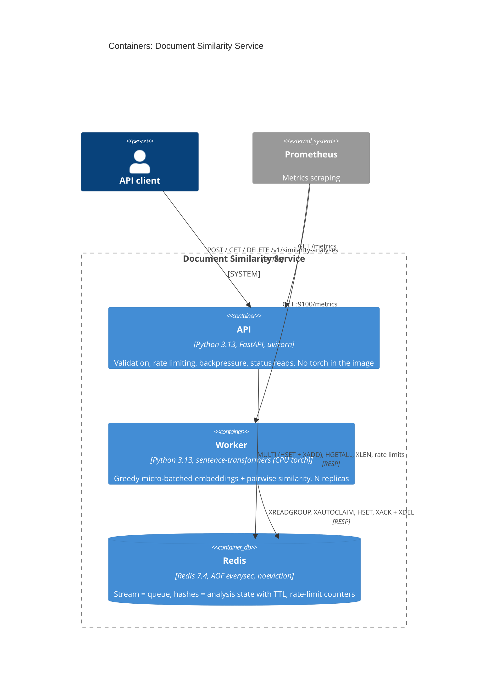

# Document Similarity Service

Clients submit a small `.txt` document together with a query and get back a similarity score
computed with `sentence-transformers/all-MiniLM-L6-v2`. Embedding is CPU-bound and much slower
than accepting an HTTP request, so the API accepts work immediately (`202 Accepted`) and a
separate worker pool computes results asynchronously. Design rationale, API contract, and every
trade-off below are specified in full in [`SPEC.md`](SPEC.md); business scenarios are in
[`BEHAVIOR.md`](BEHAVIOR.md).

## Running it

Requires Docker (for `docker compose`) or `uv` + Python 3.13 (for local development).

```bash
docker compose up --build
```

This starts Redis, the API (`:8000`), and 2 worker replicas. Then:

```bash
curl -i -X POST http://localhost:8000/v1/similarity-analyses \
  -H "X-Client-Id: client-a" \
  -F "file=@samples/fox.txt" \
  -F "query=fox over dog"
# 202 Accepted, Location: /v1/similarity-analyses/<id>

curl -s http://localhost:8000/v1/similarity-analyses/<id> -H "X-Client-Id: client-a"
# {"status": "done", "result": [0.87], ...}
```

OpenAPI docs are served at `http://localhost:8000/docs`.

### Local development

```bash
make install   # uv sync --all-groups + pre-commit install
make test       # full suite: unit + BEHAVIOR.md integration tests
make run-api    # uvicorn with --reload, against Redis on localhost:6379
make run-worker # one worker process, against the same Redis
```

Run `make help` for the full command list (linting, type-checking, dependency audit, docker
compose lifecycle). `make test-unit` / `make test-integration` split the suite by the `behavior`
pytest marker; the integration half needs Docker (testcontainers starts a real Redis) and
downloads the pinned model on first run.

Local testcontainers note: on Colima, Ryuk (the container reaper) can't reach the Docker socket
through the VM boundary, so tests hang. The Makefile exports
`TESTCONTAINERS_RYUK_DISABLED=true` to work around this; it isn't needed on CI's native Docker.

## Architecture



**Request flow:** the API rate-limits by `X-Client-Id` before reading the body, validates and
pre-cuts the document, checks queue depth, then writes the analysis record and enqueues the
stream message in a single `MULTI` transaction (never a status without a message, or vice
versa). A worker pulls up to `BATCH_MAX_SIZE` messages greedily, embeds queries and documents in
one batched call, computes pairwise similarity, and writes results before acking. Clients poll
`GET`, guided by `Retry-After`. Full sequence diagram and step-by-step in SPEC.md §3.4.

**Code structure — vertical slices, flat, functional** (SPEC.md §3.5):

```
src/similarity/
├── submit/          # POST slice (package: validation, outcomes, enqueue, router)
├── results.py       # GET + DELETE slice
├── worker/           # worker slice (package: items, batch, loop, main)
├── encoder.py        # Encoder Protocol + sentence-transformers impl — the only torch import
├── analysis.py       # shared kernel: record schema, Redis keys, transitions, expiry math
├── capacity.py       # pure capacity formulas (benchmark.py + tests)
├── api_paths.py       # single source of truth for /v1/... path construction
├── dependencies.py   # FastAPI DI aliases (SettingsDep, RedisDep, ClockDep, ...)
├── observability.py  # structlog setup, Prometheus metrics registry
├── api.py            # app factory: slice routers, /health, /ready, /metrics
└── config.py         # pydantic-settings (ApiSettings, WorkerSettings)
```

Each slice is one file (or a small package once it outgrows ~300 lines) containing everything the
feature needs — route, pure decision functions, Redis calls. Slices never import each other;
the only shared modules are the API↔worker contract (`analysis.py`), config, observability, and
the encoder boundary. Within a file, pure functions come first and the I/O handler last. A unit
test (`test_api_no_torch.py`) asserts that importing `similarity.api` never pulls in `torch`, so
the lightweight API image can't regress silently.

## Key trade-offs (see SPEC.md §11 for the full table and ADR-001)

- **Redis as the single backing service** (queue via Streams, state via hashes with TTL, rate
  limits) instead of a real broker. One component instead of three, and status + enqueue happen
  in one `MULTI` transaction instead of a dual write across two systems. Accepted cost: broker
  features Service Bus gives for free (delivery count, DLQ) are hand-rolled, and local tests run
  against a different broker than Azure production would use. See ADR-001 in SPEC.md for the
  full reasoning and the rejected Service Bus emulator alternative.
- **Own ~100-line Streams consumer** instead of Celery/RQ/arq, so the ack/redelivery/depth
  mechanics being evaluated aren't hidden behind a library.
- **202 + polling** instead of a synchronous response or webhooks — a synchronous call ties an
  HTTP connection to CPU-bound work and turns overload into timeouts.
- **Fixed visibility timeout + 3 attempts**, no exponential backoff in the worker — embedding is
  a deterministic function, so waiting longer doesn't fix a failure. Backoff only becomes useful
  once embedding calls go through a flaky external provider (see TODO #10).
- **Process split (API without torch / worker with torch)** so a stuck worker can't freeze the
  API's health checks, and each part scales on its own bottleneck.

## Benchmark

```bash
make sync   # or: uv sync --all-groups
uv run python scripts/benchmark.py
```

Measured locally on an Apple M3 Pro (native, CPython 3.13, `TORCH_NUM_THREADS=2`) — **these
numbers are this machine's, not a production SKU's; re-run `benchmark.py` on the target hardware
before sizing anything from them:**

| Batch size | p50 (ms) | p95 (ms) | T (emb/s) |
|---|---|---|---|
| 1  | 8.5   | 8.7   | 234.0 |
| 8  | 40.5  | 42.1  | 395.3 |
| 16 | 77.2  | 78.0  | 414.7 |
| 32 | 84.3  | 85.8  | 759.6 |
| 64 | 166.7 | 171.7 | 768.1 |

Replica table derived from the measured `T = 768.1 emb/s` (batch size 32), peak factor 10× (SPEC
A7), using `capacity.py`'s formulas:

| Requests/day | Peak emb/s | Replicas | Queue depth |
|---|---|---|---|
| 100,000   | 23.1   | 2 | 3841 |
| 500,000   | 115.7  | 2 | 3841 |
| 1,000,000 | 231.5  | 2 | 3841 |
| 5,000,000 | 1157.4 | 4 | 7681 |

Running the same benchmark inside the worker's Docker image under Colima (QEMU amd64 emulation
on Apple Silicon) measured roughly **15× slower** than native — an emulation artifact, not a
real capacity number. Always benchmark on hardware that matches the deployment target.

## Known limitations

- **`X-Client-Id` is a spoofable client identity**, not authentication. Rotating the header
  value bypasses per-client rate limiting; only the global queue-depth limit protects capacity
  against that today. Real auth (API Management subscription keys / Entra ID) is TODO #1.
- **Benchmark numbers are local to the machine that produced them** (see above) and must be
  re-measured on the actual target SKU before they inform replica counts or SLAs.
- **Dev/prod broker parity gap**: tests and local/compose runs use Redis Streams; the documented
  production target is Azure Service Bus (ADR-001, SPEC.md §12). Switching backs onto two files
  (`submit/enqueue.py`, `worker/loop.py`) by design, but it is not validated by CI today.
  Service Bus's Python testcontainers module doesn't exist (only Java/Go/.NET), which is why the
  emulator was rejected for this prototype. Accepted cost: broker semantics Service Bus gives
  for free (delivery count, DLQ) are hand-rolled here.
- **Single-node Redis** is a single point of failure; `AOF everysec` bounds data loss on a crash
  to roughly one second, but there is no HA/replication.

## Observability

Structured JSON logs to stdout (`structlog`) — no document or query text is ever logged, only
length and a hash, per the design's privacy stance. Prometheus metrics are exposed at
`GET /metrics` (API) and `worker:9100/metrics` (end-to-end latency, queue depth and age,
inference batch duration/size, completions by status, retries, truncations). `client_id` is
never used as a metric label (unbounded cardinality).

There is no log-aggregation or dashboarding service (Grafana, etc.) in this prototype — logs
stay on stdout and metrics are scraped directly. See TODO below.

## How this was built

Implemented against [`SPEC.md`](SPEC.md) and [`BEHAVIOR.md`](BEHAVIOR.md) by an AI coding agent
(Claude Code), one step of SPEC §15's implementation plan at a time, with every diff reviewed
and each step gated on `pre-commit run --all-files` and the full test suite passing before
moving on. Design decisions and their rejected alternatives are recorded in SPEC.md §11
("Key trade-offs") and ADR-001, written before implementation started.

One deliberate deviation from SPEC.md: the project targets **Python 3.13** rather than the
3.12 named in the original spec, since 3.13 was already available and there was no reason to
target an older runtime.

## TODO

Ordered roughly by value, per SPEC.md §14 (see that section for the full list of 16 items with
rationale); a few worth calling out specifically:

- Real authentication replacing `X-Client-Id` (#1, highest priority — see Known limitations).
- A Service Bus adapter validated by the same `BEHAVIOR.md` suite against the emulator in CI,
  closing the dev/prod parity gap from ADR-001 (#2).
- End-to-end load test (k6/Locust) ramping to `503` to validate backpressure under real load (#3).
- OpenTelemetry with trace context through the queue, plus a log-aggregation/dashboarding
  service (e.g. Grafana) and alerting (`queue_oldest_age_seconds > 5s`) — logs are stdout-only
  today (#8).
- A `dev` Docker target with live-reload for the API, separate from the production-oriented
  multi-stage build currently in the `Dockerfile`.
- Worker exponential backoff with jitter — not implemented deliberately (embedding is
  deterministic, so retrying faster or slower doesn't change the outcome), but would become
  worth adding if embedding moved behind a flaky external provider (#10).
