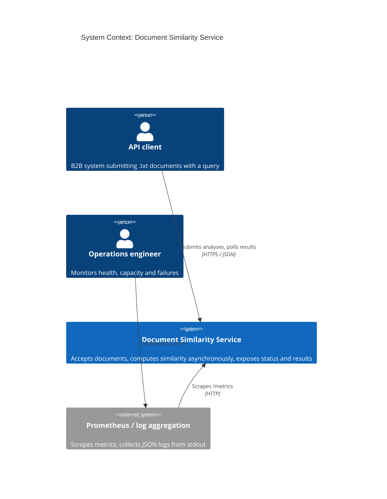
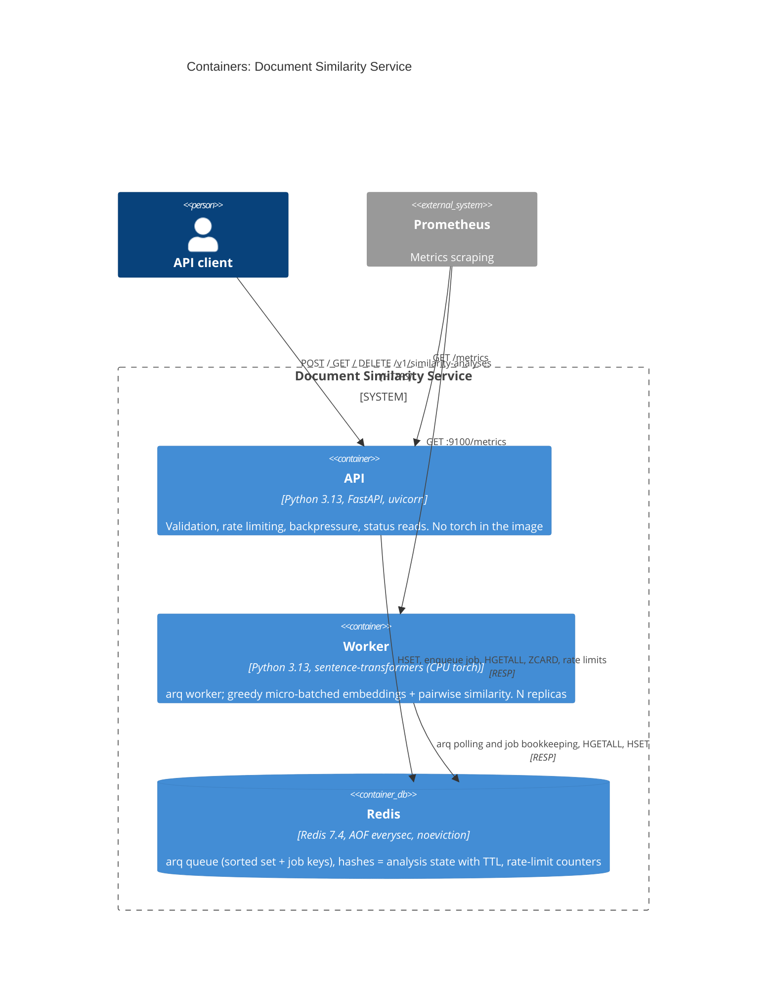
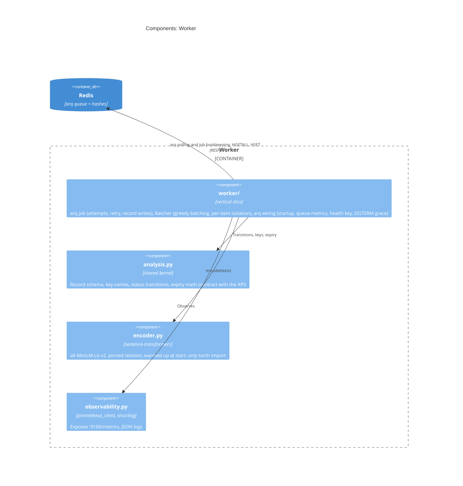
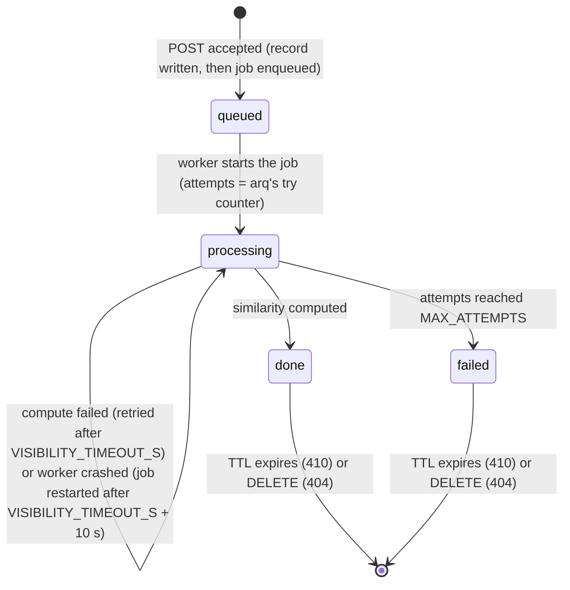

# Document Similarity Service: SPEC

> Status: implemented; see §16 for deviations.
> Companion file: [`BEHAVIOR.md`](BEHAVIOR.md) (business scenarios, mapped 1:1 to tests).
> Every component below has a one-sentence "why". If it can't be justified, it is not in the build.

---

## 1. Problem & goals

Clients submit small `.txt` documents together with a query and want a similarity score (`list[float]`) computed with `sentence-transformers/all-MiniLM-L6-v2`. The embedding step is CPU-bound and much slower than accepting an HTTP request, so traffic bursts must not degrade the API or silently lose work. The goal is a prototype that accepts work quickly, processes it asynchronously with bounded resources, tells clients exactly where their request stands, and makes overload explicit (`429`/`503` + `Retry-After`) instead of turning it into timeouts. Every scalability claim is either measured (benchmark) or listed as an explicit assumption with a formula to recompute it.

**Non-goals (prototype):** authentication, multi-region, semantic quality of the model, documents longer than the model's context window (chunking).

---

## 2. Explicit assumptions

| # | Assumption | Value | Rationale | Measured / Assumed |
|---|---|---|---|---|
| A1 | Unit of work | 1 file + 1 query = 1 analysis | Requirement speaks of many *submissions*; keeps contract and backpressure simple. Multi-file batches → TODO | Assumed |
| A2 | Max upload size | 100 KB (`413` above) | "Small files"; protects API RAM | Assumed |
| A3 | Analysed document length | First 4 096 chars, then model truncation at 256 tokens | `all-MiniLM-L6-v2` has `max_seq_length = 256`; anything beyond is silently ignored by the model. Pre-cut bounds CPU and Redis RAM per job. Client sees `document_truncated: true` only for the 4 096-char pre-cut; the model's 256-token truncation is not reported (§16 item 13) | Model limit: known. 4 096-char margin: assumed |
| A4 | Encoding | UTF-8 only (`422` otherwise), `.txt` extension (`415` otherwise) | Decoding is the real validation; headers can lie | Assumed |
| A5 | Query | 1–1 000 chars after trimming | Prevents "document disguised as query" | Assumed |
| A6 | Traffic | 500 000 req/day → 5.8 req/s average | From task description | Given |
| A7 | Peak factor | 10× average → 58 req/s, 116 embeddings/s | No traffic data available | **Assumed** |
| A8 | Hardware | CPU only, no GPU | Simplest deployable target | Assumed |
| A9 | Worker throughput `T` | embeddings/s per replica at a fixed CPU limit | Single number all capacity math depends on | **Measured** (`benchmark.py`), on the local machine only, must be re-run on the target SKU |
| A10 | SLA | p95 accept < 100 ms; p95 time-to-result < 5 s at nominal load | Separates "accepted" from "computed" promises | Assumed |
| A11 | Result format | `list[float]` of length 1 (e.g. `[0.87]`) | The provided snippet returns `[[0.87]]` (1×1 matrix); flattened deliberately | Known |
| A12 | Client identity | `X-Client-Id` header, no real auth | Needed for per-client rate limiting. **Spoofable**, see §14 | Assumed |
| A13 | Retention | 24 h from creation, then `410 Gone` | Bounded RAM; results are cheap to recompute | Assumed |
| A14 | Delivery semantics | At-least-once | Embedding is a pure, deterministic function, so a duplicate computation gives the same score; the duplicate's write is unconditional and can overwrite or recreate the record (§16 item 14) | Known |
| A15 | Analysis record size | ~300 B in Redis | To be verified with `MEMORY USAGE` | Assumed |
| A16 | Language | English | Model is trained primarily on English | Assumed |

---

## 3. Architecture

### 3.1 C4: System context



### 3.2 C4: Containers



### 3.3 C4: Worker components



> Mermaid's C4 syntax is marked experimental. Verify rendering on GitHub before submission; if it breaks, keep the same content as `flowchart` diagrams.

### 3.4 Request flow

```mermaid
sequenceDiagram
  autonumber
  participant C as Client
  participant A as API
  participant R as Redis
  participant W as Worker
  C->>A: POST /v1/similarity-analyses (file, query, X-Client-Id)
  A->>A: receive + parse the whole multipart body (FastAPI, before the handler)
  A->>R: rate limit check (limits)
  alt over client limit
    A-->>C: 429 + Retry-After (jittered)
  end
  A->>A: validate (.txt, size, UTF-8, query) and pre-cut to 4096 chars
  A->>R: ZCARD (queue depth)
  alt depth >= MAX_QUEUE_DEPTH
    A-->>C: 503 + Retry-After (jittered)
  end
  A->>R: HSET analysis:{id} status=queued, EXPIREAT
  A->>R: enqueue job (arq, job id = analysis id)
  A-->>C: 202 + Location + Retry-After + expires_at
  W->>R: arq polls and starts jobs (up to 2 x BATCH_MAX_SIZE in flight)
  W->>R: HSET status=processing, attempts = job try
  W->>W: Batcher collects up to BATCH_MAX_SIZE jobs, encodes them in one call (thread), pairwise similarity
  W->>R: HSET status=done, result (+ EXPIREAT); arq removes the job
  C->>A: GET /v1/similarity-analyses/{id}
  A->>R: HGETALL analysis:{id}
  A-->>C: 200 {status: done, result: [0.87]}
```

**Step by step:**
1. FastAPI receives and parses the whole multipart body before the handler runs; the handler then checks the per-client rate limit, so a `429` is returned only after the upload has been received (§16 item 11).
2. It validates the file (extension, size via a capped read of the received upload -- there is no `Content-Length` check, strict UTF-8 decode, non-empty) and the query, then pre-cuts the document to `MAX_DOC_CHARS`.
3. It checks queue depth (`ZCARD` of the arq queue). Above `MAX_QUEUE_DEPTH` it returns `503`; the limit is soft (check-then-add is not atomic, see §11).
4. It writes the analysis record, then enqueues the job (arq `enqueue_job`, job id = analysis id, JSON payload `analysis_id, document, query`). Two commands, not one transaction: the record goes first, so a worker never sees a job without a record; if enqueueing fails the record is deleted (§16 item 22).
5. arq starts the job and the worker records `attempts` = arq's try counter **before** computing; the `Batcher` groups waiting jobs (up to `BATCH_MAX_SIZE`), embeds queries and documents in one call, computes similarity pairwise, and the job writes the result; arq then removes the job.
6. The client polls `GET` guided by `Retry-After`; terminal states carry `result` or `error`.

### 3.5 Code structure: vertical slices, flat, functional

```
src/similarity/
├── submit/           # POST slice, split into a package once submit.py passed ~300 lines:
│   ├── validation.py #   pure: filename/UTF-8/query checks, pre-cut
│   ├── outcomes.py    #   sum type Accepted|RateLimited|QueueFull|Invalid -> HTTP response
│   ├── enqueue.py      #   I/O: rate limit, queue depth, record write + arq enqueue
│   └── router.py       #   FastAPI route
├── results.py        # GET + DELETE slice: route, 404 / 410 / 409 decisions, reads and deletes
├── worker/            # worker slice, a package on top of the arq library:
│   ├── jobs.py         #   the arq job `analyze`: attempts, retry, record writes
│   ├── batcher.py       #   greedy micro-batching in front of the encoder
│   ├── app.py           #   arq wiring: startup/shutdown, queue metrics, Worker kwargs
│   └── entrypoint.py    #   `ArqSettings` that `arq` loads (real encoder, env settings)
├── encoder.py        # Encoder Protocol + sentence-transformers implementation (the only torch import)
├── analysis.py       # shared kernel: record schema, Redis key names, statuses + transition(),
│                     # UUIDv7 / expiry math
├── capacity.py       # pure capacity formula (benchmark + tests)
├── api_paths.py       # single source of truth for /v1/... path construction
├── dependencies.py   # FastAPI Depends() getters (Annotated aliases), so slices take
│                     # dependencies as typed function arguments rather than reading app.state
├── observability.py  # metrics registry, structlog setup
├── api.py            # FastAPI app factory: slice routers, /health, /ready, /metrics, Problem Details
└── config.py         # pydantic-settings
scripts/
├── benchmark.py
└── benchmark.sh
tests/
├── test_submit_validation.py  test_submit_enqueue.py  test_results.py
├── test_worker_batcher.py  test_worker_jobs.py  test_analysis.py  test_capacity.py
├── test_config.py  test_api_no_torch.py
└── behavior/        # scenarios from BEHAVIOR.md, run against the real model (see §16 item 9)
```

**Rules:**
- **One slice = one file** with everything the feature needs: route or loop, pure decision functions, Redis calls. Understanding or changing a feature means opening one file (or, once a slice outgrows ~300 lines, one small package — see below).
- **Inside a file:** pure functions first (data in, data or sum type out), the I/O handler last. Functional core / imperative shell is applied per file, not as a layer.
- **Slices never import each other.** Shared code is limited to the cross-process contract (`analysis.py`: key names, record schema, transitions, expiry), `config.py`, `api_paths.py`, `dependencies.py`, `observability.py` and `encoder.py`.
- **A file becomes a package** (e.g. `submit/`, `worker/`) only when it outgrows ~300 lines, not before. Both did during implementation; test files were split the same way so each test module mirrors one source module.
- Dependencies are passed as function arguments; clock and RNG are injected, so jitter and `404`/`410` logic are deterministic in tests. No DI container, no service classes. In practice the clock is injected via FastAPI's `Depends()` (`ClockDep`, overridden in tests); the jitter RNG is a plain constructor argument threaded through from the route handler, not a `Depends()` — see §16 item 8.
- Outcomes are sum types matched with `match`, e.g. `Accepted | RateLimited | QueueFull | Invalid`. Business errors are values; exceptions are for infrastructure failures.
- State transitions are a pure function `transition(status, event) -> Status | IllegalTransition` in `analysis.py`.
- No monad libraries (e.g. `returns`): plain sum types give the same clarity without the learning curve.
- **Only `encoder.py` imports torch.** A unit test asserts that importing `similarity.api` does not load `torch`, so the lightweight API image cannot regress silently.

---

## 4. API contract

Base path: `/v1/similarity-analyses`. Errors returned by the API's own handlers use **RFC 9457 Problem Details** (`application/problem+json`) with an extra `code` field; `404`/`410` (JSON `null` body), FastAPI's default `422` for a missing form field or malformed UUID, uvicorn's concurrency-limit `503` (`text/plain`) and Redis failures (`500 text/plain`) do not (§16 item 12). OpenAPI is generated by FastAPI at `/docs`.

### 4.1 `POST /v1/similarity-analyses`

`multipart/form-data`: `file` (`.txt`), `query` (string). Header: `X-Client-Id` (`[A-Za-z0-9_-]{1,64}`, required).

| Status | When | Headers / body |
|---|---|---|
| `202 Accepted` | Analysis queued | `Location`, `Retry-After: 1`, body below |
| `413` | File > `MAX_FILE_SIZE_BYTES` | `code: PAYLOAD_TOO_LARGE` |
| `415` | Not a `.txt` file | `code: UNSUPPORTED_MEDIA_TYPE` |
| `422` | Not UTF-8, empty file, invalid query, missing/invalid `X-Client-Id` | `code: VALIDATION_ERROR` |
| `429` | This client exceeded its rate limit | `Retry-After` (jittered), `code: RATE_LIMITED` |
| `503` | Queue at capacity | `Retry-After` (jittered), `code: OVERLOADED` |
| `503` | Concurrency limit hit (uvicorn, before the app) | `text/plain` `Service Unavailable`, no `Retry-After` |

```json
{
  "id": "0192f3a1-7c4e-7b2a-9f10-3c5d2e8a1b44",
  "status": "queued",
  "created_at": "2026-10-16T08:00:00Z",
  "expires_at": "2026-10-17T08:00:00Z",
  "links": {"self": "/v1/similarity-analyses/0192f3a1-7c4e-7b2a-9f10-3c5d2e8a1b44"}
}
```

### 4.2 `GET /v1/similarity-analyses/{id}`

Requires the same `X-Client-Id` that created the analysis. A mismatch returns `404` (existence is not leaked).

| Status | When |
|---|---|
| `200` + `status: queued \| processing` | In progress; `Retry-After: POLL_INTERVAL_HINT_S` |
| `200` + `status: done` | `result: [float]`, `document_truncated: bool` |
| `200` + `status: failed` | `error: {code, message, attempts}` (failure is a resource state, not an HTTP error) |
| `404` | Never existed, belongs to another client, or deleted by the client |
| `410` | Existed but expired. Decided from the UUIDv7 timestamp: key missing and `id_time + RESULT_TTL_S < now` → `410`, otherwise `404`. No tombstones stored |

```json
{
  "id": "0192f3a1-7c4e-7b2a-9f10-3c5d2e8a1b44",
  "status": "done",
  "result": [0.87],
  "document_truncated": false,
  "attempts": 1,
  "created_at": "2026-10-16T08:00:00Z",
  "updated_at": "2026-10-16T08:00:01Z",
  "expires_at": "2026-10-17T08:00:00Z",
  "links": {"self": "/v1/similarity-analyses/0192f3a1-7c4e-7b2a-9f10-3c5d2e8a1b44"}
}
```

### 4.3 `DELETE /v1/similarity-analyses/{id}`

| Status | When |
|---|---|
| `204` | `done` or `failed` analysis deleted |
| `404` | Not found (or not this client's) |
| `409` | Still `queued` / `processing` (cancellation is out of scope) |

### 4.4 Operational endpoints

| Endpoint | Purpose |
|---|---|
| `GET /health` | API liveness: process responds. **No dependency checks** |
| `GET /ready` | API readiness: Redis `PING` |
| `GET /metrics` | API Prometheus metrics |
| `worker :9100/metrics` | Worker Prometheus metrics |

### 4.5 Examples

```bash
# Submit
curl -i -X POST http://localhost:8000/v1/similarity-analyses \
  -H "X-Client-Id: client-a" \
  -F "file=@samples/fox.txt" \
  -F "query=fox over dog"

# Poll
curl -s http://localhost:8000/v1/similarity-analyses/<id> -H "X-Client-Id: client-a"

# Delete
curl -i -X DELETE http://localhost:8000/v1/similarity-analyses/<id> -H "X-Client-Id: client-a"
```

---

## 5. Job lifecycle



| Mechanism | Rule | Why |
|---|---|---|
| Attempt counting | arq increments a per-job try counter each time it **starts** the job, including a start that ends in a crash; `analyze` writes it as `attempts` before computing | A worker killed mid-batch (e.g. OOM killer) never reaches an `except` block. Counting at start guarantees a "job that kills workers" stops after `MAX_ATTEMPTS` |
| Attempt overflow | arq `max_tries = MAX_ATTEMPTS + 1`; a job started with `attempts > MAX_ATTEMPTS` → `analyze` marks it `failed` without computing | Poison circuit breaker. The extra try exists so `analyze`, not arq, ends the job: arq would drop it and leave the record `processing` |
| Batch failure | Exception on the whole batch → the `Batcher` re-runs pairs one by one; a pair that still fails raises in its job, which raises arq `Retry(defer=VISIBILITY_TIMEOUT_S)`, or marks it `failed` on the last attempt | One bad document must not fail 31 good ones. Covers exceptions only: a worker crash counts an attempt for every job the worker held, and they restart together (§16 item 14) |
| Redelivery | arq keeps the job in its queue until it finishes; its in-progress marker expires `VISIBILITY_TIMEOUT_S` + 10 s after the start (arq's `job_timeout` + 10 s), after which any worker may start it again | Crashed items return to the pool |
| Job timeout | A job running longer than `VISIBILITY_TIMEOUT_S` (including the wait for its batch) is cancelled by arq, logged as failed and not retried | Bounds a stuck job; the record stays `processing` until its TTL (§16 item 22) |
| Duplicate work | Possible if a worker stalls past the in-progress marker's expiry | Same score (deterministic), wastes CPU, and the slower worker's write is unconditional, so it can overwrite `attempts` or recreate a deleted record (§16 item 14) |
| Expiry invariant | Every record write is one transaction of `HSET` + `EXPIREAT = id_time + RESULT_TTL_S`; `EXPIREAT` with a time in the past deletes the key | A record that expired in the meantime is not left behind without a TTL |
| Missing record | `analyze` returns without writing when the record no longer exists at job start | Checked once, before computing; a record deleted while its job runs is written again (§16 item 14) |
| Client-facing error | `{code: PROCESSING_FAILED, message, attempts}` | Stack traces only in logs, correlated by `analysis_id` (`batch_id` not implemented, §16 item 6) |

Worker-side exponential backoff is **not** implemented: the function is deterministic, so waiting longer does not fix a content-related failure (see TODO).

---

## 6. Load handling

### 6.1 Protection layers (cheapest first)

| Order | Layer | Protects against | Response | Cost |
|---|---|---|---|---|
| 0 | uvicorn `--limit-concurrency` | API flooding | `503` (`text/plain`, no `Retry-After`) | None in the app; counts `/health` too |
| 1 | Per-client rate limit (`limits` library, Redis storage, fixed window), first check in the handler | One client consuming all capacity | `429` + `Retry-After` | Whole body already received and parsed (§16 item 11), plus 1 Redis round-trip |
| 2 | Input validation incl. capped read (limit + 1 byte) of the parsed upload | API OOM from huge uploads | `413` / `415` / `422` | Whole body already received; no `Content-Length` check (§16 item 11) |
| 3 | Queue depth limit (`ZCARD` of the arq queue `>= MAX_QUEUE_DEPTH`) | Broker growth and broken SLA | `503` + `Retry-After` | 1 Redis round-trip |

`Retry-After = base + uniform(0, base)` seconds, so clients rejected in the same second do not come back in the same second (thundering herd). The README recommends clients use exponential backoff with full jitter.

### 6.2 Greedy micro-batching

- arq runs one job per analysis (up to `2 × BATCH_MAX_SIZE` at once, so the next batch collects while the current one encodes). Each job hands its (query, document) pair to the worker's `Batcher`, which takes whatever is waiting, up to `BATCH_MAX_SIZE`.
- If the batch is not full, the `Batcher` waits once for `BATCH_LINGER_MS` (default 10 ms) and takes what arrived meanwhile; a full batch is flushed at once. There is no fill-and-wait timer beyond that single linger.
- Low traffic: batch size ≈ 1 and a lone analysis waits for arq's poll (`POLL_DELAY_S`) plus the linger. High traffic: batches fill, throughput like full batching.
- The batch is encoded in a worker thread (`asyncio.to_thread`), so arq's polling and health check keep running during inference.
- Queries and documents are encoded in one interleaved call (`sentence-transformers` sorts by length internally; at batch sizes up to 16 short queries are padded to document length; measured in the README's capacity section).
- Similarity is computed **pairwise** (query *i* with document *i*), not as an N×N matrix: `similarity_pairwise` if available in the installed version, otherwise the diagonal of `similarity()`.
- Each job writes its own record (one transaction of `HSET` + `EXPIREAT`).

### 6.3 Redis pitfalls handled

| Pitfall | Consequence | Handling |
|---|---|---|
| Finished jobs stay in the queue | Queue depth grows forever: false "queue full" and unbounded RAM | arq removes a job's queue entry and keys when it finishes (`keep_result=0`: no result copy is kept), so `ZCARD` = queued + retrying + running jobs |
| A queue length cap trims old entries | Silently trims the oldest **accepted** jobs | Not used. Limit enforced in the API before enqueueing |
| `maxmemory-policy volatile-lru` (common managed default) | Evicts keys with TTL, i.e. our analyses | `noeviction` is set, but `maxmemory` is not, so the policy never triggers: Redis grows until the host's OOM killer stops it; with a limit, OOM errors would surface as `500`, not `503` (§16 item 15) |
| Torch thread oversubscription | Torch sees host cores, not the container CPU limit; throughput drops under cgroup throttling | Compose sets `OMP_NUM_THREADS=2` (= its CPU limit), which torch reads at start-up; `TORCH_NUM_THREADS` is not applied by the worker (§16 item 16) |
| Unpickling data read from Redis | Anyone who can write to Redis could run code in a worker | Jobs are serialised as JSON (`serialize_job`), not arq's default pickle |

### 6.4 Overload behaviour summary

Overload from rate limit, input size and queue depth ends in an explicit response (`429` / `413` / `503`; `Retry-After` on `429` and queue-full `503`), after the upload has been received; an accepted job is never trimmed by the queue limit. Redis failures are not covered: Redis down → `500`, Redis stalled → requests hang (§16 item 15). `429` means "you are sending too much"; `503` means "we are full".

---

## 7. Capacity model

### 7.1 Formula

| Step | Formula | Example (500k/day) | Source |
|---|---|---|---|
| Average | `RPD / 86 400` | 5.8 analyses/s | Given |
| Peak | `× PEAK_FACTOR` | × 10 = 58 analyses/s | Assumed (A7) |
| Embeddings at peak | `× 2 × (1 − H/2)`, `H` = query cache hit rate | `H = 0` → 116 emb/s | Given; cache is TODO |
| Replica throughput | `T` emb/s | — | **Measured** |
| Worker replicas | `ceil(peak_emb_s / (T × 0.7)) + 1` | depends on `T` | Formula |
| Queue limit | `active_replicas × (T / 2) × MAX_ACCEPTABLE_WAIT_S` | depends on `T` | Formula |
| Redis RAM | `300 B × RPD × TTL_days + MAX_QUEUE_DEPTH × ~4.2 KB` | ~150 MB + ~4 MB | Assumed (A15) |

**Why 0.7 utilisation:** waiting time grows roughly like `u / (1 − u)`: about 2.3× service time at 70%, 9× at 90%, 99× at 99%. **+1 replica** tolerates the loss of one.

**Why the cost per job is bounded:** the API pre-cuts documents to 4 096 chars and the model truncates at 256 tokens, so CPU per job has a hard ceiling regardless of file size. That is what makes capacity computable instead of guessed.

### 7.2 Worked example (illustrative only)

With `T = 49 emb/s` per replica, measured inside the worker image (Linux arm64, `--cpus 2`, measured on an Apple M3 Pro under Colima; §16 item 20), maximum acceptable wait 5 s (assumed):

| Requests/day | Peak emb/s | Replicas (`ceil(x / 34.3) + 1`) | Queue limit |
|---|---|---|---|
| 100 000 | 23 | 2 | 245 |
| 500 000 | 116 | 5 | 613 |
| 1 000 000 | 231 | 8 | 980 |
| 5 000 000 | 1 157 | 35 | 4 288 |

A native macOS run (`T` ≈ 768 emb/s) gives 2 / 2 / 2 / 4 replicas and is not representative of a Linux deployment. With the defaults (2 replicas, `MAX_QUEUE_DEPTH = 1000`), a full queue is `1000 / (2 × 49/2) ≈ 20 s` of waiting against the 5 s target.

### 7.3 Measured vs assumed

| Quantity | Status | How |
|---|---|---|
| `T` for batch 1 / 8 / 16 / 32 / 64 | Measured | `scripts/benchmark.sh` → `benchmark.py` inside the worker container with the same CPU limit: best `T` = 49 emb/s (measured on Apple M3 Pro under Colima). The first sizing used a native macOS run instead (§16 item 20) |
| p50 / p95 batch latency | Measured | Same script; sets `BATCH_MAX_SIZE` and `VISIBILITY_TIMEOUT_S` |
| Query (~5 tokens) vs document (256 tokens) cost | Measured | Two input sets |
| Peak factor, length distribution, record size | Assumed | See §2 |

`benchmark.py` prints the replica table for 100k / 500k / 1M / 5M requests/day from the measured `T`. **Results are local; repeat on the hardware you will run on before sizing.**

### 7.4 Measurements (Apple M3 Pro, CPython 3.13, 2 torch threads, 10 iterations after 3 warm-up)

Query ~5 tokens, document 4 096 chars; `T = batch × 2 / p50`.

| Batch | Worker image, Linux arm64, `--cpus 2` (Colima): p50 / p95 ms | `T` emb/s | Native macOS arm64: p50 / p95 ms | `T` emb/s |
|---|---|---|---|---|
| 1 | 74.3 / 76.7 | 26.9 | 8.5 / 8.7 | 234.0 |
| 8 | 632.4 / 639.2 | 25.3 | 40.5 / 42.1 | 395.3 |
| 16 | 1 313.3 / 1 334.5 | 24.4 | 77.2 / 78.0 | 414.7 |
| 32 | 1 341.1 / 1 353.6 | 47.7 | 84.3 / 85.8 | 759.6 |
| 64 | 2 613.1 / 2 678.7 | 49.0 | 166.7 / 171.7 | 768.1 |

- Native columns were measured during implementation and reproduced within 6 % (757.1 emb/s at batch 32). The worst p95 batch time in the worker image is 2.7 s (batch 64), below `VISIBILITY_TIMEOUT_S = 30`.
- **Why the two differ by ~15×: not established.** The images are native arm64, so no CPU emulation is involved. One difference is measured: the BLAS backend is Apple Accelerate natively and OpenBLAS in the Linux image (`torch.__config__.show()`). Colima's virtualisation overhead and threading inside a CPU-limited container were not isolated. The worker-image figure is the closer proxy for a Linux deployment, so sizing uses it.
- **Why `T` roughly doubles from batch 16 to 32:** padding. Queries and documents are encoded in one interleaved list; `sentence-transformers` sorts it by length and encodes in internal batches of 32 texts, so up to batch 16 each short query shares an internal batch with documents and is padded to document length. At batch 16, interleaved encoding took 76.7 ms vs 45.6 ms with queries and documents encoded separately (×1.68 natively, ×2.13 in the worker image); at batch 32 there was no difference. The table reflects the interleaved code path as it is today.
- Replica table at `T` = 49.0 (§7.2). With the native `T` = 768.1 the same formula gives 2 / 2 / 2 / 4 replicas and queue limits 3 841 / 3 841 / 3 841 / 7 681. The first three limits are identical because `max_queue_depth` depends only on the replica count and `T` (`replicas × T/2 × wait`, rounded up) and all three rows need 2 replicas; the formula has no floor.
- Defaults: compose runs 2 replicas and `MAX_QUEUE_DEPTH = 1000`; at `T` = 49 a full queue is `1000 / (2 × 49/2) ≈ 20 s` of waiting against the 5 s target (assumed); the formula gives a limit of 245 for 2 replicas.
- Overload measurements (same machine): 300 MB upload → `413` only after all 300 MB was sent; client over its rate limit + 300 MB upload → `429` after 0.93 s, also after the full upload; 3 000 rate-limited POSTs at concurrency 50 → p99 42 ms (`ab`); API container memory 53 MiB after these tests; 1 500 concurrent POSTs (concurrency 300), workers stopped → exactly 1 000 accepted, queue 1 000 (overshoot 0, one API replica; several replicas not measured); about 1 000 queued analyses drained by two workers in 7-8 s including start-up, batches averaging ~30 of 32.
- Failure measurements (same machine): `SIGKILL` of one worker with 300 analyses in flight → the 64 it held restarted on the other worker ~40 s later (`VISIBILITY_TIMEOUT_S` + 10 s), all 300 `done`, 64 with `attempts = 2`; `docker compose stop worker` with 300 in flight → 6.0 s, both exit 0, all `done` with `attempts = 1`; with `SHUTDOWN_GRACE_S = 8` one worker was still shutting down at Docker's 10 s limit and exited 137; Redis killed → `500 text/plain` from `POST`/`GET`, `/ready` 503, one of two workers exited 1 once Redis returned; Redis paused → `POST` hangs > 30 s, `/ready` > 20 s.

---

## 8. Observability

### 8.1 Metrics (each answers one operational question)

| Question | Metric | Type | Where |
|---|---|---|---|
| Are we meeting the SLA (p95 < 5 s)? (creation → result written, so queue wait, batching and inference) | `analysis_end_to_end_seconds` | histogram | worker |
| Are we keeping up? | `queue_depth` | gauge | worker |
| How long has the oldest job been waiting? | `queue_oldest_age_seconds` | gauge | worker |
| How many requests per handler and status class? (`status` grouped as `2xx`/`4xx`/`5xx`, so the rejection reason is not visible; uvicorn's `503`s not counted; §16 item 18) | `http_requests_total{handler, method, status}` | counter | API (instrumentator) |
| Is accepting fast (< 100 ms)? | `http_request_duration_seconds{handler}` | histogram | API (instrumentator) |
| What does a batch cost? Does `VISIBILITY_TIMEOUT_S` have headroom? | `inference_batch_duration_seconds` | histogram | worker |
| Does batching work under load? | `inference_batch_size` | histogram | worker |
| What fraction fails? | `analyses_completed_total{status}` | counter | worker |
| Is something failing repeatedly? | `analysis_retries_total` | counter | worker |
| How many analyses had their document pre-cut by the API? (the model's 256-token truncation is not counted; §16 item 13) | `documents_truncated_total` | counter | worker |

- **`queue_oldest_age_seconds` is the primary alert signal**: depth says *how much*, age says *how long the oldest unfinished job has waited*. It is free: arq's queue is a sorted set scored by the time a job becomes runnable (its enqueue time in ms), so `ZRANGE 0 0 WITHSCORES` returns the oldest job. Jobs stay in the set while they run, so a job stuck on a dead worker keeps the age growing; a job deferred for a retry has a future score and counts as age 0. The worker refreshes both queue gauges once a second.
- **`client_id` is never a metric label** (unbounded cardinality would bloat Prometheus RAM). It is not logged either (§16 item 19).

### 8.2 Logs

Application events: JSON, one line per event, stdout (`structlog`). Fields emitted: `ts`, `level`, `event`, `analysis_id`, `attempts`, `batch_size`, `reason`; `service`, `batch_id`, `client_id`, `duration_ms` and `error_type` are not emitted (§16 items 6 and 19). uvicorn's access log, the `sentence-transformers` progress bar and model-loading messages are plain text on the same stdout. **Never** document text or query; their length and SHA-256 are not logged either.

Key events: `analysis.accepted`, `analysis.rejected{reason}`, `batch.processed`, `analysis.completed`, `analysis.compute_failed` / `batch.encode_failed` (with stack trace), `analysis.failed` (no stack trace), `worker.model_loaded` (no cold-start duration, §16 item 7).

### 8.3 Health

| Container | Startup | Liveness | Readiness |
|---|---|---|---|
| API | — | `/health` (no dependencies) | `/ready` (Redis `PING`) |
| Worker | arq's health-check key appears once the worker is polling (after model load + warm-up encode); the image's `HEALTHCHECK` has `--start-period=60s` | `arq --check` (image `HEALTHCHECK`): fails once the key, refreshed every 15 s from the polling loop, has expired | None: the worker pulls work, nobody routes traffic to it |

Liveness never checks Redis: a Redis blip would otherwise restart every API replica at once (restart storm) without fixing Redis. The worker's key is refreshed by arq's polling loop, including when the queue is empty, so an idle worker never looks dead; it shows that the loop is alive and Redis reachable, not that a job is progressing. `/health` is counted by `--limit-concurrency`, so under a flood it can return `503` like any other request.

---

## 9. Retention

| Data | Where | Lifetime |
|---|---|---|
| Document text (pre-cut) and query | arq job payload only (`arq:job:{id}`, JSON) | Until the job finishes (arq deletes the key; `keep_result=0`) |
| Status, result, error, attempts, timestamps, owner `client_id` | Hash `analysis:{id}` | 24 h from creation (`EXPIREAT` derived from the UUIDv7 timestamp) |
| Logs | stdout → log platform | Platform policy; no content or query |

- TTL counts from creation, so `expires_at` is known in the `202` response.
- After TTL: `410` (from ID age, no tombstones). After client `DELETE`: `404` (a worker still holding the analysis can write it back, §16 item 14).
- `maxmemory-policy noeviction` is set but `maxmemory` is not, so nothing is evicted and nothing limits memory: Redis grows until the host's OOM killer stops it (§16 item 15); AOF `everysec` limits loss on restart to ~1 s (prototype simplification, see ADR-001).

---

## 10. Configuration

Environment variables only, validated at start-up with `pydantic-settings` (bad or inconsistent config → container fails to start). Same image on every environment. `.env.example` documents all values.

**Build-time (Dockerfile `ARG`, not runtime):** `MODEL_NAME=sentence-transformers/all-MiniLM-L6-v2`, `MODEL_REVISION=<pinned commit hash>`. Runtime sets `HF_HUB_OFFLINE=1`, so changing the model means a new image.

### Shared

| Variable | Default | Purpose |
|---|---|---|
| `REDIS_URL` | `redis://redis:6379/0` | Queue + state |
| `LOG_LEVEL` | `INFO` | |
| `RESULT_TTL_S` | `86400` | Retention |
| `QUEUE_NAME` | `arq:queue` | arq queue (a Redis sorted set) |

### API

| Variable | Default | Purpose | Value source |
|---|---|---|---|
| `MAX_FILE_SIZE_BYTES` | `102400` | `413` | Assumed |
| `MAX_DOC_CHARS` | `4096` | Pre-cut before enqueue | Assumed |
| `MAX_QUERY_LENGTH` | `1000` | `422`; **defined, not wired** -- validation hard-codes 1 000 (§16 item 16) | Assumed |
| `RATE_LIMIT` | `20/second` | Per-client limit (`limits` syntax) | Assumed |
| `RATE_LIMIT_STRATEGY` | `fixed-window` | `limits` strategy | — |
| `MAX_QUEUE_DEPTH` | `1000` | `503` threshold | **From benchmark** (§7) |
| `RETRY_AFTER_BASE_S` | `5` | `Retry-After` for `429`/`503` = base + jitter | Assumed |
| `POLL_INTERVAL_HINT_S` | `1` | `Retry-After` on in-progress `GET` | Assumed |
| `API_CONCURRENCY_LIMIT` | `200` | uvicorn `--limit-concurrency` | Assumed |

### Worker

| Variable | Default | Purpose | Value source |
|---|---|---|---|
| `BATCH_MAX_SIZE` | `32` | Greedy micro-batch cap | **From benchmark** |
| `BATCH_LINGER_MS` | `10` | How long a non-full batch waits once for more jobs | Assumed |
| `POLL_DELAY_S` | `0.1` | How often arq looks for new jobs | Assumed |
| `VISIBILITY_TIMEOUT_S` | `30` | arq job timeout (> p95 batch time) and the delay before a failed attempt is retried; a job whose worker died restarts after this + 10 s | **From benchmark** |
| `SHUTDOWN_GRACE_S` | `5` | How long arq waits for in-flight jobs on `SIGTERM` (arq 0.25 waits it in full); keep below the orchestrator's stop timeout minus the longest batch | Assumed |
| `MAX_ATTEMPTS` | `3` | Retry cap | Assumed |
| `TORCH_NUM_THREADS` | `2` | **Defined, not wired** in the worker; only `benchmark.py` applies it (§16 item 16) | — |
| `OMP_NUM_THREADS` | not a setting; `2` in compose | Torch's thread count in the worker; = container CPU limit | **From deployment** |
| `METRICS_PORT` | `9100` | Worker `/metrics` | — |

**Start-up invariants:** `MAX_DOC_CHARS <= MAX_FILE_SIZE_BYTES`; `MAX_ATTEMPTS >= 1`.

---

## 11. Key trade-offs

| Decision | Choice | Alternative | Why |
|---|---|---|---|
| Result delivery | `202` + polling (Asynchronous Request-Reply) | Sync; webhook | Sync ties HTTP connections to CPU work and turns overload into timeouts; webhooks need retries, signing and SSRF protection. Webhook and long-poll → TODO |
| API style | REST, domain resource `similarity-analyses`, Richardson level 2 + `links.self` | `/jobs`; full HATEOAS; `303` to a result sub-resource | Domain name hides the queue as an implementation detail. A separate resource for an 8-byte result is an extra round-trip for nothing |
| Process split | API (no torch) + worker | Thread pool; process pool in one container | A stuck worker cannot freeze health checks; each part scales on its own bottleneck |
| Backing service | Redis for queue, state, rate limits | Service Bus (+ emulator); Postgres `SKIP LOCKED`; RabbitMQ | See **ADR-001** |
| Queue library | `arq` (async, Redis-only), pinned to 0.25.0 (§16 item 22) | Own Streams consumer (an earlier version, ~580 lines in `worker/`); Celery; RQ; Dramatiq | arq provides redelivery after a crash, retries, a try counter, graceful shutdown and a health-check key, so none of that is hand-written. Celery is heavy and prefork-oriented (one torch model per process); RQ forks per job; Dramatiq has no async. Costs: no batching in arq (our `Batcher`, ~100 lines), polling latency, newer releases need `redis<6`, record and job written in two steps |
| Batching | Greedy `Batcher` in the worker: takes the jobs waiting, ≤ `BATCH_MAX_SIZE`, lingers once for `BATCH_LINGER_MS` if not full | None; long fill-and-wait | Batch 32 gave ~2× the throughput of batch 1 in the worker image (47.7 vs 26.9 emb/s, measured); the linger costs a lone analysis ~10 ms |
| Retry | arq `Retry` after a fixed `VISIBILITY_TIMEOUT_S`, 3 attempts | Exponential backoff in worker | Deterministic function: waiting longer fixes nothing. Jitter is applied where the herd forms: client `Retry-After` |
| Rate limiting | `limits` library, fixed window | Hand-written; token bucket (Lua) | Ready tool; up to 2× burst at window edges is acceptable for a PoC |
| Queue limit | Soft (`ZCARD` then enqueue) | Atomic Lua check-and-add | Overshoot ≤ number of concurrent POSTs; acceptable |
| Retention | TTL from creation, `410` from UUIDv7 | Tombstones; TTL from completion | Zero extra storage; `expires_at` known up front |
| Model delivery | Baked into image, pinned revision | Download at start; mount from storage | No runtime dependency on Hugging Face during scale-out; reproducible |
| Observability | Prometheus + JSON logs + `analysis_id` correlation | OpenTelemetry + collector | Same diagnostic value at a fraction of the setup; OTel → TODO |
| Tests | Fake encoder (unit tests of the `Batcher` and the job) + real Redis (testcontainers) | Mock Redis (fakeredis); real model in tests | Correctness relies on real Redis semantics; the model is measured separately |
| Code organisation | Vertical slices, flat (one file per feature) + small shared kernel | Layers (`domain/`, `application/`, `adapters/`) | Code is organised around change: a feature lives in one file. Accepted cost: some repetition between slices; the only shared module is the API ↔ worker contract |
| Paradigm | Pure functions + I/O handler at the end of each file | Service classes + DI container | Decisions are testable without infrastructure; side effects stay at the edge of each slice |

### ADR-001: Redis as the single backing service for the prototype

- **Decision:** queue (arq's sorted set and job keys), analysis state (hashes with TTL) and rate-limit counters on one Redis. Production moves the queue to Azure Service Bus.
- **Context:** 2–4 h prototype that must start with one command and be easy to reason about.
- **Why:**
  1. One component instead of three: queue, state, TTL and rate limiting in one process; `docker compose up` starts in seconds with a small RAM footprint.
  2. One Redis for record and job: both are written to the same server, record first, so a worker never sees a job without a record; if enqueueing fails the record is deleted. The single `MULTI` of an earlier version is gone (§16 item 22): a Redis crash between the two writes leaves a `queued` record without a job, which expires with its TTL.
  3. Fast, light tests: testcontainers with only Redis.
- **Rejected for the PoC: Service Bus emulator.** It needs a SQL Server sidecar (message state stored in SQL Server, no in-memory mode), does not persist data across container restarts, and testcontainers ships a ready-made Service Bus module for Java, Go and .NET but not Python.
- **Accepted costs:** broker semantics that Service Bus provides natively are partly provided by arq (redelivery, try counter) and partly absent (no dead-letter queue); local tests run against a different broker than production (dev/prod parity gap). Single-node Redis is a single point of failure; AOF `everysec` is a PoC-level durability measure.
- **Mitigations:** the broker is touched in `submit/enqueue.py` (`enqueue_job`, `ZCARD`), `worker/app.py` (arq `Worker` settings, queue metrics) and `worker/jobs.py` (`Retry`, the try counter). Switching to Service Bus would replace the enqueue path and the arq wiring; the job function, the `Batcher`, the results slice and the record schema stay. Not validated by CI (§16 item 21). TODO: run the same BDD suite against a Service Bus adapter with the emulator in CI.
- **Revisit when:** message durability with an SLA is required, an operational DLQ is needed, multiple consumers (pub/sub) appear, or compliance requirements apply.

---

## 12. Production on Azure

| Local component | Azure | What changes |
|---|---|---|
| API container | **Azure Container Apps** (HTTP scaling) | Scale on request rate; same image from **Azure Container Registry** |
| Worker container | **Azure Container Apps** with **KEDA** scale rule on queue length | Scale-to-zero at night; `min/maxReplicas` from §7; KEDA threshold = `T/2 × target wait` |
| arq queue on Redis | **Azure Service Bus** queue | Peek-lock = ack, `DeliveryCount` = attempts, `LockDuration` = visibility timeout, built-in DLQ with `MaxDeliveryCount`, scheduled messages for backoff. Messages up to 256 KB fit Standard tier; larger → Claim-Check with Blob Storage |
| Redis hashes | **Azure Managed Redis** (cheap hot polling reads) or **Cosmos DB with TTL** (durability) | Set eviction policy explicitly (`noeviction`); polling makes Cosmos RU cost grow |
| Rate limiting, client identity | **Azure API Management** (`rate-limit-by-key`, `quota-by-key`, subscription keys / Entra ID) | Rejected traffic never reaches the containers; real auth replaces `X-Client-Id` |
| Secrets | **Key Vault** references in Container Apps; later **Managed Identity** to Redis | No secrets in env files or repo |
| `/metrics` | **Azure Monitor managed Prometheus** + Managed Grafana | |
| JSON logs on stdout | **Log Analytics** (collected by Container Apps automatically) | |
| Probes | Container Apps startup / liveness / readiness probes, termination grace period | Same semantics as §8.3 |

The API contract (`202` + polling) does not change; only what sits behind it does.

**At 10× traffic** (5 000 000 requests/day in the replica table, §7.2): worker replicas go from 5 to 35 by the formula at `T` = 49 (worker-image measurement on a laptop; a target SKU must be measured), the soft queue limit's overshoot risk grows with concurrent request volume (making the atomic Lua check more valuable), and the per-client fixed window's 2× burst tolerance matters more in absolute request counts, though it is the same relative bound.

---

## 13. Testing strategy

| Layer | What | How | Budget |
|---|---|---|---|
| Unit (pure) | Validation; `404` vs `410` from UUIDv7; `Retry-After` bounds; state transitions; attempt overflow → `failed`; pairwise result shape (`list[float]`, not `[[...]]`); capacity formula; config invariants | Plain pytest on the pure functions of each slice and `analysis.py`; injected clock and RNG; "API import does not load torch" check | ~20 min |
| Behaviour (BDD) | Business scenarios in `BEHAVIOR.md`, mapped 1:1 to `test_given_..._when_..._then_...` | FastAPI `TestClient` + a real arq `Worker` in burst mode (runs until the queue is empty, including jobs deferred for a retry) driven in-process + **real Redis via testcontainers** (session-scoped container, `FLUSHDB` between tests) + **the real pinned model**, loaded once per test session. Changed from a fake encoder during implementation (§16 item 9): these are integration tests meant to prove the service itself works, which a fake model can't do. The one scenario about a failure that "can never succeed" simulates an infrastructure-level failure via a wrapper around the real encoder, not a poisoned input. | ~60 s with the real model |
| Model | Throughput and latency, not correctness | `benchmark.py` (§7) | — |
| Smoke | `docker compose up` + `curl` happy path | Manual / README | — |

**Quality gates (pre-commit, run identically in CI):** `ruff` (lint + format; replaces flake8, black, isort, bandit-style `S` rules), `mypy` (strict on the whole package; `ignore_missing_imports` for torch / sentence-transformers, whose boundary is isolated in `encoder.py`), `gitleaks`, `hadolint`, `pre-commit-hooks` (`detect-private-key`, `check-yaml`, EOL). CI additionally runs `pip-audit` and builds both Docker targets. Dependencies locked in `uv.lock`.

**CI (GitHub Actions):** `pre-commit run --all-files` → `pytest` (testcontainers; Docker available on Ubuntu runners) → `pip-audit` → `docker build --target api` and `--target worker`.

**Not tested (deliberately):** semantic quality of the model, `/metrics` content, end-to-end load (TODO). **Not tested today:** responses from a real uvicorn server (the in-process `TestClient` does not surface the `DELETE` error), concurrent writes from two workers to one record, Redis failures.

---

## 14. Out of scope / TODO (highest value first)

1. **Real authentication and client identity** (APIM subscription keys / Entra ID). `X-Client-Id` is trivially spoofable; rotating IDs bypasses per-client limits. Today only the global queue limit protects capacity.
2. **Service Bus adapter + same BDD suite on the emulator in CI** (closes the dev/prod parity gap from ADR-001).
3. **End-to-end load test** (k6 / Locust) ramping until `503` to validate backpressure and SLA.
4. **Query embedding cache** keyed by content hash (parameter `H` in §7); deterministic function makes it safe.
5. **Redis durability / HA** beyond AOF `everysec` (managed HA tier).
6. **Dynamic `MAX_QUEUE_DEPTH`** from replica count; `Retry-After` computed from current depth and throughput.
7. **Token bucket / client tiers and priorities**; atomic queue limit (Lua).
8. **OpenTelemetry** with trace context propagated through the queue; dashboard + alerts (`queue_oldest_age_seconds > 5 s` for 2 min); optional Prometheus + Grafana compose profile.
9. **Webhook delivery** and **long-polling** (`GET ...?wait=10`); `Idempotency-Key` on `POST`.
10. **Worker exponential backoff with jitter**: becomes valuable when embeddings move to an external provider (e.g. Azure OpenAI / Foundry) whose errors are transient (`429`).
11. **ONNX / OpenVINO backend with quantisation**, measured against `T`.
12. **Dead-letter store** for operator inspection of `failed` analyses.
13. **Cancellation** (`queued → cancelled`), tombstone so `GET` after `DELETE` returns `410`, full HATEOAS, `pytest-bdd` if non-developers start writing scenarios.
14. **Multi-file submissions** in one request; chunking for documents beyond the model context.
15. **Per-tier retention**; long-term export (Blob + lifecycle management).
16. **Model outside the image** (Blob / Azure ML registry) for multiple or large models; image scanning (Trivy / Defender for Containers); coverage threshold; Managed Identity to Redis.
17. **`batch_id` correlation and cold-start duration in logs** (§8.2 named both as log fields; neither is implemented -- see §16 item 10). A worker currently logs `analysis_id` per item but nothing ties the items of one batch together, and `worker.model_loaded` carries no timing.
18. **`dev` Docker target with live-reload** for local API development, instead of rebuilding the production-oriented multi-stage image on every change.
19. **Early rejection on `Content-Length`** (and the rate limit) in ASGI middleware, before the multipart body is parsed (§16 item 11).
20. **Redis failure handling:** `socket_timeout`, `RedisError` → `503` + `Retry-After`, worker reconnect loop and a restart policy; set `maxmemory` and map OOM errors to `503` (§16 item 15).
21. **Record integrity:** conditional record writes in Lua (only if the record exists and is `processing`); isolate items after a worker crash (§16 item 14).
22. **Token-count-based truncation flag** in the worker (§16 item 13); **encode queries and documents separately** to avoid padding queries to document length.
23. **Consistent error format** (Problem Details for `404`/`410`, validation errors and `500`; `Retry-After` on the concurrency-limit `503`); empty `204` for `DELETE`; reject non-v7 UUIDs and whitespace-only documents (§16 item 12).
24. **Wire or remove dead config** (`MAX_QUERY_LENGTH`, `TORCH_NUM_THREADS`); liveness path not counted by `--limit-concurrency`; exec-form API `CMD` (§16 items 16-17).
25. **Observability fixes:** ungrouped status labels, uvicorn access log through structlog, `client_id` in logs (§16 items 18-19).
26. **arq job timeout and version:** mark an analysis `failed` (or retry it) when arq cancels its job on timeout; replace or upgrade `arq` (newer releases need `redis<6`) (§16 item 22).
27. **Supply chain and local safety:** digest-pin the Redis image, avoid the duplicated model layer, bind Redis to localhost in compose; benchmark on the target SKU with thread limits applied (§16 item 20).

---

## 15. Implementation plan

Estimates assume implementation with a coding agent **including reading and understanding every diff**. The checkpoint "understand" is mandatory: each decision must be explainable in the interview.

| # | Step | Min | Works after this step | Understand before moving on |
|---|---|---|---|---|
| 0 | Scaffold: `pyproject.toml`, `uv.lock`, pre-commit (ruff, mypy, gitleaks, hadolint), `config.py`, compose with Redis (`noeviction`, AOF) | 20 | `pre-commit run -a` green; Redis up | Why each gate exists; config invariants |
| 1 | Shared kernel `analysis.py` + `capacity.py` + unit tests: record schema, key names, transitions, UUIDv7 expiry math, capacity formula | 20 | Unit tests green without Docker | Why this is the only shared module; `404` vs `410` |
| 2 | Slice `submit.py` + `api.py`: validation, pre-cut, rate limit (`limits`), size cap, queue limit, `MULTI` enqueue, Problem Details, health/ready, instrumentator | 35 | `curl POST` → `202` | Check order (cheap first); `429` vs `503`; `MULTI` |
| 3 | Slice `results.py`: `GET` / `DELETE`, ownership check, `404` / `410` / `409` | 20 | `GET` → `queued`; `DELETE` rules | Why a foreign ID returns `404` |
| 4 | Slice `worker.py` + `encoder.py`: loop, greedy batching, pairwise similarity, per-item isolation, attempts, reclaim, `XDEL`, heartbeat, warm-up, SIGTERM, metrics | 45 | `compose up` → result `[0.xx]` | Attempts at start; visibility timeout; `XDEL` after `XACK`; pairwise vs N×N |
| 5 | Docker: multi-stage (`api`, `worker`), CPU torch index, baked pinned model, compose with 2 workers and CPU limits | 20 | Both images build; cold start logged | CPU wheel vs CUDA; image size vs scale-out time |
| 6 | BDD tests from `BEHAVIOR.md` (scenarios 1–7) | 25 | All behaviour tests green | Fake encoder via the `Encoder` Protocol; why real Redis |
| 7 | `benchmark.py` + `scripts/benchmark.sh` + replica table | 15 | `T`, p95 batch, recommended config printed | Utilisation 0.7; what is measured vs assumed |
| 8 | CI workflow | 10 | Green pipeline | CI = pre-commit + tests + audit + build |
| 9 | README (from this SPEC): run, architecture, trade-offs, ADR-001, known limitations, "How this was built", TODO | 20 | Reader can run and understand | Every "why" sentence |
| | **Total** | **230** | | |


### README must also contain

- **Known limitations:** spoofable `X-Client-Id` (full auth needed); benchmark numbers are local and must be re-measured on the target machine; dev/prod broker parity gap (ADR-001); single-node Redis.
- **How this was built:** design decisions recorded in this SPEC (with rejected alternatives); implementation done with an AI coding agent against the SPEC.

---

## 16. Implementation notes & deviations

Differences between this SPEC and the implemented code. Only real deviations are listed; places
where the code matches the design are not repeated here.

| # | SPEC said | Implemented | Reason | Impact |
|---|---|---|---|---|
| 1 | Python 3.12 | Python 3.13 everywhere (`pyproject.toml`, Dockerfile, CI) | 3.13 was already available; no reason to target an older runtime | None -- a strict improvement |
| 2 | One file per slice (§3.5) | `submit/` and `worker/` are packages (4-5 files each) | Both slices passed the ~300-line threshold that §3.5 itself sets as the trigger | None -- the rule was followed, not broken |
| 3 | §3.5 file tree lists `dependencies.py`/`api_paths.py` nowhere | Both exist: `dependencies.py` holds the FastAPI `Depends()` getters so slices take typed `Annotated` parameters instead of reading `request.app.state`; `api_paths.py` centralises `/v1/...` path construction | Removes repeated magic strings and manual `app.state` lookups across slices | None -- both are small, single-purpose, and consistent with "shared code limited to the cross-process contract + config + observability + encoder" |
| 4 | Test files: `test_submit.py`, `test_worker.py` (§3.5) | Split into `test_submit_validation.py`/`test_submit_enqueue.py` and `test_worker_batcher.py`/`test_worker_jobs.py` (after the move to arq, item 22; earlier `test_worker_items.py`/`test_worker_batch.py`), plus new `test_config.py`, `test_api_no_torch.py` | Mirrors the source package split (item 2); each test module maps to one source module | None |
| 5 | §6.1 layer 0: `uvicorn --limit-concurrency` protects against API flooding | `API_CONCURRENCY_LIMIT` existed in `config.py`/`.env.example` but nothing read it until the gap was found; now wired into the API Dockerfile's `CMD` via shell-form env interpolation | Oversight during implementation: the setting was added to the config model but never connected to the one place that can apply it | Layer 0 is applied today, only in the Docker image (not by `make run-api`); the shell-form `CMD` makes `sh` PID 1, so `SIGTERM` does not reach uvicorn (item 17) |
| 6 | §8.2 log fields: `batch_id`, `duration_ms`, `error_type` | None of the three exist in any log call. `analysis_id` is logged per item; no identifier correlates items processed in the same batch | Not implemented; no record of why | **Not fixed** -- tracked as TODO §14 item 17. Reduces the ability to correlate "this batch's 32 items" in log search, and to query by duration or failure type without parsing messages |
| 7 | §8.2: `worker.model_loaded` log event carries cold-start duration | The event is logged (`worker/app.py`) but with no timing field; startup never measures how long model load + warm-up took | Not implemented | **Not fixed** -- tracked as TODO §14 item 17. Cold-start time is currently invisible in logs/metrics |
| 8 | §3.5: "clock and RNG are injected" | The clock is injected via `Depends()` (`ClockDep`, overridden in tests). The jitter RNG is a plain constructor argument (`random.Random()`) created fresh in `submit/router.py`'s handler and threaded through as a function argument to `decide_and_enqueue()`, not supplied via `Depends()` | `decide_and_enqueue()` takes `rng` as a parameter either way, so it is deterministic and testable without DI; the router just doesn't use the same mechanism as the clock | Cosmetic inconsistency only -- both paths are testable, but the two "injected" dependencies the rule names are injected two different ways |
| 9 | §13: BDD scenarios use a fake encoder; real model is benchmarked separately | All 8 BEHAVIOR.md scenarios load and run the real pinned model (session-scoped fixture); the fake encoder (`tests/fake_encoder.py`) now backs only the pure unit tests of `process_batch` logic (`test_worker_batch.py`) | A fake-model "integration" test proves the plumbing works, not that the service works; decided during implementation that these tests should prove the latter | Full suite runtime grew from ~20s to ~60-70s. Scenario 5 ("poisoned document") was reframed to "an analysis that can never succeed", since a real model has no notion of a poisoned input -- it is now simulated as one analysis's embedding call raising, via a wrapper around the real encoder, not a special input string |
| 10 | (not in original SPEC) | `Makefile` added for common dev commands (install, test variants split by the `behavior` pytest marker, lint/format/typecheck, audit, local run targets, compose lifecycle) | Convenience wrapper around commands already in use; not a design decision | None |
| 11 | §3.4 step 1, §6.1: rate limit checked "before reading the body"; size via `Content-Length` with "no body I/O on rejection" | FastAPI parses the whole multipart body before the handler; there is no `Content-Length` check, so `429` and `413` are decided after the upload is received | Framework behaviour not accounted for in the design | Measured on Apple M3 Pro under Colima: a 300 MB upload is fully received before `413`, and before `429` for a client over its limit (0.93 s). TODO §14 item 19 |
| 12 | §4: RFC 9457 for errors; §4.1: concurrency-limit `503` with `Retry-After` and `OVERLOADED` | Problem Details only from the API's own handlers; `404`/`410` have a `null` body; FastAPI's default `422` for a missing form field or malformed UUID; uvicorn's `503` and Redis `500` are `text/plain`; `DELETE` `204` is sent with a body, which logs a `RuntimeError` and closes the connection; nil UUID returns `410`; whitespace-only documents are accepted | Not handled | Clients see several error formats. TODO §14 item 23 |
| 13 | A3: client sees `document_truncated` | The flag reflects only the 4 096-char pre-cut; the model's 256-token truncation is not reported, and `documents_truncated_total` counts only the pre-cut | Not implemented | Measured on Apple M3 Pro under Colima: a 2 925-char document scored exactly like its first half, flag `false`. TODO §14 item 22 |
| 14 | §5: missing record → no resurrection; duplicate work harmless; one bad document must not fail the batch | Worker writes are unconditional (full-record `HSET`), so a stale worker can overwrite `attempts` or recreate a deleted record; the existence check happens once, at job start; per-item isolation covers exceptions, not worker crashes, and a crash restarts every job the worker held (up to `2 × BATCH_MAX_SIZE`) together | Existence checked once, before computing | Measured on Apple M3 Pro under Colima with the previous hand-written consumer: 32 deleted analyses reappeared as `done` after a paused worker resumed; not re-measured with arq. The earlier gap in the attempts increment (no `EXPIREAT`) is closed: the job's writes are `HSET` + `EXPIREAT` in one transaction. TODO §14 item 21 |
| 15 | §6.3: `noeviction` → full memory fails writes with `503`; §6.4: never a timeout | `maxmemory` is not set, so the policy has no effect; no Redis socket timeout and no `RedisError` handler: Redis down → `500`, Redis stalled → requests and `/ready` hang; workers exit when Redis goes away and compose does not restart them | Not implemented | Measured on Apple M3 Pro under Colima (`docker kill` / `docker pause` on Redis). TODO §14 item 20 |
| 16 | §6.3/§10: `TORCH_NUM_THREADS` = container CPU limit; §10: `MAX_QUERY_LENGTH` → `422` | The worker never applies `TORCH_NUM_THREADS` (thread count follows `OMP_NUM_THREADS`, set to 2 in compose); validation hard-codes 1 000 instead of reading `MAX_QUERY_LENGTH` | Settings added to config without a reader | Changing either setting has no effect. TODO §14 item 24 |
| 17 | §8.3: worker liveness from heartbeat age | Replaced by arq's health-check key: the worker refreshes it from its polling loop and the image's `HEALTHCHECK` runs `arq --check` (measured: both compose workers `healthy`). The API `CMD` is shell form, so `SIGTERM` does not reach uvicorn (`docker compose stop api` takes ~10 s, exit 137) | The heartbeat file was dropped with the hand-written loop | The health key shows the polling loop is alive, not that a job progresses. API shutdown is not graceful. TODO §14 item 24 |
| 18 | §8.1: `http_requests_total{handler, status}` answers "why we reject" | `status` is grouped (`4xx`) by the instrumentator's default, and uvicorn's `503`s are not counted. `analysis_end_to_end_seconds` and `updated_at` are taken after inference | Library default | The rejection reason is only in the `analysis.rejected` log event. TODO §14 item 25 |
| 19 | §8.1/§8.2: `client_id` goes to logs; JSON logs | `client_id` is not logged; uvicorn's access log, the model progress bar and model-loading messages are plain text | Not implemented | TODO §14 item 25 |
| 20 | §7.3: `T` measured inside the worker container with the same CPU limit | The first sizing used a native macOS run (`T` ≈ 768 emb/s) and attributed the ~15x slower container result to emulation, although the images are native arm64. Measured inside the worker image with `--cpus 2`: `T` = 49 emb/s; the cause of the gap is not established (BLAS backend differs: Accelerate vs OpenBLAS) | Native run was faster to iterate on | Replica table recomputed from `T` = 49 (§7.2): 500k requests/day need 5 replicas, not 2. TODO §14 item 26 |
| 21 | §11 / ADR-001: consumer of ~100 lines; broker calls in two files | The hand-written consumer was ~580 lines and touched Redis in `submit/enqueue.py`, `worker/loop.py` and `worker/batch.py`; superseded by item 22 | The worker slice grew into a package (item 2) | See item 22 |
| 22 | §3.3, §5, §6, §11 / ADR-001: hand-written Redis Streams consumer (`XREADGROUP`, `XAUTOCLAIM`, own heartbeat file, record + message in one `MULTI`) | The worker is an `arq` job (`worker/jobs.py`) behind a `Batcher` (`worker/batcher.py`); arq is pinned to 0.25.0 because newer releases require `redis<6` and the project uses redis-py 7.4.1; the queue is arq's sorted set `arq:queue` (`QUEUE_NAME`); the API writes the record, then enqueues the job (two commands, record deleted if enqueueing fails); jobs are JSON, not pickle; `STREAM_KEY`, `CONSUMER_GROUP`, `READ_BLOCK_MS`, `RECLAIM_INTERVAL_S`, `HEARTBEAT_*` are gone and `BATCH_LINGER_MS`, `POLL_DELAY_S`, `SHUTDOWN_GRACE_S` are new; `VISIBILITY_TIMEOUT_S` is now arq's job timeout | Less hand-written queue code; arq supplies redelivery, retries, graceful shutdown and a health check | No single transaction for record + job; a job over `VISIBILITY_TIMEOUT_S` is cancelled by arq and not retried, leaving its record `processing`; recovery of a crashed worker's jobs takes `VISIBILITY_TIMEOUT_S` + 10 s (~40 s measured on an Apple M3 Pro, 64 jobs); up to `2 × BATCH_MAX_SIZE` jobs are held per worker; arq 0.25 waits the whole `SHUTDOWN_GRACE_S` on `SIGTERM` whenever a job is in flight. Measured on the same laptop: 1,500 concurrent POSTs → exactly 1,000 accepted; ~1,000 queued analyses drained by two workers in 7-8 s; `docker compose stop worker` under load 6.0 s, exit 0. TODO §14 item 26 |

Items 1-10 do not change the API contract (§4), the job lifecycle (§5), or the capacity formula (§7). Items 11-21 record where the implementation differs from statements in §3-§11; item 22 records the replacement of the hand-written consumer by arq, after which §3-§11 describe the arq-based worker. The capacity formula (§7) is unchanged.
