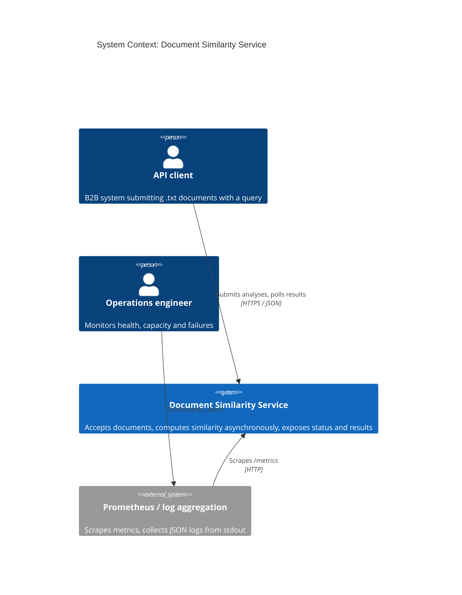
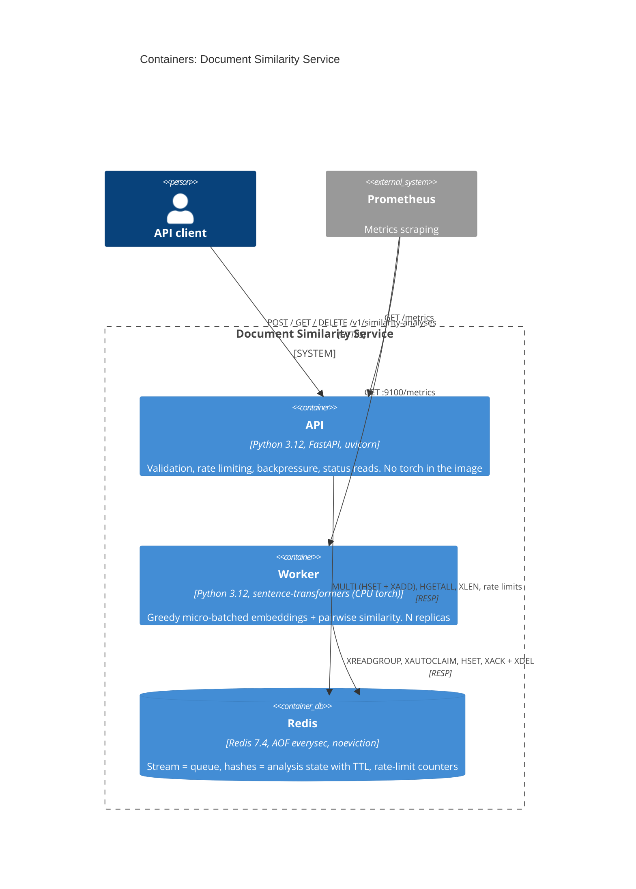
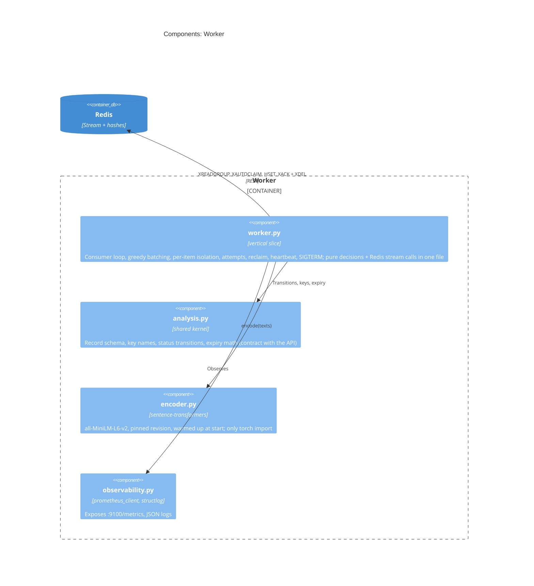
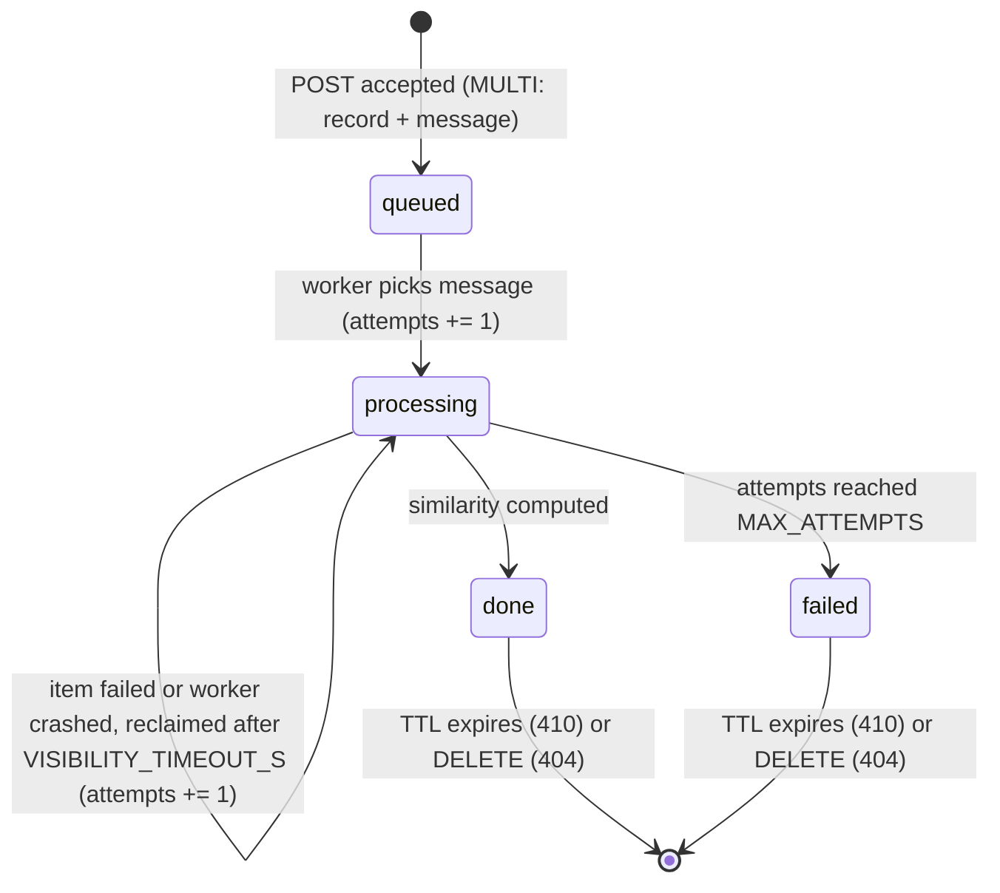

# Document Similarity Service: SPEC

> Status: approved design, ready for implementation.
> Companion file: [`BEHAVIOR.md`](BEHAVIOR.md) (business scenarios, mapped 1:1 to tests).
> Every component below has a one-sentence "why". If it can't be justified, it is not in the build.

---

## 1. Problem & goals

Clients submit small `.txt` documents together with a query and want a similarity score (`list[float]`) computed with `sentence-transformers/all-MiniLM-L6-v2`. The embedding step is CPU-bound and much slower than accepting an HTTP request, so traffic bursts must not degrade the API or silently lose work. The goal is a prototype that accepts work quickly, processes it asynchronously with bounded resources, tells clients exactly where their request stands, and makes overload explicit (`429`/`503` + `Retry-After`) instead of turning it into timeouts. Every scalability claim is either measured (benchmark) or listed as an explicit assumption with a formula to recompute it.

**Non-goals (prototype):** authentication, multi-region, semantic quality of the model, documents longer than the model's context window (chunking).

---

## 2. Explicit assumptions

| # | Assumption | Value | Rationale | Measured / Assumed |
|---|---|---|---|---|
| A1 | Unit of work | 1 file + 1 query = 1 analysis | Requirement speaks of many *submissions*; keeps contract and backpressure simple. Multi-file batches → TODO | Assumed |
| A2 | Max upload size | 100 KB (`413` above) | "Small files"; protects API RAM | Assumed |
| A3 | Analysed document length | First 4 096 chars, then model truncation at 256 tokens | `all-MiniLM-L6-v2` has `max_seq_length = 256`; anything beyond is silently ignored by the model. Pre-cut bounds CPU and Redis RAM per job. Client sees `document_truncated: true` | Model limit: known. 4 096-char margin: assumed |
| A4 | Encoding | UTF-8 only (`422` otherwise), `.txt` extension (`415` otherwise) | Decoding is the real validation; headers can lie | Assumed |
| A5 | Query | 1–1 000 chars after trimming | Prevents "document disguised as query" | Assumed |
| A6 | Traffic | 500 000 req/day → 5.8 req/s average | From task description | Given |
| A7 | Peak factor | 10× average → 58 req/s, 116 embeddings/s | No traffic data available | **Assumed** |
| A8 | Hardware | CPU only, no GPU | Simplest deployable target | Assumed |
| A9 | Worker throughput `T` | embeddings/s per replica at a fixed CPU limit | Single number all capacity math depends on | **Measured** (`benchmark.py`), on the local machine only, must be re-run on the target SKU |
| A10 | SLA | p95 accept < 100 ms; p95 time-to-result < 5 s at nominal load | Separates "accepted" from "computed" promises | Assumed |
| A11 | Result format | `list[float]` of length 1 (e.g. `[0.87]`) | The provided snippet returns `[[0.87]]` (1×1 matrix); flattened deliberately | Known |
| A12 | Client identity | `X-Client-Id` header, no real auth | Needed for per-client rate limiting. **Spoofable**, see §14 | Assumed |
| A13 | Retention | 24 h from creation, then `410 Gone` | Bounded RAM; results are cheap to recompute | Assumed |
| A14 | Delivery semantics | At-least-once | Embedding is a pure, deterministic function, so a duplicate computation is harmless | Known |
| A15 | Analysis record size | ~300 B in Redis | To be verified with `MEMORY USAGE` | Assumed |
| A16 | Language | English | Model is trained primarily on English | Assumed |

---

## 3. Architecture

### 3.1 C4: System context



### 3.2 C4: Containers



### 3.3 C4: Worker components



> Mermaid's C4 syntax is marked experimental. Verify rendering on GitHub before submission; if it breaks, keep the same content as `flowchart` diagrams.

### 3.4 Request flow

```mermaid
sequenceDiagram
  autonumber
  participant C as Client
  participant A as API
  participant R as Redis
  participant W as Worker
  C->>A: POST /v1/similarity-analyses (file, query, X-Client-Id)
  A->>R: rate limit check (limits)
  alt over client limit
    A-->>C: 429 + Retry-After (jittered)
  end
  A->>A: validate (.txt, size, UTF-8, query) and pre-cut to 4096 chars
  A->>R: XLEN (queue depth)
  alt depth >= MAX_QUEUE_DEPTH
    A-->>C: 503 + Retry-After (jittered)
  end
  A->>R: MULTI: HSET analysis:{id} status=queued, EXPIREAT, XADD stream
  A-->>C: 202 + Location + Retry-After + expires_at
  W->>R: XREADGROUP COUNT=32 BLOCK=5000
  W->>R: HINCRBY attempts, HSET status=processing
  W->>W: encode batch, pairwise similarity
  W->>R: HSET status=done, result; XACK + XDEL
  C->>A: GET /v1/similarity-analyses/{id}
  A->>R: HGETALL analysis:{id}
  A-->>C: 200 {status: done, result: [0.87]}
```

**Step by step:**
1. The API checks the per-client rate limit **before reading the body**, so a `429` costs no upload I/O.
2. It validates the file (extension, size via `Content-Length` and a capped read, strict UTF-8 decode, non-empty) and the query, then pre-cuts the document to `MAX_DOC_CHARS`.
3. It checks queue depth (`XLEN`). Above `MAX_QUEUE_DEPTH` it returns `503`; the limit is soft (check-then-add is not atomic, see §11).
4. It writes the analysis record and the stream message **in one `MULTI` transaction**, so there is never a status without a message or vice versa.
5. Workers pull greedily (up to `BATCH_MAX_SIZE`), increment `attempts` **before** computing, embed queries and documents in one call, compute similarity pairwise, write results, then `XACK` + `XDEL`.
6. The client polls `GET` guided by `Retry-After`; terminal states carry `result` or `error`.

### 3.5 Code structure: vertical slices, flat, functional

```
src/similarity/
├── submit.py         # POST slice: route, validation + pre-cut, rate limit, backpressure, MULTI enqueue
├── results.py        # GET + DELETE slice: route, 404 / 410 / 409 decisions, reads and deletes
├── worker.py         # worker slice: loop, greedy batching, per-item isolation, attempts,
│                     # reclaim, heartbeat, warm-up, SIGTERM
├── encoder.py        # Encoder Protocol + sentence-transformers implementation (the only torch import)
├── analysis.py       # shared kernel: record schema, Redis key names, statuses + transition(),
│                     # UUIDv7 / expiry math
├── capacity.py       # pure capacity formula (benchmark + tests)
├── observability.py  # metrics registry, structlog setup
├── api.py            # FastAPI app factory: slice routers, /health, /ready, /metrics, Problem Details
└── config.py         # pydantic-settings
scripts/
├── benchmark.py
└── benchmark.sh
tests/
├── test_submit.py  test_results.py  test_worker.py  test_analysis.py  test_capacity.py
└── behavior/        # scenarios from BEHAVIOR.md
```

**Rules:**
- **One slice = one file** with everything the feature needs: route or loop, pure decision functions, Redis calls. Understanding or changing a feature means opening one file.
- **Inside a file:** pure functions first (data in, data or sum type out), the I/O handler last. Functional core / imperative shell is applied per file, not as a layer.
- **Slices never import each other.** Shared code is limited to the cross-process contract (`analysis.py`: key names, record schema, transitions, expiry), `config.py`, `observability.py` and `encoder.py`.
- **A file becomes a package** (e.g. `submit/`) only when it outgrows ~300 lines, not before.
- Dependencies are passed as function arguments; clock and RNG are injected, so jitter and `404`/`410` logic are deterministic in tests. No DI container, no service classes.
- Outcomes are sum types matched with `match`, e.g. `Accepted | RateLimited | QueueFull | Invalid`. Business errors are values; exceptions are for infrastructure failures.
- State transitions are a pure function `transition(status, event) -> Status | IllegalTransition` in `analysis.py`.
- No monad libraries (e.g. `returns`): plain sum types give the same clarity without the learning curve.
- **Only `encoder.py` imports torch.** A unit test asserts that importing `similarity.api` does not load `torch`, so the lightweight API image cannot regress silently.

---

## 4. API contract

Base path: `/v1/similarity-analyses`. Errors use **RFC 9457 Problem Details** (`application/problem+json`) with an extra `code` field. OpenAPI is generated by FastAPI at `/docs`.

### 4.1 `POST /v1/similarity-analyses`

`multipart/form-data`: `file` (`.txt`), `query` (string). Header: `X-Client-Id` (`[A-Za-z0-9_-]{1,64}`, required).

| Status | When | Headers / body |
|---|---|---|
| `202 Accepted` | Analysis queued | `Location`, `Retry-After: 1`, body below |
| `413` | File > `MAX_FILE_SIZE_BYTES` | `code: PAYLOAD_TOO_LARGE` |
| `415` | Not a `.txt` file | `code: UNSUPPORTED_MEDIA_TYPE` |
| `422` | Not UTF-8, empty file, invalid query, missing/invalid `X-Client-Id` | `code: VALIDATION_ERROR` |
| `429` | This client exceeded its rate limit | `Retry-After` (jittered), `code: RATE_LIMITED` |
| `503` | Queue at capacity, or concurrency limit hit | `Retry-After` (jittered), `code: OVERLOADED` |

```json
{
  "id": "0192f3a1-7c4e-7b2a-9f10-3c5d2e8a1b44",
  "status": "queued",
  "created_at": "2026-10-16T08:00:00Z",
  "expires_at": "2026-10-17T08:00:00Z",
  "links": {"self": "/v1/similarity-analyses/0192f3a1-7c4e-7b2a-9f10-3c5d2e8a1b44"}
}
```

### 4.2 `GET /v1/similarity-analyses/{id}`

Requires the same `X-Client-Id` that created the analysis. A mismatch returns `404` (existence is not leaked).

| Status | When |
|---|---|
| `200` + `status: queued \| processing` | In progress; `Retry-After: POLL_INTERVAL_HINT_S` |
| `200` + `status: done` | `result: [float]`, `document_truncated: bool` |
| `200` + `status: failed` | `error: {code, message, attempts}` (failure is a resource state, not an HTTP error) |
| `404` | Never existed, belongs to another client, or deleted by the client |
| `410` | Existed but expired. Decided from the UUIDv7 timestamp: key missing and `id_time + RESULT_TTL_S < now` → `410`, otherwise `404`. No tombstones stored |

```json
{
  "id": "0192f3a1-7c4e-7b2a-9f10-3c5d2e8a1b44",
  "status": "done",
  "result": [0.87],
  "document_truncated": false,
  "attempts": 1,
  "created_at": "2026-10-16T08:00:00Z",
  "updated_at": "2026-10-16T08:00:01Z",
  "expires_at": "2026-10-17T08:00:00Z",
  "links": {"self": "/v1/similarity-analyses/0192f3a1-7c4e-7b2a-9f10-3c5d2e8a1b44"}
}
```

### 4.3 `DELETE /v1/similarity-analyses/{id}`

| Status | When |
|---|---|
| `204` | `done` or `failed` analysis deleted |
| `404` | Not found (or not this client's) |
| `409` | Still `queued` / `processing` (cancellation is out of scope) |

### 4.4 Operational endpoints

| Endpoint | Purpose |
|---|---|
| `GET /health` | API liveness: process responds. **No dependency checks** |
| `GET /ready` | API readiness: Redis `PING` |
| `GET /metrics` | API Prometheus metrics |
| `worker :9100/metrics` | Worker Prometheus metrics |

### 4.5 Examples

```bash
# Submit
curl -i -X POST http://localhost:8000/v1/similarity-analyses \
  -H "X-Client-Id: client-a" \
  -F "file=@samples/fox.txt" \
  -F "query=fox over dog"

# Poll
curl -s http://localhost:8000/v1/similarity-analyses/<id> -H "X-Client-Id: client-a"

# Delete
curl -i -X DELETE http://localhost:8000/v1/similarity-analyses/<id> -H "X-Client-Id: client-a"
```

---

## 5. Job lifecycle



| Mechanism | Rule | Why |
|---|---|---|
| Attempt counting | `HINCRBY attempts 1` **before** computing | A worker killed mid-batch (e.g. OOM killer) never reaches an `except` block. Counting at start guarantees a "message that kills workers" stops after `MAX_ATTEMPTS` |
| Attempt overflow | Message reclaimed with `attempts > MAX_ATTEMPTS` → `failed` without computing | Poison circuit breaker |
| Batch failure | Exception on the whole batch → re-run items one by one; successes → `done`, failures stay un-acked | One bad document must not fail 31 good ones |
| Redelivery | `XAUTOCLAIM` every `RECLAIM_INTERVAL_S` for messages idle > `VISIBILITY_TIMEOUT_S` | Crashed or failed items return to the pool; the timeout also acts as a natural backoff |
| Duplicate work | Possible if a batch outlives `VISIBILITY_TIMEOUT_S` | Harmless (deterministic), but wastes CPU, so the timeout is set from the measured p95 batch time |
| Expiry invariant | Every write re-applies `EXPIREAT = id_time + RESULT_TTL_S` | A write can never resurrect a record without a TTL |
| Missing record | Worker skips (and acks) messages whose record no longer exists | Record expired or was deleted; no resurrection |
| Client-facing error | `{code: PROCESSING_FAILED, message, attempts}` | Stack traces only in logs, correlated by `analysis_id` and `batch_id` |

Worker-side exponential backoff is **not** implemented: the function is deterministic, so waiting longer does not fix a content-related failure (see TODO).

---

## 6. Load handling

### 6.1 Protection layers (cheapest first)

| Order | Layer | Protects against | Response | Cost |
|---|---|---|---|---|
| 0 | uvicorn `--limit-concurrency` | API flooding | `503` | Zero, built in |
| 1 | `Content-Length` check + capped read (limit + 1 byte) | API OOM from huge uploads | `413` | No body I/O on rejection |
| 2 | Per-client rate limit (`limits` library, Redis storage, fixed window) | One client consuming all capacity | `429` + `Retry-After` | 1 Redis round-trip, before body read |
| 3 | Queue depth limit (`XLEN >= MAX_QUEUE_DEPTH`) | Broker growth and broken SLA | `503` + `Retry-After` | 1 Redis round-trip |

`Retry-After = base + uniform(0, base)` seconds, so clients rejected in the same second do not come back in the same second (thundering herd). The README recommends clients use exponential backoff with full jitter.

### 6.2 Greedy micro-batching

- `XREADGROUP COUNT=BATCH_MAX_SIZE BLOCK=READ_BLOCK_MS` returns as soon as **at least one** message is available and takes up to `BATCH_MAX_SIZE`. No timer waits for a batch to fill.
- Low traffic: batch size ≈ 1, latency like no batching. High traffic: batches fill naturally, throughput like full batching.
- Queries and documents are encoded in one call (`sentence-transformers` sorts by length internally to reduce padding).
- Similarity is computed **pairwise** (query *i* with document *i*), not as an N×N matrix: `similarity_pairwise` if available in the installed version, otherwise the diagonal of `similarity()`.
- Results are written with one pipeline per batch; `XACK` and `XDEL` take multiple IDs.

### 6.3 Redis Streams pitfalls handled

| Pitfall | Consequence | Handling |
|---|---|---|
| Acked entries stay in the stream | `XLEN` grows forever: false "queue full" and unbounded RAM | `XDEL` after `XACK`, so `XLEN` = outstanding work |
| `XADD MAXLEN` looks like a queue limit | Silently trims the oldest **accepted** jobs | Never used. Limit enforced in the API before `XADD` |
| `maxmemory-policy volatile-lru` (common managed default) | Evicts keys with TTL, i.e. our analyses | `noeviction`: full memory fails writes → `503`, accepted work is never evicted |
| Torch thread oversubscription | Torch sees host cores, not the container CPU limit; throughput drops under cgroup throttling | `TORCH_NUM_THREADS` / `OMP_NUM_THREADS` = container CPU limit |

### 6.4 Overload behaviour summary

Every overload ends in a fast, explicit response with `Retry-After`, never a timeout and never a silent loss of an accepted job. `429` means "you are sending too much"; `503` means "we are full".

---

## 7. Capacity model

### 7.1 Formula

| Step | Formula | Example (500k/day) | Source |
|---|---|---|---|
| Average | `RPD / 86 400` | 5.8 analyses/s | Given |
| Peak | `× PEAK_FACTOR` | × 10 = 58 analyses/s | Assumed (A7) |
| Embeddings at peak | `× 2 × (1 − H/2)`, `H` = query cache hit rate | `H = 0` → 116 emb/s | Given; cache is TODO |
| Replica throughput | `T` emb/s | — | **Measured** |
| Worker replicas | `ceil(peak_emb_s / (T × 0.7)) + 1` | depends on `T` | Formula |
| Queue limit | `active_replicas × (T / 2) × MAX_ACCEPTABLE_WAIT_S` | depends on `T` | Formula |
| Redis RAM | `300 B × RPD × TTL_days + MAX_QUEUE_DEPTH × ~4.2 KB` | ~150 MB + ~4 MB | Assumed (A15) |

**Why 0.7 utilisation:** waiting time grows roughly like `u / (1 − u)`: about 2.3× service time at 70%, 9× at 90%, 99× at 99%. **+1 replica** tolerates the loss of one.

**Why the cost per job is bounded:** the API pre-cuts documents to 4 096 chars and the model truncates at 256 tokens, so CPU per job has a hard ceiling regardless of file size. That is what makes capacity computable instead of guessed.

### 7.2 Worked example (illustrative only)

With a **placeholder** `T = 200 emb/s` per replica (replace with the benchmark result):

| Requests/day | Peak emb/s | Replicas (`ceil(x / 140) + 1`) |
|---|---|---|
| 100 000 | 23 | 2 |
| 500 000 | 116 | 2 |
| 1 000 000 | 231 | 3 |
| 5 000 000 | 1 157 | 10 |

### 7.3 Measured vs assumed

| Quantity | Status | How |
|---|---|---|
| `T` for batch 1 / 8 / 16 / 32 / 64 | Measured | `scripts/benchmark.sh` → `benchmark.py` inside the worker container with the same CPU limit |
| p50 / p95 batch latency | Measured | Same script; sets `BATCH_MAX_SIZE` and `VISIBILITY_TIMEOUT_S` |
| Query (~5 tokens) vs document (256 tokens) cost | Measured | Two input sets |
| Peak factor, length distribution, record size | Assumed | See §2 |

`benchmark.py` prints the replica table for 100k / 500k / 1M / 5M requests/day from the measured `T`. **Results are local; repeat on the target SKU before sizing production.**

---

## 8. Observability

### 8.1 Metrics (each answers one operational question)

| Question | Metric | Type | Where |
|---|---|---|---|
| Are we meeting the SLA (p95 < 5 s)? | `analysis_end_to_end_seconds` | histogram | worker |
| Are we keeping up? | `queue_depth` | gauge | worker |
| How long has the oldest job been waiting? | `queue_oldest_age_seconds` | gauge | worker |
| How much do we reject, and why? | `http_requests_total{handler, status}` | counter | API (instrumentator) |
| Is accepting fast (< 100 ms)? | `http_request_duration_seconds{handler}` | histogram | API (instrumentator) |
| What does a batch cost? Does `VISIBILITY_TIMEOUT_S` have headroom? | `inference_batch_duration_seconds` | histogram | worker |
| Does batching work under load? | `inference_batch_size` | histogram | worker |
| What fraction fails? | `analyses_completed_total{status}` | counter | worker |
| Is something failing repeatedly? | `analysis_retries_total` | counter | worker |
| How many clients get results from truncated documents? | `documents_truncated_total` | counter | worker |

- **`queue_oldest_age_seconds` is the primary alert signal**: depth says *how much*, age says *how long the client waits*. It is free: a stream entry ID is a millisecond timestamp (`XRANGE - + COUNT 1`).
- **`client_id` is never a metric label** (unbounded cardinality would bloat Prometheus RAM). It goes to logs.

### 8.2 Logs

JSON, one line per event, stdout (`structlog`). Fields: `ts`, `level`, `service`, `event`, `analysis_id`, `batch_id`, `client_id`, `duration_ms`, `attempts`, `error_type`. **Never** document text or query: only length and SHA-256.

Key events: `analysis.accepted`, `analysis.rejected{reason}`, `batch.processed`, `analysis.failed` (with stack trace), `worker.model_loaded` (cold-start duration).

### 8.3 Health

| Container | Startup | Liveness | Readiness |
|---|---|---|---|
| API | — | `/health` (no dependencies) | `/ready` (Redis `PING`) |
| Worker | Heartbeat file created only after model load + warm-up encode | Heartbeat younger than `HEARTBEAT_MAX_AGE_S` | None: the worker pulls work, nobody routes traffic to it |

Liveness never checks Redis: a Redis blip would otherwise restart every API replica at once (restart storm) without fixing Redis. The heartbeat is updated on every loop iteration, including empty reads, so an idle worker never looks dead.

---

## 9. Retention

| Data | Where | Lifetime |
|---|---|---|
| Document text (pre-cut) and query | Stream message only | Until `XACK` → `XDEL` |
| Status, result, error, attempts, timestamps, owner `client_id` | Hash `analysis:{id}` | 24 h from creation (`EXPIREAT` derived from the UUIDv7 timestamp) |
| Logs | stdout → log platform | Platform policy; no content or query |

- TTL counts from creation, so `expires_at` is known in the `202` response.
- After TTL: `410` (from ID age, no tombstones). After client `DELETE`: `404`.
- `maxmemory-policy noeviction` guarantees accepted records are not evicted early; AOF `everysec` limits loss on restart to ~1 s (prototype simplification, see ADR-001).

---

## 10. Configuration

Environment variables only, validated at start-up with `pydantic-settings` (bad or inconsistent config → container fails to start). Same image on every environment. `.env.example` documents all values.

**Build-time (Dockerfile `ARG`, not runtime):** `MODEL_NAME=sentence-transformers/all-MiniLM-L6-v2`, `MODEL_REVISION=<pinned commit hash>`. Runtime sets `HF_HUB_OFFLINE=1`, so changing the model means a new image.

### Shared

| Variable | Default | Purpose |
|---|---|---|
| `REDIS_URL` | `redis://redis:6379/0` | Queue + state |
| `LOG_LEVEL` | `INFO` | |
| `RESULT_TTL_S` | `86400` | Retention |
| `STREAM_KEY` | `analyses:jobs` | Stream name |
| `CONSUMER_GROUP` | `workers` | Consumer group |

### API

| Variable | Default | Purpose | Value source |
|---|---|---|---|
| `MAX_FILE_SIZE_BYTES` | `102400` | `413` | Assumed |
| `MAX_DOC_CHARS` | `4096` | Pre-cut before enqueue | Assumed |
| `MAX_QUERY_LENGTH` | `1000` | `422` | Assumed |
| `RATE_LIMIT` | `20/second` | Per-client limit (`limits` syntax) | Assumed |
| `RATE_LIMIT_STRATEGY` | `fixed-window` | `limits` strategy | — |
| `MAX_QUEUE_DEPTH` | `1000` | `503` threshold | **From benchmark** (§7) |
| `RETRY_AFTER_BASE_S` | `5` | `Retry-After` for `429`/`503` = base + jitter | Assumed |
| `POLL_INTERVAL_HINT_S` | `1` | `Retry-After` on in-progress `GET` | Assumed |
| `API_CONCURRENCY_LIMIT` | `200` | uvicorn `--limit-concurrency` | Assumed |

### Worker

| Variable | Default | Purpose | Value source |
|---|---|---|---|
| `BATCH_MAX_SIZE` | `32` | Greedy micro-batch cap | **From benchmark** |
| `READ_BLOCK_MS` | `5000` | `XREADGROUP BLOCK` | Assumed |
| `VISIBILITY_TIMEOUT_S` | `30` | `XAUTOCLAIM` idle threshold (> p95 batch time) | **From benchmark** |
| `RECLAIM_INTERVAL_S` | `10` | How often to look for abandoned messages | Assumed |
| `MAX_ATTEMPTS` | `3` | Retry cap | Assumed |
| `TORCH_NUM_THREADS` / `OMP_NUM_THREADS` | `2` | = container CPU limit | **From deployment** |
| `HEARTBEAT_PATH` | `/tmp/worker-heartbeat` | Liveness file | — |
| `HEARTBEAT_MAX_AGE_S` | `30` | Liveness threshold | Assumed |
| `METRICS_PORT` | `9100` | Worker `/metrics` | — |

**Start-up invariants:** `HEARTBEAT_MAX_AGE_S > 2 × READ_BLOCK_MS / 1000`; `MAX_DOC_CHARS <= MAX_FILE_SIZE_BYTES`; `MAX_ATTEMPTS >= 1`.

---

## 11. Key trade-offs

| Decision | Choice | Alternative | Why |
|---|---|---|---|
| Result delivery | `202` + polling (Asynchronous Request-Reply) | Sync; webhook | Sync ties HTTP connections to CPU work and turns overload into timeouts; webhooks need retries, signing and SSRF protection. Webhook and long-poll → TODO |
| API style | REST, domain resource `similarity-analyses`, Richardson level 2 + `links.self` | `/jobs`; full HATEOAS; `303` to a result sub-resource | Domain name hides the queue as an implementation detail. A separate resource for an 8-byte result is an extra round-trip for nothing |
| Process split | API (no torch) + worker | Thread pool; process pool in one container | A stuck worker cannot freeze health checks; each part scales on its own bottleneck |
| Backing service | Redis for queue, state, rate limits | Service Bus (+ emulator); Postgres `SKIP LOCKED`; RabbitMQ | See **ADR-001** |
| Queue library | Own Streams consumer (~100 lines) | Celery / RQ / arq | Libraries hide exactly what is being evaluated (acks, redelivery, depth) |
| Batching | Greedy (take what is waiting, ≤ 32) | None; fill-and-wait | Self-tuning: no latency penalty at low load |
| Retry | Fixed visibility timeout, 3 attempts | Exponential backoff in worker | Deterministic function: waiting longer fixes nothing. Jitter is applied where the herd forms: client `Retry-After` |
| Rate limiting | `limits` library, fixed window | Hand-written; token bucket (Lua) | Ready tool; up to 2× burst at window edges is acceptable for a PoC |
| Queue limit | Soft (`XLEN` then `XADD`) | Atomic Lua check-and-add | Overshoot ≤ number of concurrent POSTs; acceptable |
| Retention | TTL from creation, `410` from UUIDv7 | Tombstones; TTL from completion | Zero extra storage; `expires_at` known up front |
| Model delivery | Baked into image, pinned revision | Download at start; mount from storage | No runtime dependency on Hugging Face during scale-out; reproducible |
| Observability | Prometheus + JSON logs + `analysis_id` correlation | OpenTelemetry + collector | Same diagnostic value at a fraction of the setup; OTel → TODO |
| Tests | Fake encoder + real Redis (testcontainers) | Mock Redis (fakeredis); real model in tests | Correctness relies on real Redis semantics; the model is measured separately |
| Code organisation | Vertical slices, flat (one file per feature) + small shared kernel | Layers (`domain/`, `application/`, `adapters/`) | Code is organised around change: a feature lives in one file. Accepted cost: some repetition between slices; the only shared module is the API ↔ worker contract |
| Paradigm | Pure functions + I/O handler at the end of each file | Service classes + DI container | Decisions are testable without infrastructure; side effects stay at the edge of each slice |

### ADR-001: Redis as the single backing service for the prototype

- **Decision:** queue (Streams), analysis state (hashes with TTL) and rate-limit counters on one Redis. Production moves the queue to Azure Service Bus.
- **Context:** 2–4 h prototype that must start with one command and be easy to reason about.
- **Why:**
  1. One component instead of three: queue, state, TTL and rate limiting in one process; `docker compose up` starts in seconds with a small RAM footprint.
  2. One transaction instead of a dual write: status and message are written atomically with `MULTI`. Two systems (Redis + broker) would require handling writes to two stores without a shared transaction.
  3. Fast, light tests: testcontainers with only Redis.
- **Rejected for the PoC: Service Bus emulator.** It needs a SQL Server sidecar (message state stored in SQL Server, no in-memory mode), does not persist data across container restarts, and testcontainers ships a ready-made Service Bus module for Java, Go and .NET but not Python.
- **Accepted costs:** broker semantics that Service Bus provides natively (redelivery, delivery count, dead-lettering) are implemented by hand; local tests run against a different broker than production (dev/prod parity gap). Single-node Redis is a single point of failure; AOF `everysec` is a PoC-level durability measure.
- **Mitigations:** broker calls are confined to two slices: `submit.py` (enqueue, depth) and `worker.py` (receive, ack, reclaim). Switching to Service Bus changes those two files and nothing else; the slices are the seam. TODO: run the same BDD suite against a Service Bus adapter with the emulator in CI.
- **Revisit when:** message durability with an SLA is required, an operational DLQ is needed, multiple consumers (pub/sub) appear, or compliance requirements apply.

---

## 12. Production on Azure

| Local component | Azure | What changes |
|---|---|---|
| API container | **Azure Container Apps** (HTTP scaling) | Scale on request rate; same image from **Azure Container Registry** |
| Worker container | **Azure Container Apps** with **KEDA** scale rule on queue length | Scale-to-zero at night; `min/maxReplicas` from §7; KEDA threshold = `T/2 × target wait` |
| Redis Stream | **Azure Service Bus** queue | Peek-lock = ack, `DeliveryCount` = attempts, `LockDuration` = visibility timeout, built-in DLQ with `MaxDeliveryCount`, scheduled messages for backoff. Messages up to 256 KB fit Standard tier; larger → Claim-Check with Blob Storage |
| Redis hashes | **Azure Managed Redis** (cheap hot polling reads) or **Cosmos DB with TTL** (durability) | Set eviction policy explicitly (`noeviction`); polling makes Cosmos RU cost grow |
| Rate limiting, client identity | **Azure API Management** (`rate-limit-by-key`, `quota-by-key`, subscription keys / Entra ID) | Rejected traffic never reaches the containers; real auth replaces `X-Client-Id` |
| Secrets | **Key Vault** references in Container Apps; later **Managed Identity** to Redis | No secrets in env files or repo |
| `/metrics` | **Azure Monitor managed Prometheus** + Managed Grafana | |
| JSON logs on stdout | **Log Analytics** (collected by Container Apps automatically) | |
| Probes | Container Apps startup / liveness / readiness probes, termination grace period | Same semantics as §8.3 |

The API contract (`202` + polling) does not change; only what sits behind it does.

---

## 13. Testing strategy

| Layer | What | How | Budget |
|---|---|---|---|
| Unit (pure) | Validation; `404` vs `410` from UUIDv7; `Retry-After` bounds; state transitions; attempt overflow → `failed`; pairwise result shape (`list[float]`, not `[[...]]`); capacity formula; config invariants | Plain pytest on the pure functions of each slice and `analysis.py`; injected clock and RNG; "API import does not load torch" check | ~20 min |
| Behaviour (BDD) | Business scenarios in `BEHAVIOR.md`, mapped 1:1 to `test_given_..._when_..._then_...` | FastAPI `TestClient` + one iteration of the `worker.py` loop (`process_batch`) driven in-process + **real Redis via testcontainers** (session-scoped container, `FLUSHDB` between tests) + **fake encoder** (deterministic vectors; a marker string raises to simulate poison) | ~25 min |
| Model | Throughput and latency, not correctness | `benchmark.py` (§7) | — |
| Smoke | `docker compose up` + `curl` happy path | Manual / README | — |

**Quality gates (pre-commit, run identically in CI):** `ruff` (lint + format; replaces flake8, black, isort, bandit-style `S` rules), `mypy` (strict on the whole package; `ignore_missing_imports` for torch / sentence-transformers, whose boundary is isolated in `encoder.py`), `gitleaks`, `hadolint`, `pre-commit-hooks` (`detect-private-key`, `check-yaml`, EOL). CI additionally runs `pip-audit` and builds both Docker targets. Dependencies locked in `uv.lock`.

**CI (GitHub Actions):** `pre-commit run --all-files` → `pytest` (testcontainers; Docker available on Ubuntu runners) → `pip-audit` → `docker build --target api` and `--target worker`.

**Not tested (deliberately):** semantic quality of the model, `/metrics` content, end-to-end load (TODO).

---

## 14. Out of scope / TODO (highest value first)

1. **Real authentication and client identity** (APIM subscription keys / Entra ID). `X-Client-Id` is trivially spoofable; rotating IDs bypasses per-client limits. Today only the global queue limit protects capacity.
2. **Service Bus adapter + same BDD suite on the emulator in CI** (closes the dev/prod parity gap from ADR-001).
3. **End-to-end load test** (k6 / Locust) ramping until `503` to validate backpressure and SLA.
4. **Query embedding cache** keyed by content hash (parameter `H` in §7); deterministic function makes it safe.
5. **Redis durability / HA** beyond AOF `everysec` (managed HA tier).
6. **Dynamic `MAX_QUEUE_DEPTH`** from replica count; `Retry-After` computed from current depth and throughput.
7. **Token bucket / client tiers and priorities**; atomic queue limit (Lua).
8. **OpenTelemetry** with trace context propagated through the queue; dashboard + alerts (`queue_oldest_age_seconds > 5 s` for 2 min); optional Prometheus + Grafana compose profile.
9. **Webhook delivery** and **long-polling** (`GET ...?wait=10`); `Idempotency-Key` on `POST`.
10. **Worker exponential backoff with jitter**: becomes valuable when embeddings move to an external provider (e.g. Azure OpenAI / Foundry) whose errors are transient (`429`).
11. **ONNX / OpenVINO backend with quantisation**, measured against `T`.
12. **Dead-letter stream** for operator inspection of `failed` analyses.
13. **Cancellation** (`queued → cancelled`), tombstone so `GET` after `DELETE` returns `410`, full HATEOAS, `pytest-bdd` if non-developers start writing scenarios.
14. **Multi-file submissions** in one request; chunking for documents beyond the model context.
15. **Per-tier retention**; long-term export (Blob + lifecycle management).
16. **Model outside the image** (Blob / Azure ML registry) for multiple or large models; image scanning (Trivy / Defender for Containers); coverage threshold; Managed Identity to Redis.

---

## 15. Implementation plan

Estimates assume implementation with a coding agent **including reading and understanding every diff**. The checkpoint "understand" is mandatory: each decision must be explainable in the interview.

| # | Step | Min | Works after this step | Understand before moving on |
|---|---|---|---|---|
| 0 | Scaffold: `pyproject.toml`, `uv.lock`, pre-commit (ruff, mypy, gitleaks, hadolint), `config.py`, compose with Redis (`noeviction`, AOF) | 20 | `pre-commit run -a` green; Redis up | Why each gate exists; config invariants |
| 1 | Shared kernel `analysis.py` + `capacity.py` + unit tests: record schema, key names, transitions, UUIDv7 expiry math, capacity formula | 20 | Unit tests green without Docker | Why this is the only shared module; `404` vs `410` |
| 2 | Slice `submit.py` + `api.py`: validation, pre-cut, rate limit (`limits`), size cap, queue limit, `MULTI` enqueue, Problem Details, health/ready, instrumentator | 35 | `curl POST` → `202` | Check order (cheap first); `429` vs `503`; `MULTI` |
| 3 | Slice `results.py`: `GET` / `DELETE`, ownership check, `404` / `410` / `409` | 20 | `GET` → `queued`; `DELETE` rules | Why a foreign ID returns `404` |
| 4 | Slice `worker.py` + `encoder.py`: loop, greedy batching, pairwise similarity, per-item isolation, attempts, reclaim, `XDEL`, heartbeat, warm-up, SIGTERM, metrics | 45 | `compose up` → result `[0.xx]` | Attempts at start; visibility timeout; `XDEL` after `XACK`; pairwise vs N×N |
| 5 | Docker: multi-stage (`api`, `worker`), CPU torch index, baked pinned model, compose with 2 workers and CPU limits | 20 | Both images build; cold start logged | CPU wheel vs CUDA; image size vs scale-out time |
| 6 | BDD tests from `BEHAVIOR.md` (scenarios 1–7) | 25 | All behaviour tests green | Fake encoder via the `Encoder` Protocol; why real Redis |
| 7 | `benchmark.py` + `scripts/benchmark.sh` + replica table | 15 | `T`, p95 batch, recommended config printed | Utilisation 0.7; what is measured vs assumed |
| 8 | CI workflow | 10 | Green pipeline | CI = pre-commit + tests + audit + build |
| 9 | README (from this SPEC): run, architecture, trade-offs, ADR-001, known limitations, "What I'd cut in 2 h", "How this was built", TODO | 20 | Reviewer can run and understand | Every "why" sentence |
| | **Total** | **230** | | |

### What I would cut with only 2 hours

Keep: API contract, worker split, Redis queue with acks, greedy batching, backpressure (`429`/`503`), metrics on queue depth/age, Dockerfile. Cut: `DELETE`, BDD layer (keep a handful of unit tests), benchmark script (keep the formula with assumptions), CI and most quality gates (keep ruff), graceful shutdown.

### README must also contain

- **Known limitations:** spoofable `X-Client-Id` (full auth needed); benchmark numbers are local and must be re-measured on the target machine; dev/prod broker parity gap (ADR-001); single-node Redis.
- **How this was built:** design decisions recorded in this SPEC (with rejected alternatives); implementation done with an AI coding agent against the SPEC and reviewed line by line.
